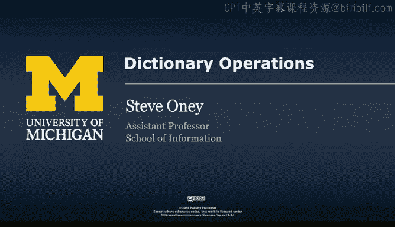
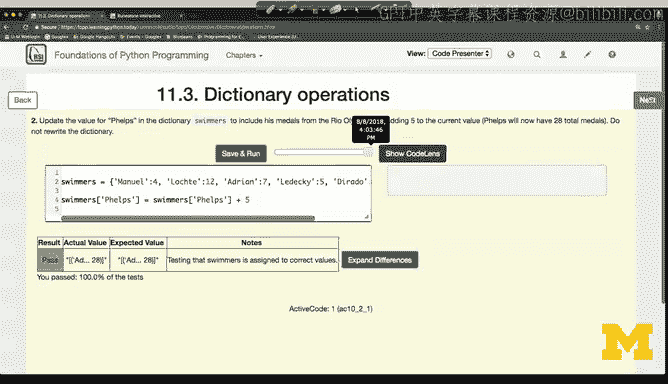

# 112：字典操作详解 📚




在本节课中，我们将学习如何修改字典。我们将探讨删除键值对、更新值、计算字典长度等操作，并通过示例来理解这些操作的具体效果。

---

## 字典的创建与删除操作

上一节我们介绍了字典的基本概念，本节中我们来看看如何修改一个已存在的字典。

首先，我们创建一个包含四个键值对的字典。

```python
inventory = {'pears': 217, 'apples': 430, 'oranges': 175, 'bananas': 312}
```

现在，我们使用 `del` 操作来删除一个键值对。`del` 是 `delete` 的缩写，用于从字典中移除指定的键及其关联的值。

```python
del inventory['pears']
```

执行上述代码后，字典中与键 `'pears'` 关联的键值对 `'pears': 217` 将被删除。字典的键值对数量将从 4 个减少到 3 个。

---

## 更新字典中的值

如果我们不想删除键值对，而是想更新某个键对应的值，可以直接通过赋值操作来完成。

假设我们重新创建了最初的字典。

```python
inventory = {'pears': 217, 'apples': 430, 'oranges': 175, 'bananas': 312}
```

现在，我们将键 `'pears'` 对应的值从 `217` 更新为 `0`。

```python
inventory['pears'] = 0
```

执行这行代码后，字典中 `'pears'` 键对应的值不再是 `217`，而是变成了 `0`。

---

## 基于原值进行更新

有时我们需要基于键的当前值来更新它，例如增加一个数值。

以下是基于原值更新字典的示例。

```python
inventory = {'pears': 217, 'apples': 430, 'oranges': 175, 'bananas': 312}
inventory['bananas'] = inventory['bananas'] + 200
```

要理解这行代码，我们需要分步计算。首先，Python 会计算表达式 `inventory['bananas'] + 200` 的值。从字典中查找，`'bananas'` 的当前值是 `312`，因此表达式结果为 `312 + 200 = 512`。然后，Python 将这个新值 `512` 赋值给键 `'bananas'`。执行后，`'bananas'` 的值变为 `512`。

---

## 获取字典的长度

与字符串、列表和元组一样，我们可以使用 `len()` 函数来获取字典中键值对的数量。

```python
num_items = len(inventory)
```

对于包含四个键值对的 `inventory` 字典，`len(inventory)` 的结果是 `4`。因此，变量 `num_items` 将被赋值为整数 `4`。

---

## 练习题解析

为了巩固理解，我们来看两个练习题。

**练习题 1：** 以下代码会打印什么？

```python
my_dict = {'cat': 12, 'dog': 6, 'elephant': 23}
my_dict['mouse'] = my_dict['cat'] + my_dict['dog']
print(my_dict['mouse'])
```

以下是解题步骤：
1.  首先计算 `my_dict['cat'] + my_dict['dog']`，即 `12 + 6 = 18`。
2.  然后将结果 `18` 赋值给新键 `'mouse'`。
3.  最后打印 `my_dict['mouse']`，输出结果为 `18`。

因此，正确答案是 **C. 18**。

**练习题 2：** 如何更新字典 `swimmers` 中键 `'Phelps'` 的值，为其当前值加上 5？

已知字典如下：
```python
swimmers = {'Phelps': 23, 'Ledecky': 6, 'Manuel': 6, 'Schooling': 1, 'Adrian': 3, 'Murphy': 3}
```

要求不重写整个字典，只更新 `'Phelps'` 的值。

更新操作如下：
```python
swimmers['Phelps'] = swimmers['Phelps'] + 5
```

这行代码获取 `'Phelps'` 的当前值 `23`，加上 `5` 得到 `28`，然后将其作为 `'Phelps'` 的新值存回字典。

---

## 总结

本节课中我们一起学习了字典的几种关键修改操作：
*   使用 `del` 语句删除指定的键值对。
*   通过直接赋值来更新或添加键值对。
*   基于键的当前值进行计算并更新。
*   使用 `len()` 函数获取字典中键值对的数量。



掌握这些操作是灵活使用字典来管理和操作数据的基础。