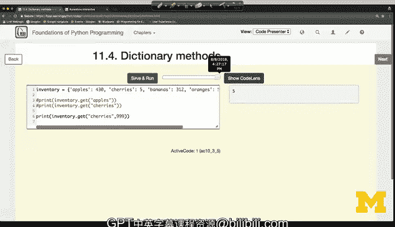

# 113：字典方法解析 📚


在本节课中，我们将学习如何操作 Python 字典。我们将重点介绍几种关键的字典方法，这些方法能帮助我们获取键、值、键值对，以及安全地检查字典内容。

---

## 获取字典中的值

上一节我们介绍了如何通过键来访问字典中的值。例如，我们有一个名为 `inventory` 的字典，它包含四个键值对。

```python
inventory = {'apples': 430, 'bananas': 312, 'oranges': 525, 'pears': 217}
```

要获取键 `'oranges'` 对应的值，我们可以使用索引操作：

```python
print(inventory['oranges'])
```

有时，我们不仅想获取单个键的值，而是希望遍历字典中的所有键或所有键值对。为此，字典提供了一系列有用的方法。

---

## 遍历字典的键

为了遍历字典中的所有键，我们可以使用 `.keys()` 方法。以下是如何在 `for` 循环中使用它：

```python
for key in inventory.keys():
    print(key)
```

运行此代码将输出字典中的所有键。需要注意的是，字典是无序的，因此无法保证键的打印顺序。唯一能保证的是，`for` 循环会为每个键运行一次。

如果我们想同时获取与每个键关联的值，可以在循环内部进行索引：

```python
for key in inventory.keys():
    print(key, 'has the value', inventory[key])
```

这将输出每个键及其对应的值。

---

## 将键转换为列表

如果我们希望将字典的键作为一个列表获取，可以使用 `list()` 函数进行转换：

```python
keys = list(inventory.keys())
print(keys)
```

这将生成一个包含所有键的列表。同样，列表的顺序是不确定的。在 Python 3 中，`.keys()` 方法返回的是一个可迭代对象，而不是直接的列表，因此我们通常需要调用 `list()` 函数来将其转换为列表。

此外，遍历字典的键还有一种更简洁的方式，即直接在 `for` 循环中使用字典本身：

```python
for key in inventory:
    print('Got key', key)
```

Python 会自动假设我们想要遍历字典的键。

---

## 获取值和键值对

除了 `.keys()` 方法，字典还有两个类似的方法：`.values()` 和 `.items()`。

`.values()` 方法返回一个包含字典所有值的列表：

```python
print(inventory.values())
```

`.items()` 方法则返回一个列表，其中每个元素都是一个元组，表示一个键值对：

```python
print(inventory.items())
```

以下是这些方法可能输出的示例：

```python
# .values() 可能输出
dict_values([430, 312, 525, 217])

# .items() 可能输出
dict_items([('apples', 430), ('bananas', 312), ('oranges', 525), ('pears', 217)])
```

---

## 检查键是否存在

我们可以使用 `in` 操作符来检查一个键是否存在于字典中。这个表达式会返回一个布尔值：

```python
print('apples' in inventory)  # 输出: True
print('cherries' in inventory) # 输出: False
```

重要的是，`in` 操作符只检查键，不检查值。我们可以在条件语句中使用这个检查：

```python
if 'bananas' in inventory:
    print(inventory['bananas'])
else:
    print('We have no bananas.')
```

---

## 使用 `.get()` 方法安全获取值

`.get()` 方法提供了一种更安全的方式来获取值。如果键存在，它返回对应的值；如果键不存在，它不会引发错误，而是返回 `None` 或一个指定的默认值。

基本用法如下：

```python
print(inventory.get('apples'))  # 输出: 430
print(inventory.get('cherries')) # 输出: None
```

与直接索引不同，直接索引不存在的键会引发 `KeyError`：

```python
# 这会导致运行时错误
# print(inventory['cherries'])
```

`.get()` 方法可以接受一个可选的第二个参数，作为键不存在时的默认返回值：

```python
print(inventory.get('cherries', 0))  # 输出: 0
```

这并不会在字典中添加新的键值对，它只是在键不存在时提供一个安全的返回值。

---

## 总结

本节课中我们一起学习了 Python 字典的几个核心方法：
*   使用 `.keys()`、`.values()` 和 `.items()` 来分别获取键、值和键值对。
*   使用 `in` 操作符来检查字典中是否存在某个键。
*   使用 `.get()` 方法来安全地获取值，避免因键不存在而引发程序错误。



掌握这些方法能让你更高效、更安全地处理和操作字典数据。