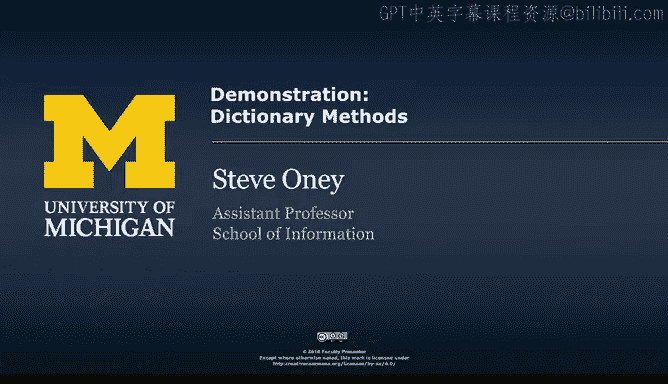
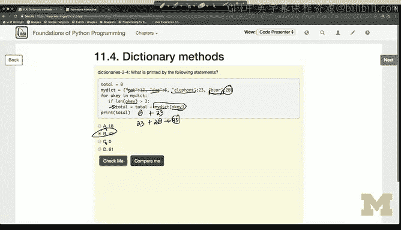
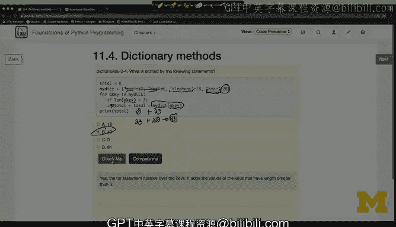

# 114：字典方法演示 📚


在本节课中，我们将学习Python字典的几个核心方法，并通过具体的代码示例来理解它们的用法。我们将探讨如何访问字典中的值、检查键是否存在以及如何遍历字典并进行条件计算。



---

## 问题一：字典值的访问与运算

首先，我们来看一个涉及字典值访问和整数除法运算的问题。

我们有一个名为 `my_dict` 的字典，它包含四个键值对。代码打印了 `my_dict.get('cat')` 除以 `my_dict.get('dog')` 的结果，这里使用的是整数除法。

```python
my_dict = {'cat': 12, 'dog': 6, 'elephant': 23, 'bear': 20}
print(my_dict.get('cat') // my_dict.get('dog'))
```

`my_dict.get('cat')` 的值是 **12**，`my_dict.get('dog')` 的值是 **6**。因此，**12 // 6** 的结果是 **2**。所以，这段代码的输出是 **2**。

---

## 问题二：使用 `in` 关键字检查键是否存在

上一节我们进行了值的运算，本节中我们来看看如何检查一个键是否存在于字典中。

我们使用 `in` 关键字来检查 `'dog'` 是否是字典 `my_dict` 的一个键。

```python
my_dict = {'cat': 12, 'dog': 6, 'elephant': 23, 'bear': 20}
print('dog' in my_dict)
```

`'dog'` 确实是字典的一个键（其值为6）。`in` 操作只关心键是否存在，不关心其对应的值。因此，这个表达式的值是 **True**。

---

## 问题三：`in` 关键字不检查值

理解了如何检查键之后，我们需要注意一个常见的误区：`in` 关键字只用于检查键，不用于检查值。

以下代码检查数字 **23** 是否是字典 `my_dict` 的一个键。

```python
my_dict = {'cat': 12, 'dog': 6, 'elephant': 23, 'bear': 20}
print(23 in my_dict)
```

虽然 `'elephant'` 这个键对应的值是 **23**，但 **23** 本身并不是一个键。字典的键是 `'cat'`、`'dog'`、`'elephant'` 和 `'bear'`。因此，这个表达式的值是 **False**。

---

## 问题四：遍历字典并进行条件求和

最后，我们来看一个更复杂的例子，它结合了字典遍历和条件判断。

以下是实现步骤：
1.  初始化变量 `total` 为 0。
2.  遍历字典 `my_dict` 中的所有键。
3.  对于每个键，检查其字符串长度是否大于 3。
4.  如果长度大于 3，则将该键对应的值加到 `total` 上。

```python
total = 0
my_dict = {'cat': 12, 'dog': 6, 'elephant': 23, 'bear': 20}
for key in my_dict:
    if len(key) > 3:
        total = total + my_dict[key]
print(total)
```

我们来逐步分析循环过程：
*   键 `'cat'` 和 `'dog'` 的长度都不大于3，因此不会执行加法。
*   键 `'elephant'` 长度大于3，执行 `total = 0 + 23`，`total` 变为 **23**。
*   键 `'bear'` 长度大于3，执行 `total = 23 + 20`，`total` 变为 **43**。

因此，这段代码的最终输出是 **43**。

---

## 总结 🎯



本节课中我们一起学习了Python字典的几个重要操作：
1.  使用 `.get()` 方法安全地获取值并进行数学运算。
2.  使用 `in` 关键字检查某个键是否存在于字典中。
3.  明确了 `in` 只检查键，不检查值。
4.  掌握了如何遍历字典的键，并根据条件（如键的长度）对对应的值进行累计求和。



这些是处理字典数据的基础技能，熟练掌握它们对后续学习至关重要。