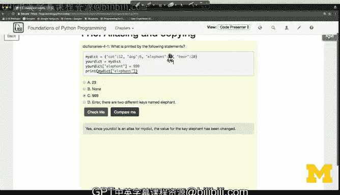

# 115：字典别名与复制机制 📚


在本节课中，我们将要学习Python字典中一个重要的概念：别名。我们将了解当多个变量指向同一个字典对象时，通过其中一个变量修改字典，会如何影响所有指向该对象的变量。

---

## 概述

上一节我们介绍了字典的基本操作。本节中我们来看看字典的别名机制，理解变量如何指向内存中的同一个对象，以及这种机制带来的影响。

## 字典别名机制

在Python中，当你将一个字典赋值给另一个变量时，并不会创建一个新的字典副本。相反，新变量会成为原字典的一个“别名”，它们都指向内存中的同一个字典对象。

以下代码演示了别名的创建：
```python
opposites = {'up': 'down', 'right': 'wrong', 'true': 'false'}
alias = opposites
```

执行上述代码后，`alias` 和 `opposites` 是两个不同的变量名，但它们引用的是同一个字典对象。

## 别名带来的影响

由于别名指向同一个对象，通过任何一个变量修改字典，都会影响到另一个变量。

让我们通过一个例子来观察：
```python
opposites = {'up': 'down', 'right': 'wrong', 'true': 'false'}
alias = opposites
print(alias is opposites)  # 输出：True

alias['right'] = 'left'
print(opposites['right'])  # 输出：left
```

在上面的代码中，我们通过 `alias` 将键 `'right'` 的值从 `'wrong'` 修改为 `'left'`。随后，通过 `opposites` 访问同一个键，得到的值也是 `'left'`。这证明了两个变量操作的是同一个字典。

## 理解内存中的对象

为了更好地理解，我们可以想象内存中有一个字典对象。变量 `opposites` 和 `alias` 都像是一个标签，贴在这个对象上。无论你通过哪个标签去修改对象，对象本身发生了变化，所以所有指向它的标签看到的结果都是一致的。

以下是另一个练习示例：
```python
my_dict = {'cat': 12, 'dog': 6, 'elephant': 23, 'bear': 20}
your_dict = my_dict
your_dict['elephant'] = 999
print(my_dict['elephant'])  # 输出：999
```

在这个例子中，`your_dict` 是 `my_dict` 的别名。通过 `your_dict` 修改键 `'elephant'` 的值为 `999` 后，通过 `my_dict` 访问该键，得到的值同样是 `999`。

## 如何避免别名的影响

如果你需要创建一个独立的字典副本，而不是别名，可以使用字典的 `.copy()` 方法或 `dict()` 构造函数。

以下是创建副本的方法：
```python
original = {'a': 1, 'b': 2}
# 方法一：使用 .copy() 方法
copy1 = original.copy()
# 方法二：使用 dict() 构造函数
copy2 = dict(original)
```

创建副本后，修改副本将不会影响原始字典。

---

## 总结



本节课中我们一起学习了Python字典的别名机制。我们了解到，简单的赋值操作（如 `b = a`）并不会创建新的字典，而是让新变量成为原字典的别名。这意味着通过任何一个别名修改字典，所有指向该字典的变量都会看到变化。如果需要一个独立的副本，务必使用 `.copy()` 方法或 `dict()` 构造函数。理解这一点对于管理程序中的数据状态至关重要。