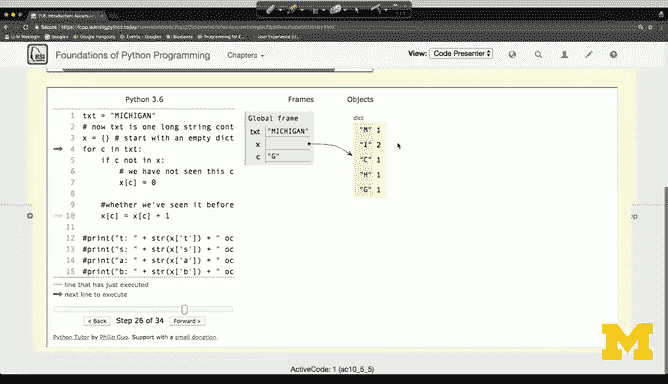

# 课程1：Python 3 编程 - P118：字典累积技术 📚


在本节课中，我们将学习一种称为“字典累积”的强大编程模式。我们将从回顾基础的累积模式开始，然后逐步探索如何利用字典来更高效地统计和处理数据。

---

## 概述

上一节我们介绍了基础的累积模式，即遍历一个序列并更新一个累加器变量。本节中，我们将学习字典累积模式，其核心思想相同，但累加器变量将是一个包含多个键值对的字典。这种方法在处理需要统计多种不同项目（如文本中所有字母的出现次数）时尤为高效。

---

## 回顾：标准累积模式

首先，我们回顾一个标准累积模式的例子。假设我们有一个名为 `Scarlet.txt` 的文件，其中包含了小说《红字》的文本。我们想要统计其中字母“T”出现的次数。

以下是实现此功能的代码：

```python
f = open('Scarlet.txt', 'r')
txt = f.read()

t_count = 0
for char in txt:
    if char == 'T':
        t_count = t_count + 1

print(t_count)
```

在这段代码中：
*   `t_count` 是我们的累加器变量，初始化为 `0`。
*   我们遍历文本中的每一个字符。
*   如果字符是“T”，就将 `t_count` 的值增加 `1`。
*   循环结束后，`t_count` 的值就是字母“T”出现的总次数。

运行代码后，我们得到 `Scarlet.txt` 中字母“T”出现了7584次。

---

## 从多个变量到字典

现在，假设我们不仅想统计“T”，还想统计“S”的出现次数。一种直接的方法是创建两个累加器变量。

以下是使用两个累加器变量的代码：

```python
f = open('Scarlet.txt', 'r')
txt = f.read()

t_count = 0
s_count = 0

for char in txt:
    if char == 'T':
        t_count = t_count + 1
    if char == 'S':
        s_count = s_count + 1

print(t_count, s_count)
```

这种方法虽然可行，但存在一个明显的问题：如果我们想统计字母表中的所有26个字母，就需要初始化26个不同的变量，代码会变得冗长且难以维护。

为了解决这个问题，我们可以引入字典作为单一的累加器。

---

## 引入字典累积模式

字典允许我们将多个累加器（键值对）存储在一个变量中。以下是使用字典实现相同功能的初始版本：

```python
f = open('Scarlet.txt', 'r')
txt = f.read()

x = {}  # 初始化一个空字典作为累加器
x['T'] = 0  # 为字母“T”初始化计数器
x['S'] = 0  # 为字母“S”初始化计数器

for char in txt:
    if char == 'T':
        x['T'] = x['T'] + 1
    if char == 'S':
        x['S'] = x['S'] + 1

print(x['T'], x['S'])
```

在这个版本中：
*   `x` 是我们的字典累加器。
*   我们手动为键 `'T'` 和 `'S'` 设置了初始值 `0`。
*   在循环中，我们根据字符更新对应键的值。

运行代码，我们得到了与之前相同的结果。

---

## 优化：使用变量动态访问键

上面的代码中，我们在更新字典时硬编码了键名（如 `'T'` 和 `'S'`）。我们可以利用循环变量 `char` 来动态地访问和更新字典，这为下一步的通用化铺平了道路。

以下是优化后的代码：

```python
f = open('Scarlet.txt', 'r')
txt = f.read()

x = {}
x['T'] = 0
x['S'] = 0

for char in txt:
    if char == 'T':
        x[char] = x[char] + 1  # 使用变量 char 代替硬编码的 'T'
    if char == 'S':
        x[char] = x[char] + 1  # 使用变量 char 代替硬编码的 'S'

print(x['T'], x['S'])
```

请注意，`if` 语句确保了只有当 `char` 是特定字母时，才会执行对应的更新操作。因此，用 `x[char]` 替换 `x['T']` 是安全的，并且逻辑不变。

---

## 通用字典累积模式

现在，我们来到最强大的部分：编写一个通用的字典累积模式，用于统计文本中**每一个**字符的出现次数，而无需预先知道会出现哪些字符。

以下是通用字典累积模式的完整代码：

```python
f = open('Scarlet.txt', 'r')
txt = f.read()

x = {}  # 初始化空字典

for char in txt:
    if char not in x:  # 检查当前字符是否已经是字典的键
        x[char] = 0    # 如果不是，则为其初始化计数器为0
    x[char] = x[char] + 1  # 将该字符的计数器加1

print("Number of T's:", x['T'])
print("Number of S's:", x['S'])
# 现在可以轻松查询任何字符
print("Number of A's:", x['a'])
print("Number of B's:", x['b'])
```

**核心逻辑如下：**
1.  **初始化**：创建一个空字典 `x`。
2.  **遍历**：遍历文本中的每个字符 `char`。
3.  **检查并初始化**：在循环内，使用 `if char not in x:` 检查当前字符是否已作为键存在于字典中。如果不存在，则通过 `x[char] = 0` 将其添加为键，并设置初始值为0。这确保了我们在首次遇到某个字符时为其创建计数器。
4.  **累加**：无论字符是否为新出现的，都执行 `x[char] = x[char] + 1`，将该字符的计数增加1。

运行这段代码，我们不仅能得到“T”和“S”的准确计数，还能通过 `x['a']`、`x['b']` 等方式查询任何其他字符的出现次数。

---

## 示例解析：字符串 “Michigan”

为了更清晰地展示字典累积的工作流程，我们用一个更简单的例子进行逐步解析。假设文本是字符串 `"Michigan"`。

```python
txt = "Michigan"
x = {}

for char in txt:
    if char not in x:
        x[char] = 0
    x[char] = x[char] + 1

# 循环结束后，字典 x 的内容将是：
# {'M': 1, 'i': 2, 'c': 1, 'h': 1, 'g': 1, 'a': 1, 'n': 1}
```

**逐步过程：**
1.  处理 `'M'`：不在字典中 -> 初始化 `x['M'] = 0` -> 累加 `x['M'] = 1`。
2.  处理 `'i'`：不在字典中 -> 初始化 `x['i'] = 0` -> 累加 `x['i'] = 1`。
3.  处理 `'c'`：不在字典中 -> 初始化 `x['c'] = 0` -> 累加 `x['c'] = 1`。
4.  处理 `'h'`：不在字典中 -> 初始化 `x['h'] = 0` -> 累加 `x['h'] = 1`。
5.  处理 **第二个 `'i'`**：**已在字典中** -> 跳过初始化步骤 -> 直接累加 `x['i'] = 2`。
6.  后续字符 `'g'`、`'a'`、`'n'` 都是首次出现，流程同前。

最终，字典 `x` 完整记录了字符串中每个字符的出现次数。

---

## 总结

本节课中我们一起学习了字典累积技术。我们从简单的单一变量累积模式出发，逐步扩展到使用字典来管理多个计数器。核心的通用模式包括三个步骤：**初始化空字典**、**遍历序列**、以及在遍历过程中**检查键是否存在并初始化**，然后**更新累加值**。



这种模式非常强大，是文本分析、数据统计等任务中的基础工具。起初可能觉得有些反直觉，但通过练习，你会越来越熟悉并欣赏它的简洁与高效。在接下来的课程中，我们将看到更多应用字典累积技术的例子。