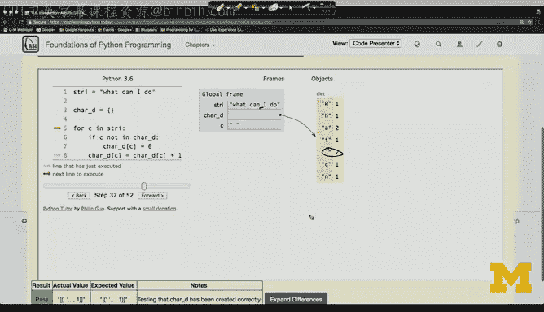

# 密歇根大学《Python3编程》课程1、2｜P119：字典累积模式教程 📚


在本节课中，我们将学习如何使用**字典累积模式**来统计字符串中单词或字符的出现次数。我们将通过两个具体的编程问题来演示这一核心概念。

---

## 概述

上一节我们介绍了字典的基本操作。本节中我们来看看如何利用循环和条件判断，通过**字典累积模式**来动态地构建一个计数器字典。我们将处理两个问题：统计句子中单词的频率和统计字符串中字符的频率。

## 问题一：统计单词频率

我们被提供了一个字符串句子。问题要求我们将字符串分割成单词列表，然后创建一个字典，记录每个单词及其出现的次数，该字典应命名为 `word_counts`。

以下是实现步骤：

首先，我们需要将句子分割成单词。我们可以对字符串调用 `split` 方法。

```python
words = sentence.split()
```

变量 `words` 将是一个字符串列表。第一个元素是“the”，第二个是“dog”，第三个是“chased”，依此类推。

接着，我们使用字典累积模式。根据问题要求，我们将累加器变量命名为 `word_counts`，并将其初始化为一个空字典。

```python
word_counts = {}
```

然后，我们需要遍历所有单词。

```python
for word in words:
```

对于每个单词，我们检查它是否已存在于字典中。

```python
    if word not in word_counts:
```

如果不存在，我们将其值初始化为0。

```python
        word_counts[word] = 0
```

在 `for` 循环内，但在 `if` 语句之外，我们递增 `word_counts` 中该单词对应的值。

```python
    word_counts[word] = word_counts[word] + 1
```

运行代码后，我们可以打印 `word_counts` 来查看结果。输出显示，首字母大写的“The”出现了一次，小写的“the”出现了三次，“dog”出现了一次，“rabbit”出现了两次，等等。

## 问题二：统计字符频率

在这个问题中，我们需要从字符串 `str1` 创建一个名为 `char_d` 的字典，使得键是字符，值是该字符出现的次数。这同样是字典累积模式的直接应用。

以下是实现步骤：

首先，我将我的字典累加器命名为 `char_d`。

```python
char_d = {}
```

然后，我遍历 `str1` 中的每个字符。

```python
for c in str1:
```

如果我之前没有见过这个字符。

```python
    if c not in char_d:
```

那么，我将 `char_d` 中该字符对应的值初始化为0。

```python
        char_d[c] = 0
```

在 `for` 循环内，但在 `if` 语句之外，我将 `char_d` 中该字符对应的值增加1。

```python
    char_d[c] = char_d[c] + 1
```

运行代码后，可以看到它正确工作。我们通过代码执行过程来逐步观察：首先初始化 `str1` 为字符串，然后初始化累加器字典为空。接着遍历每个字符，如果字符不在字典中，则添加并初始化其值为1；如果已在字典中，则跳过初始化，直接将其值加1。

## 总结



本节课中我们一起学习了**字典累积模式**。我们通过两个实例演示了如何统计单词和字符的频率。关键步骤包括：初始化一个空字典作为累加器，遍历目标数据（单词或字符），检查元素是否已在字典中（若不在则初始化），然后递增其计数值。这种模式是处理频率统计问题的强大工具。