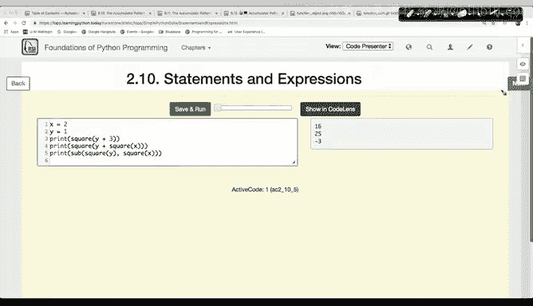

# 12：语句与表达式 🧩


在本节课中，我们将要学习 Python 编程中的两个核心概念：**表达式**与**语句**。我们将了解它们是什么，它们之间有何区别，以及它们如何协同工作来构建程序。

---

## 概述

到目前为止，我们已经讨论了**表达式**，它是程序的构建块，代表一个具体的**值**。在 Python 中，每个值都有其**类型**。本节课，我们将引入另一个关键概念：**语句**。语句是 Python 程序执行的完整指令。我们将通过具体例子来理解表达式如何被求值，以及它们如何被组合到语句中。

---

## 什么是语句？📝

上一节我们介绍了表达式和值，本节中我们来看看**语句**。

一个**语句**是 Python 程序执行的完整指令。目前我们见过的唯一语句是**赋值语句**。

例如：
```python
x = 1 + 2 + 3
```
这整个 `x = 1 + 2 + 3` 就是一个完整的赋值语句。然而，等号右边的 `1 + 2 + 3` 部分是一个**表达式**。

当 Python 计算这个表达式的值时，它会将其分解为更小的部分：
1.  先计算 `1 + 2`，得到结果 `3`。
2.  再计算 `3 + 3`，得到最终结果 `6`。
3.  然后，赋值语句将值 `6` 赋给变量 `x`。

---

## 表达式的例子 🔢

以下是几种不同类型的表达式示例：

**字面量表达式**：表达式的值就是其本身。
*   `500` 是一个值为 `500`、类型为整数的表达式。
*   `3.14` 是一个值为 `3.14`、类型为浮点数的表达式。

**算术表达式**：包含运算符的表达式。
*   `200 + 300` 是一个表达式，Python 会计算其值为 `500`（整数）。
*   `10.0 + 5.0` 是一个表达式，其值为 `15.0`（浮点数）。

---

## 表达式求值与打印 🖨️

当我们调用函数（包括 `print` 函数）时，Python 会先计算要打印的表达式的值。

请看以下代码：
```python
print(1 + 1 + 2 * 3)
```
Python 执行此语句时：
1.  它看到 `print` 函数的参数是表达式 `1 + 1 + 2 * 3`。
2.  Python 不会打印表达式本身，而是先计算它的值。
3.  计算过程是分解子表达式：
    *   计算 `1 + 1`，得到 `2`。
    *   计算 `2 * 3`，得到 `6`。
    *   计算 `2 + 6`，得到 `8`。
4.  最终，打印出值 `8`。

再看另一个例子：
```python
print(len("HELLO"))
```
1.  Python 先计算表达式 `len("HELLO")` 的值。
2.  `"HELLO"` 是一个字面量字符串表达式。
3.  调用 `len` 函数计算其长度，得到 `5`。
4.  最终，打印出值 `5`。

**核心要点**：Python 总是先计算表达式的值，然后打印或使用这个值，而不是表达式本身。

---

## 赋值语句中的表达式求值 💾

在赋值语句中，等号右边的表达式也会被先求值。

例如：
```python
y = 3.14  # 将变量 y 赋值为浮点数 3.14
x = len("hello")  # 先计算 len("hello") 得到 5，再将 5 赋值给 x
```
执行后，在变量的值表中：
*   `x` 指向整数值 `5`。
*   `y` 指向浮点数值 `3.14`。

因此：
```python
print(x)  # 输出：5
print(y)  # 输出：3.14
```

---

## 组合复杂表达式 🧱

我们可以将不同类型的表达式组合成更复杂的表达式。

考虑以下代码：
```python
print(2 * len("hello") + len("goodbye"))
```
Python 计算这个复杂表达式的值遵循“由内而外”的原则：
1.  计算最内层的子表达式：
    *   `len("hello")` 的值为 `5`。
    *   `len("goodbye")` 的值为 `7`。
2.  表达式简化为 `print(2 * 5 + 7)`。
3.  继续计算：
    *   `2 * 5` 的值为 `10`。
    *   `10 + 7` 的值为 `17`。
4.  最终，打印出 `17`。

---

## 综合示例与变量作用 🎯

让我们通过一个定义函数的例子，看变量如何参与表达式求值。

假设我们定义了平方函数 `square` 和减法函数 `sub`：
```python
def square(n):
    return n * n

def sub(a, b):
    return a - b

x = 2
y = 1
```
以下是几个使用它们的语句：

**示例 1：**
```python
print(square(y + 3))
```
求值过程：
1.  `y` 的值为 `1`。
2.  计算 `y + 3` 即 `1 + 3`，得到 `4`。
3.  计算 `square(4)` 即 `4 * 4`，得到 `16`。
4.  输出：`16`。

**示例 2：**
```python
print(square(y) + square(x))
```
求值过程：
1.  `square(y)` 即 `square(1)`，值为 `1`。
2.  `square(x)` 即 `square(2)`，值为 `4`。
3.  计算 `1 + 4`，得到 `5`。
4.  注意：这里打印的是 `5`，而不是 `square(5)`。因为 `print` 的参数是 `square(y) + square(x)` 这个**表达式的结果** `5`。
5.  输出：`5`。
    *（视频中此处描述为 `square(1+4)` 导致结果为 `25`，这与代码 `print(square(y) + square(x))` 的逻辑不符。根据代码，应是先分别求平方再相加，结果为 `1 + 4 = 5`。视频讲解可能在此处有口误或笔误。）*

**示例 3：**
```python
print(sub(square(y), square(x)))
```
求值过程：
1.  `square(y)` 值为 `1`。
2.  `square(x)` 值为 `4`。
3.  计算 `sub(1, 4)` 即 `1 - 4`，得到 `-3`。
4.  输出：`-3`。

---

## 总结

本节课中我们一起学习了：
*   **语句**是 Python 执行的完整指令（如赋值语句）。
*   **表达式**是能计算出一个值的代码片段。
*   程序运行时，Python 会**先对表达式进行求值**，得到具体的值，然后再执行语句（如打印、赋值）。
*   对于复杂表达式，Python 采用**由内而外**的方式逐步求值。
*   理解表达式求值的顺序，是理解和调试程序逻辑的基础。



记住：代码是写给人看的，只是恰好机器也能执行。清晰地理解每个表达式如何一步步计算出最终值，是成为优秀程序员的关键一步。