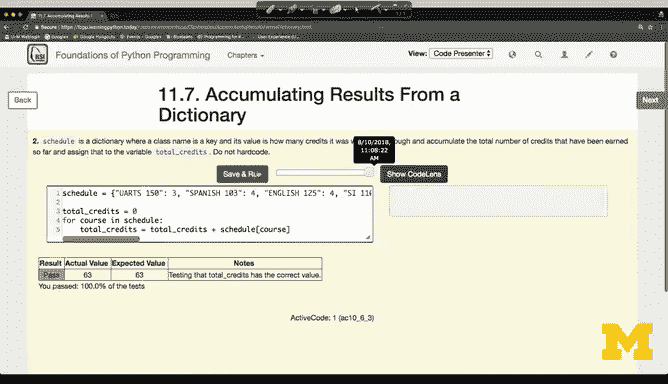

# 课程 32：字典结果累积 📊


在本节课中，我们将学习如何对字典中累积的数据进行进一步处理。我们将探索如何遍历字典、比较值、以及基于字典内容进行计算。

---

## 概述

上一节我们介绍了字典累积模式，用于统计字符频率。本节中，我们来看看如何利用累积后的字典数据，例如打印所有字符的计数、比较不同字符的出现频率，以及计算文本的“拼字游戏”得分。

---

## 遍历并打印字典内容

假设我们已运行代码，将《猩红字》文本中每个字符的出现次数累积到了字典 `letter_counts` 中。

以下是打印字典中每个字符及其出现次数的代码：

```python
for y in letter_counts:
    print("There are", letter_counts[y], "of the character", y)
```

这段代码会遍历 `letter_counts` 字典中的所有键。对于每个键 `y`，它会打印出字符 `y` 及其对应的出现次数 `letter_counts[y]`。

运行代码后，你将看到类似以下的输出，展示了每个字符（包括空格和标点）的出现次数：

```
There are 17584 of the character T
There are ... of the character S
There are ... of the character
...
```

---

## 比较字典中的值

现在，假设我们的字典名为 `x`。我们想判断在文本中，字符 `E` 的出现次数是否多于字符 `T`。

我们可以通过比较字典中对应键的值来实现：

```python
x['E'] > x['T']
```

*   `x['E']` 获取字典 `x` 中键 `'E'` 对应的值（即 `E` 的出现次数）。
*   `x['T']` 获取字典 `x` 中键 `'T'` 对应的值（即 `T` 的出现次数）。
*   表达式 `x['E'] > x['T']` 在 `E` 出现次数更多时为 `True`，否则为 `False`。

---

## 应用：计算“拼字游戏”得分

在拼字游戏中，不同字母有不同分值。假设我们已有一个字典 `letter_values`，存储了每个字母的分值（例如，`'A': 1`, `'Z': 10`）。

我们想计算文本 `Scarlet2.txt` 的总拼字游戏得分。思路是：遍历统计好字符频率的字典 `x`，对于每个在 `letter_values` 中有分值的字符，将其分值乘以其出现次数，并累加起来。

以下是实现此计算的代码：

```python
scrabble_score = 0  # 初始化累加器变量
for y in x:
    if y in letter_values:  # 检查字符是否有拼字游戏分值
        scrabble_score = scrabble_score + letter_values[y] * x[y]
print(scrabble_score)
```

代码解释：
1.  `scrabble_score = 0`：初始化累加器变量。
2.  `for y in x:`：遍历频率字典 `x` 中的每个字符。
3.  `if y in letter_values:`：确保该字符在分值字典中有定义。
4.  `scrabble_score = scrabble_score + letter_values[y] * x[y]`：这是标准的累加模式。将当前字符的分值（`letter_values[y]`）乘以其出现次数（`x[y]`），然后加到总得分上。

运行后，`print(scrabble_score)` 将输出文本的总拼字游戏得分。

---

## 练习：对字典值求和

让我们通过两个练习来巩固如何对字典中的所有值进行求和。

### 练习一：旅行国家总数

字典 `travel` 记录了 Jackie 到访过的每个大洲的国家数量。目标是计算 Jackie 到访过的国家总数。

以下是计算总和的代码：

```python
total = 0  # 初始化累加器
for continent in travel:
    total = total + travel[continent]  # 更新累加器
```

代码解释：
*   `total = 0`：初始化累加器变量 `total`。
*   `for continent in travel:`：遍历字典 `travel` 中的每个键（大洲名称）。
*   `total = total + travel[continent]`：获取当前大洲的国家数量（`travel[continent]`），并将其加到 `total` 上。

循环结束后，变量 `total` 即为国家总数。

### 练习二：计算总学分

字典 `schedule` 的键是课程名称，值是课程学分。目标是计算已获得的总学分。

计算总学分的代码如下：

```python
total_credits = 0  # 初始化累加器
for course in schedule:
    total_credits = total_credits + schedule[course]  # 更新累加器
```

代码解释：
*   `total_credits = 0`：初始化累加器变量 `total_credits`。
*   `for course in schedule:`：遍历课表字典中的每门课程。
*   `total_credits = total_credits + schedule[course]`：将当前课程的学分加到总学分上。

循环结束后，`total_credits` 即为总学分数。

---

## 总结

本节课中我们一起学习了如何对累积在字典中的数据进行处理。我们掌握了如何遍历字典并打印其内容、如何比较字典中不同键对应的值，以及如何对字典中的所有值执行求和操作。这些技能对于分析和利用字典中存储的数据至关重要。



下次再见！