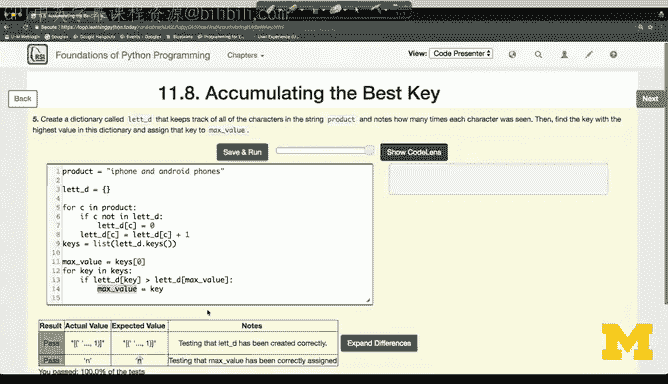

# 121：最优键值累积 🎯


在本节课中，我们将学习如何通过字典来统计字符串中每个字符的出现次数，并在此基础上，找出字典中值最大或最小的键。我们将分两步完成这个任务：首先使用字典累积模式构建频率字典，然后使用最大值/最小值累积模式找出目标键。

---

## 第一步：构建字符频率字典 📊

上一节我们介绍了字典的基本概念，本节中我们来看看如何使用字典累积模式来统计字符频率。

我们需要创建一个字典，用于记录字符串中每个字符出现的次数。以下是实现此功能的具体步骤：

1.  初始化一个空字典。
2.  遍历字符串中的每一个字符。
3.  对于每个字符，检查它是否已经是字典的键。
4.  如果不是，则将该字符作为键添加到字典中，并将其值初始化为0。
5.  无论该字符是否为新键，都将其对应的值加1。

以下是实现上述逻辑的代码：

```python
# 假设字符串变量名为 `placement`
d = {}
for c in placement:
    if c not in d:
        d[c] = 0
    d[c] = d[c] + 1
```

执行完这部分代码后，字典 `d` 就包含了字符串 `placement` 中每个字符及其出现次数的映射关系。

---

## 第二步：找出最优键（最小/最大值）🔍

在第一步中，我们成功构建了频率字典。现在，我们进入第二步：在这个字典中找出值最小（或最大）的键。

我们将使用最小值累积模式来寻找值最小的键。以下是具体步骤：

1.  获取字典中所有键的列表。
2.  将列表中的第一个键设为当前的最小值键（`min_value`）。
3.  遍历键列表中的每一个键。
4.  比较当前键对应的值是否小于当前 `min_value` 键对应的值。
5.  如果是，则更新 `min_value` 为当前键。

以下是实现寻找最小值键的代码：

```python
# 接续第一步的字典 `d`
keys = list(d.keys())
min_value = keys[0]
for key in keys:
    if d[key] < d[min_value]:
        min_value = key
```

如果要寻找值最大的键，只需将比较条件从“小于”（`<`）改为“大于”（`>`），并将变量名改为 `max_value` 即可。

```python
# 寻找最大值键的代码
keys = list(d.keys())
max_value = keys[0]
for key in keys:
    if d[key] > d[max_value]:
        max_value = key
```

---

## 总结 📝

本节课中我们一起学习了如何结合两种编程模式来解决一个实际问题。

*   首先，我们使用**字典累积模式**统计了字符串中字符的频率，其核心是 `if key not in dict: dict[key] = 0` 的初始化与累加。
*   接着，我们应用了**最大值/最小值累积模式**，在已构建的频率字典中寻找具有极端值（最小或最大）的键，其核心是初始化一个候选值，并通过遍历比较来更新它。



通过将大问题分解为两个清晰的子任务，并运用恰当的累积模式，我们可以高效、准确地处理数据并提取所需信息。