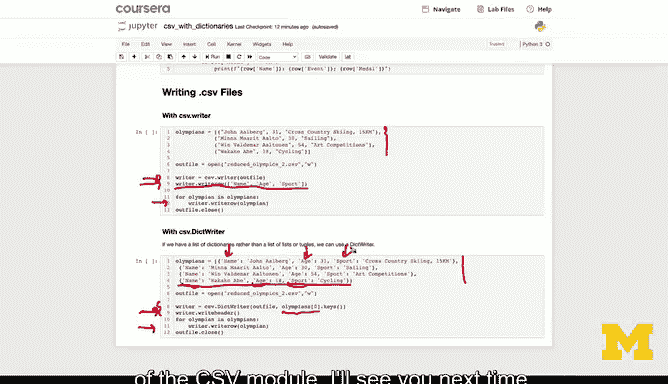

# 122：Python字典与CSV模块整合 📂


在本节课中，我们将学习如何将Python字典与CSV模块结合使用，以更清晰、更优雅的方式读写CSV格式的数据文件。

---

## 概述

上一节我们介绍了Python字典的基本概念。本节中，我们将探讨如何使用CSV模块的`DictReader`和`DictWriter`类，将CSV文件的每一行作为字典来处理，从而避免依赖列的位置索引，使代码更易读、更易维护。

---

## 回顾：使用CSV Reader读取数据

首先，回顾一下之前使用`csv.reader`读取奥运会奖牌数据文件的代码。

```python
import csv

with open('olympics.csv', 'r') as file:
    csv_reader = csv.reader(file)
    for row in csv_reader:
        if row[5] != 'NA':
            print(row[0], row[4], row[5])
```

这段代码通过位置索引（如`row[0]`、`row[5]`）访问每一行的数据。虽然功能正确，但代码的可读性较差，因为读者需要记住每个索引对应的字段含义。

---

## 使用DictReader读取数据

现在，我们来看看如何使用`csv.DictReader`来改进代码。

以下是使用`DictReader`的示例代码：

```python
import csv

with open('olympics.csv', 'r') as file:
    dict_reader = csv.DictReader(file)
    print(dict_reader.fieldnames)
    for row in dict_reader:
        if row['medal'] != 'NA':
            print(row['name'], row['event'], row['medal'])
```

与`csv.reader`相比，`DictReader`有以下不同之处：

*   `DictReader`会自动将CSV文件的第一行作为字段名（列标题）。
*   每一行数据被表示为一个字典，其中键是字段名，值是对应的数据。
*   访问数据时，使用有意义的键（如`row['name']`）而非位置索引，代码意图更清晰。

运行上述代码，`dict_reader.fieldnames`会输出字段名列表。遍历`dict_reader`时，每一行都是一个`OrderedDict`（有序字典），其行为与普通字典相同，可以像`row['medal']`这样通过键来访问值。

---

## 使用DictWriter写入数据

如果你有一个字典列表形式的数据集，并希望将其写入CSV文件，可以使用`csv.DictWriter`。

以下是使用`DictWriter`的示例代码：

```python
import csv

olympians = [
    {'name': '张三', 'age': 24, 'sport': '游泳'},
    {'name': '李四', 'age': 22, 'sport': '田径'}
]

fieldnames = ['name', 'age', 'sport']

with open('new_olympians.csv', 'w', newline='') as file:
    dict_writer = csv.DictWriter(file, fieldnames=fieldnames)
    dict_writer.writeheader()
    for olympian in olympians:
        dict_writer.writerow(olympian)
```

以下是使用`DictWriter`的关键步骤：

1.  定义要写入的字典列表`olympians`。
2.  明确指定`fieldnames`列表，它定义了CSV文件的列标题及其顺序。
3.  创建`DictWriter`对象时，传入文件对象和`fieldnames`参数。
4.  调用`writeheader()`方法写入标题行。
5.  遍历字典列表，对每个字典调用`writerow()`方法写入数据行。

虽然需要显式提供`fieldnames`，但这比在旧版本代码中凭空出现列标题定义更清晰，因为字段名直接来源于数据字典的键。

---

## 总结

本节课中，我们一起学习了如何利用CSV模块的`DictReader`和`DictWriter`类来整合Python字典与CSV文件操作。

*   使用`csv.DictReader`可以将CSV文件的每一行作为字典读取，通过键名而非索引访问数据，提升了代码的可读性。
*   使用`csv.DictWriter`可以将字典列表数据写入CSV文件，需要显式指定字段名作为列标题。



这种方法使得处理带标题的CSV数据更加直观和不易出错，是处理结构化文本数据的推荐方式。