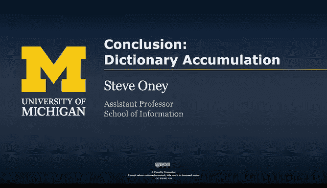

# Python 3 编程课程（第35课）：字典累积总结 📚

在本节课中，我们将总结字典累积这一重要编程技术。我们已经学习了编写高质量Python代码的多种核心技巧，本节将重点回顾如何将字典与累积模式结合，以解决更复杂的问题。




---

上一节我们介绍了字典的基本操作和累积模式的概念。本节中，我们来看看如何将两者结合，形成强大的字典累积技术。

字典累积通过扩展累积模式，使其能够使用任意数量的累积变量，从而大大增强了处理数据的能力。这种技术允许我们灵活地适应多种问题场景。

以下是字典累积的核心步骤：

1.  初始化一个空字典作为累积器。
2.  遍历数据集合（如列表、字符串或文件）。
3.  在循环中，更新字典累积器中的键值对。

其通用模式可以用以下伪代码描述：
```python
accumulator_dict = {}
for item in data:
    # 根据item更新accumulator_dict中的键或值
    # 例如：accumulator_dict[key] = accumulator_dict.get(key, 0) + 1
```

掌握了字典累积后，我们可以将其应用于各种实际问题中，例如统计词频、分组数据或构建索引。

---

我想用我最喜欢的一个简短笑话来结束本节课。这个笑话只有两个字：**“不假。”** 它有趣的原因在于它是真的。

---


本节课中我们一起学习了字典累积的总结。我们看到了如何将字典数据结构与累积循环模式相结合，创造出一种处理计数、分组和聚合数据的强大工具。这项技术是Python编程中数据处理的核心技能之一。

下次见。