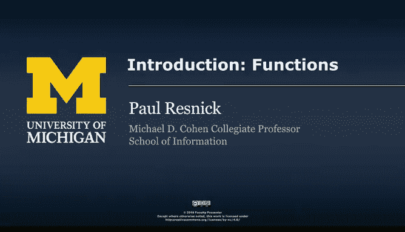

# 课程1：Python 3编程｜第36讲：函数导论 🎯

在本节课中，我们将学习Python函数的基础知识。函数是编程中用于封装可重用代码块的核心工具。掌握函数的使用，意味着你从编写单一脚本迈向构建模块化、可维护的程序。

---

## 概述 📋


上一节我们介绍了代码的基本结构和逻辑控制。本节中，我们来看看如何将代码组织成可复用的单元——函数。

函数允许我们将一段执行特定任务的代码抽象出来，为其命名，并通过不同的输入（参数）反复调用它。这提高了代码的清晰度和效率。



---

## 函数的定义与调用

函数通过 `def` 关键字定义，后跟函数名、括号内的参数列表和冒号。函数体需缩进。

以下是定义一个简单函数的语法：

```python
def function_name(parameter1, parameter2):
    # 函数体
    # 执行操作
    return result  # 可选
```

定义函数后，你可以通过其名称和括号内的实际值（称为参数值）来调用它。

```python
# 调用函数
output = function_name(value1, value2)
```

---

## 形式参数与实际参数

理解形式参数和实际参数（参数值）的区别至关重要。

*   **形式参数**：在函数定义时，括号内声明的变量名。它们代表函数需要接收的数据。
*   **实际参数（参数值）**：在调用函数时，传递给形式参数的具体数据值。

请看以下示例：

```python
def greet(name):  # `name` 是形式参数
    return f"Hello, {name}!"

message = greet("Alice")  # `"Alice"` 是实际参数值
print(message)  # 输出：Hello, Alice!
```

在这个例子中，`name` 是形式参数，而调用函数时传入的字符串 `"Alice"` 是实际参数值。

---

## 返回值

函数可以使用 `return` 语句将一个值发送回调用它的地方。这个值称为**返回值**。

并非所有函数都需要返回值。没有 `return` 语句的函数，或 `return` 语句后不跟任何值的函数，默认返回 `None`。

以下是预测函数返回值的步骤：

1.  确定传入函数的实际参数值。
2.  在函数体内，用这些实际值替换对应的形式参数。
3.  逐步执行函数体中的代码。
4.  当遇到 `return` 语句时，其后的表达式结果即为函数的返回值。

例如：

```python
def add(a, b):
    result = a + b
    return result

sum_value = add(5, 3)  # 用5替换a，用3替换b，计算5+3，返回8
print(sum_value)  # 输出：8
```

---

## 关键要点总结

本节课中我们一起学习了：

1.  **函数的定义**：使用 `def` 关键字创建函数，并为其指定名称和形式参数。
2.  **形式参数与实际参数**：形式参数是函数定义中的占位符，实际参数是调用时传入的具体值。
3.  **返回值**：函数通过 `return` 语句将结果传递回调用处。理解如何根据输入参数追踪执行路径以预测返回值。

掌握这些概念，你便拥有了构建更复杂、更优雅程序的基础工具。函数是抽象思维在编程中的直接体现，它将具体的操作转化为通用的解决方案。