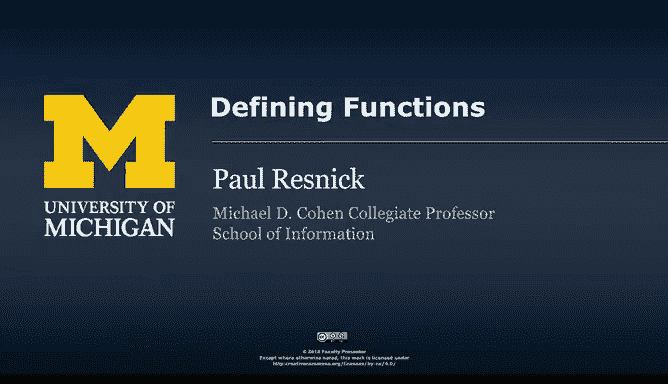
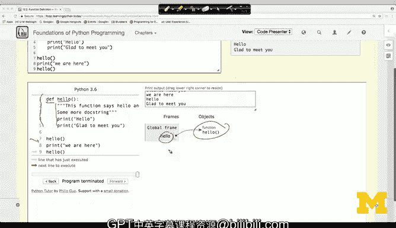

# 125：函数定义方法 🧑‍💻




在本节课中，我们将要学习如何在 Python 中定义函数。函数是组织代码、实现代码复用的核心工具。我们将从最基本的语法开始，逐步理解函数是如何被创建和调用的。

## 函数定义的基本语法

上一节我们介绍了函数的概念，本节中我们来看看如何具体定义一个函数。定义函数的基本语法以关键字 `def` 开头，它是 “define” 的缩写。

以下是函数定义的核心结构：

```python
def 函数名():
    # 这里是函数体，由缩进的代码块组成
```

具体来说，语法包含以下几个部分：
*   `def` 关键字。
*   一个符合 Python 变量命名规则的函数名称。
*   一对圆括号 `()`。我们稍后会看到，括号内可以包含变量名（参数），但目前这个函数没有。
*   一个冒号 `:`。
*   一个缩进的代码块。这个缩进规则与你在 `while` 循环、`for` 循环或 `if` 语句中见过的相同。

所有缩进量相同的代码行都属于这个函数定义的一部分。当我们遇到一行代码，其缩进层级与开头的 `def` 关键字对齐时，就标志着函数定义的结束。

## 文档字符串（Docstring）

在函数定义中，第一行可以包含一个可选的注释，这被称为文档字符串（Docstring）。Python 有一些工具可以自动生成程序文档，这些工具会显示与函数关联的文档字符串。文档字符串通常是多行字符串，因此我们使用三引号 `"""` 来定义它。

例如：
```python
def hello():
    """
    这是一个简单的问候函数。
    它会打印两行问候语。
    """
    print("hello")
    print("glad to meet you")
```

## 函数的创建与调用

理解函数定义代码的执行过程至关重要。当我们执行上面这样的代码时，即使函数体内有 `print` 语句，也不会立即打印出任何内容。

执行第1行到第5行的代码，仅仅会**创建**一个名为 `hello` 的函数对象，而不会**执行**这个函数。第4行和第5行的代码只有在函数被**调用**时才会执行。

因此，我们需要在 `def` 语句之后，添加调用函数的代码。调用函数时，只需写出函数名加上括号即可。

```python
def hello():
    print("hello")
    print("glad to meet you")

# 调用函数
hello()
```

现在当我们执行这段代码时，控制权会传递给 `hello` 函数，从而执行其内部的代码（打印两行文字），执行完毕后，控制权会返回到函数调用之后的位置。

## 代码执行流程示例

让我们通过一个更完整的例子来观察代码的执行流程。

```python
def hello():
    print("hello")
    print("glad to meet you")

hello()
print("we are here")
hello()
```

以下是代码的执行步骤：
1.  执行 `def hello(): ...`，创建函数对象。
2.  执行 `hello()`，调用函数：
    *   控制权进入函数体。
    *   执行 `print("hello")`。
    *   执行 `print("glad to meet you")`。
    *   函数执行完毕，控制权返回。
3.  执行 `print("we are here")`。
4.  再次执行 `hello()`，重复步骤2的过程。

因此，输出结果将是：
```
hello
glad to meet you
we are here
hello
glad to meet you
```

## 总结

本节课中我们一起学习了 Python 函数定义的基础知识。我们掌握了定义函数的基本语法 `def 函数名():`，了解了可选的文档字符串的用途，并重点区分了函数的**创建**与**调用**。记住，`def` 语句只是创建函数，而函数名后加括号 `()` 才是真正执行它。函数执行完毕后，程序会从调用点之后继续运行。



下一讲，我们将为函数添加形式参数，让函数能够接收外部输入的数据。