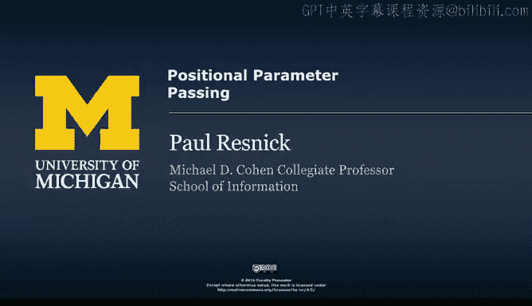
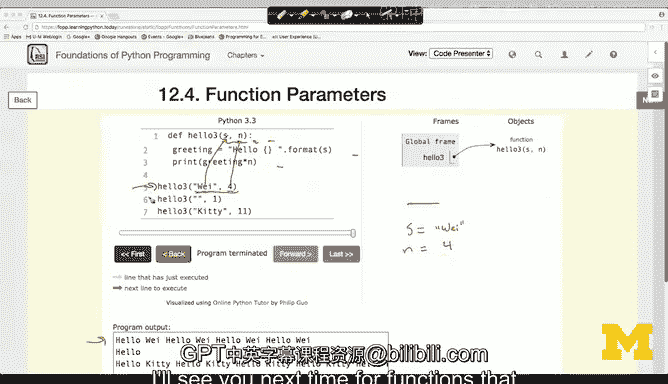

# 密歇根大学《Python3编程》课程1、2｜P126：38_03_03_位置参数传递 🧩





在本节课中，我们将要学习函数如何通过接收不同的参数值来执行不同的操作。我们将重点理解**位置参数传递**的核心机制，即参数值如何与函数定义中的参数名进行匹配。

## 概述 📋

函数可以根据传递给它的参数值执行不同的任务。为了实现这一点，我们需要在定义函数时指定**形式参数**，并在调用函数时提供对应的**参数值**。本节课将详细解释这一过程。

## 带一个参数的函数

首先，我们来看一个带有一个参数的函数定义。

```python
def hello2(s):
    print("Hello " + s)
    print("Glad to meet you")
```

与之前简单的`hello`函数相比，这个函数在括号内多了一个变量名`s`。括号内的变量名被称为**形式参数名**或**参数名**。

当我们调用这个函数时，例如：

```python
hello2("Iman")
```

在函数开始执行时，变量`s`会获得值`"Iman"`。这就像在幕后执行了一个赋值语句：`s = "Iman"`。然后，在函数的其余部分，我们就可以引用变量`s`。

让我们通过代码执行来观察这个过程。首先创建函数，然后调用它。在幕后，发生了赋值操作，`s`现在绑定到了`"Iman"`。因此，当执行`print("Hello " + s)`时，输出窗口会显示`Hello Iman`。

第二次调用时：

```python
hello2("Jackie")
```

`s`将绑定到`"Jackie"`，输出结果为`Hello Jackie`。

我们通常将传递给函数的这些值称为**输入**。请注意，不要将此处的“输入”与`input()`函数混淆。这里的“输入”指的是传递给函数的值，作为函数的输入参数或参数值。

## 带多个参数的函数

一个函数可以接收多个输入参数。下面是一个带有两个形式参数的函数示例。

```python
def hello3(s, n):
    greeting = "Hello " + s
    print(greeting * n)
```

在这个函数中，我们有两个形式参数：`s`和`n`。我们会在函数体内引用这两个参数。记住，星号`*`应用于字符串时，表示将字符串重复连接多次。

让我们逐步执行这段代码。首先创建函数，然后第一次调用它：

```python
hello3("Way", 4)
```

第一个参数值`"Way"`会自动与第一个形式参数名`s`匹配，所以`s`绑定到`"Way"`。第二个值`4`则传递给第二个参数名`n`，所以`n`获得值`4`。这被称为**位置参数传递**：第一个参数值与第一个参数名匹配，第二个参数值与第二个参数名匹配。

执行第二行时，`greeting`的值变为`"Hello Way"`。在第三行，我们将这个字符串打印4次，输出结果为`Hello WayHello WayHello WayHello Way`。

下一次调用：

```python
hello3("", 1)
```

`s`绑定到一个空字符串，`n`绑定到`1`。因此，`greeting`是`"Hello "`（带有空格）。我们将其打印一次，输出看起来就像`Hello`（空格不可见）。

最后一次调用：

```python
hello3("Kitty", 11)
```

两个输入参数值是`"Kitty"`和`11`。因此，我们会得到`Hello Kitty`重复11次。

## 核心概念总结

以下是本节课涉及的核心概念：

*   **形式参数**：有时称为参数名或输入参数。它们位于函数定义的括号内。例如，`hello3(s, n)`中的`s`和`n`就是形式参数。
*   **参数值**：有时称为实参或实际参数。它们位于函数调用的括号内。例如，`hello3("Way", 4)`中的`"Way"`和`4`就是参数值。
*   **位置匹配**：参数值按照位置与形式参数进行匹配。第一个参数值与第一个参数名匹配，第二个参数值与第二个参数名匹配，依此类推。
*   **幕后赋值**：在函数开始执行时，这些值会通过幕后的赋值操作绑定到对应的参数名上。例如，调用`hello3("Way", 4)`时，就像在幕后执行了`s = "Way"`和`n = 4`这两个赋值语句。

## 总结 🎯

本节课中，我们一起学习了函数参数传递的基础——位置参数传递。我们了解了如何在函数定义中设置形式参数，如何在调用函数时提供参数值，以及这些值如何根据位置顺序与参数名进行匹配绑定。理解这一机制是编写灵活、可复用函数的关键。

下一节课，我们将学习函数如何通过**返回值**来产生输出。



