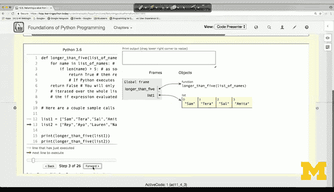

# 课程1：Python 3 编程 - P127：39_03_04_返回值机制 🧮


在本节课中，我们将学习Python函数中一个核心概念：**返回值**。我们将了解如何让函数计算结果并传递出来，以及`return`语句如何控制函数的执行流程。

---

## 函数：一个输入输出的机器 🤖

上一节我们介绍了函数的基本定义和调用。本节中我们来看看函数如何“产出”结果。

一个有助于理解的比喻是：将函数看作一台机器。它可能接收一些输入（即参数），然后运行（就像动画中看到的“运转”过程），并可以产生一个输出。

## 如何让函数返回值 📤

让我们看看如何使函数返回一个值。以下是`square`函数的定义：

```python
def square(x):
    y = x * x
    return y
```

请注意第3行。我们使用了一个特殊的关键字 **`return`**。其后可以跟任何Python表达式，在这个例子中，只是一个对变量`y`的引用。该变量的值（某个Python对象）将成为函数返回的值。

观察第6行的调用：

```python
two_squared = 10
square_result = square(two_squared)
```

我们调用函数`square`并传入一个输入（实参）。这个值将被绑定到第一个形式参数`x`上。然后执行函数体：将`x`乘以自身并赋值给变量`y`。接着，`return y`会返回一个值，这个返回值将成为整个函数调用表达式的值，并最终被赋值给变量`square_result`。

**注意**：这里的`result`只是一个普通的变量名，而`return`才是用于从函数返回值的关键字。

## 返回值与打印的区别 🖨️ vs 🔄

学生常有一个混淆点：**打印一个值并不等于返回这个值**。

请看以下有问题的函数定义：

```python
def square(x):
    y = x * x
    print(y)  # 错误：这里打印了y，但没有返回它
```

如果函数定义中完全没有`return`语句，Python会自动返回一个特殊值：**`None`**。

以下是执行过程：
1.  定义函数`square`。
2.  设置`two_squared = 10`。
3.  调用函数`square(10)`。`x`得到值10，计算`y`为100，然后**打印**出100。
4.  由于函数没有显式返回值，它隐式返回`None`。
5.  因此，`square_result`被赋值为`None`。
6.  当我们尝试打印格式化语句时，会得到“10的平方结果是None”，而不是期望的100。

正确的做法是使用`return y`而不是`print(y)`。这样，函数调用表达式的值就是计算结果，可以被其他代码使用。

## `return`语句的执行控制 ⏹️

关于`return`语句另一个重要特性是：**它会中断函数的执行**。在`return`语句执行后，函数内的其他代码都不会再执行。

这有点像棋盘游戏“大富翁”中的“直接入狱”卡：不经过“起点”，不收取200元。在我们的场景中，意味着不执行函数内剩下的任何代码，即使你正处在一个`for`循环或`if`语句的中间。

以下是一个说明性的例子：

```python
def weird():
    print("here")
    return 5
    print("there")  # 这行代码永远不会被执行

x = weird()
print(x)
```
执行时，我们会打印出“here”，然后`return 5`。`return`之后，函数立即结束，因此“there”永远不会被打印。变量`x`获得返回值5，最后打印出5。

## 一个实用的编程模式：提前返回 🔍

让我们看一个常见的、在函数中间使用`return`的良好模式。

这个名为`longer_than_5`的函数返回一个布尔值（`True`或`False`）。它接收一个字符串列表作为输入。如果列表中**任何**字符串长度超过5个字符，函数就返回`True`；否则，返回`False`。

```python
def longer_than_5(list_of_names):
    for name in list_of_names:
        if len(name) > 5:
            return True  # 发现一个长名字，立即返回True
    return False  # 循环结束都没发现长名字，返回False
```



以下是该函数的工作原理：

我们遍历所有名字（第2-5行）。如果**任何时候**遇到一个长名字（`len(name) > 5`），我们就执行第4行，**立即返回`True`**。一旦执行`return`，我们就跳出`for`循环，结束整个函数。

反之，如果我们**完整地**迭代了整个列表，都**没有**执行到第4行的`return True`，那么循环结束后，我们会执行第6行的`return False`。

这种逻辑之所以有效，是因为只有在处理完所有名字且没有一个触发`return True`的情况下，我们才会到达第6行。这意味着所有名字都不长，因此可以安全地返回`False`。

---

## 总结 📝

本节课中我们一起学习了函数返回值的机制：

1.  **返回值**：使用 **`return`** 关键字后跟一个表达式，可以将值从函数内部传递到调用处。
2.  **执行控制**：`return`语句会**立即结束**当前函数的执行，其后的代码将被忽略。
3.  **默认返回值**：如果一个函数没有执行任何`return`语句，它会自动返回特殊值 **`None`**。
4.  **关键区别**：`print()`函数用于向**人**显示输出，它不返回值；`return`语句用于向**程序**返回值，它不显示任何内容。

记住：`print`是给人看的，`return`是给函数用的。