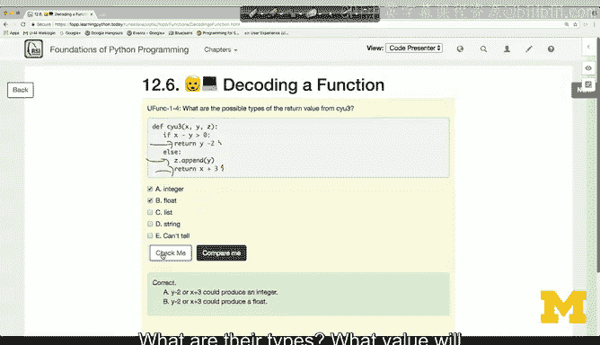

# 128：程序员之道：函数解析 🔍


在本节课中，我们将学习如何解析一个函数定义。这是一种重要的编程习惯，能帮助你快速理解函数的工作原理，并有效缩短调试时间。


---

## 概述

解析函数意味着在看到一个函数定义时，系统地回答三个核心问题。掌握这个方法，将使你更清晰地理解代码的意图和结构。

上一节我们介绍了函数的基本概念，本节中我们来看看如何系统地“解码”一个函数。

---

## 解析函数的三个核心问题

以下是解析任何函数时需要回答的三个关键问题：

1.  **函数有多少个参数？**
2.  **这些参数将被绑定什么类型的值？**
3.  **函数的返回值是什么类型？**

让我们通过几个例子来实践这个方法。

---

## 示例解析

假设我们有以下函数定义：

```python
def C(x, y, z):
    if x > y:
        return y - 2
    else:
        z.append(x + 3)
        return x + 3
```

### 1. 参数数量

第一个问题最容易回答。你只需查看函数定义中的括号。

```python
def C(x, y, z):
```

括号内有三个由逗号分隔的变量名：`x`, `y`, `z`。因此，这个函数有 **3个输入参数**。

### 2. 参数类型

接下来，我们需要推断每个参数的类型。这需要观察参数在函数体内是如何被使用的。

*   **`x` 和 `y` 的类型**：在代码中，我们看到表达式 `x > y` 和 `x - y`。能进行大小比较和减法运算的对象通常是**数字**（整数或浮点数）。字符串通常不能直接进行减法运算。

*   **`z` 的类型**：参数 `z` 在代码 `z.append(...)` 中被使用。`append` 方法是**列表**特有的操作。字符串等类型不支持 `append` 方法。因此，`z` 必须是**列表**类型。

### 3. 返回值类型

最后，我们需要确定函数返回什么类型的值。函数中有两个返回语句：`return y - 2` 和 `return x + 3`。

我们之前已经推断出 `x` 和 `y` 是数字类型。加法和减法运算对整数和浮点数都有效。因此，返回值可能是**整数**，也可能是**浮点数**，具体取决于输入参数的类型。

---

## 培养解析习惯

养成在阅读或编写函数时进行解析的习惯至关重要。通过主动回答这三个问题，你能在调试前就预见到许多潜在的类型错误或逻辑问题，从而显著提高编码效率和代码质量。

---

## 总结

本节课中我们一起学习了“解析函数”的方法。我们了解到，面对任何一个函数，都应该系统地思考其**参数数量**、**参数类型**以及**返回值类型**。掌握这一“程序员之道”，将使你更自信地阅读、编写和调试Python代码。



我们下次再见。