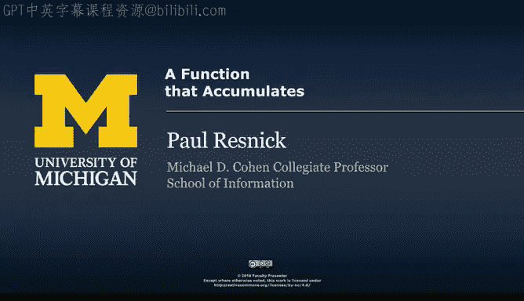
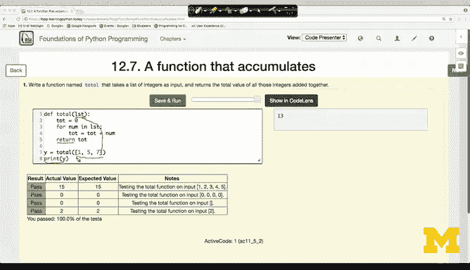

# 课程1：Python 3编程 - P129：累积功能函数实现 🧮




在本节课中，我们将学习如何将一个计算列表总和的代码片段，转换成一个可重用的函数。我们将重点关注“累加器模式”，并学习如何通过定义函数来使代码更通用、更灵活。

---

## 从代码片段到函数

上一节我们介绍了使用累加器模式计算特定列表总和的方法。本节中，我们来看看如何将这段代码抽象成一个函数，以便它能处理任何整数列表。

我们之前见过类似这样的代码，目标是最终定义一个名为 `total` 的函数。以下是一段计算列表总和的代码，它使用了累加器模式：

```python
lst = [1, 5, 7]
tote = 0
for number in lst:
    tote = tote + number
print(tote)
```

这段代码针对一个特定的列表 `[1, 5, 7]` 工作。累加器 `tote` 从 0 开始，遍历列表，每次更新总和。最终，它打印出结果 13。

现在的问题是：如何让它适用于任何整数列表，而不仅仅是 `[1, 5, 7]`？

---

## 定义函数

我们需要定义一个名为 `total` 的函数。目前，调用 `total` 会出错，因为这个函数尚未定义。

让我们开始定义这个函数。我们将把上面的代码放入函数内部，并做一些调整。

首先，我们希望 `total` 能接收一个输入参数，而不是只处理固定的列表。我们将这个输入列表作为函数的**形式参数**。

```python
def total(lst):
    tote = 0
    for number in lst:
        tote = tote + number
    print(tote)
```

然后，我们调用这个函数，并将结果赋值给一个变量 `y`。

```python
y = total([1, 5, 7])
```

让我们在代码透镜中观察执行过程。函数 `total` 首先被定义。当我们用列表 `[1, 5, 7]` 调用它时，形式参数 `lst` 被绑定到这个列表。接着，代码逐行执行：`tote` 初始化为0，遍历列表，更新总和，最后打印出结果。

---

## 返回值与打印输出

这里有一个初学者常犯的错误。在函数内部，我们使用了 `print(tote)` 来输出结果。然而，当我们执行 `y = total(...)` 时，我们期望变量 `y` 被绑定到计算结果（例如13），但实际上，函数没有返回任何值（即返回 `None`），所以 `y` 得到的是 `None`。

为了修复这个问题，我们需要**返回**总和，而不是打印它。在函数内部，应该使用 `return` 语句。

```python
def total(lst):
    tote = 0
    for number in lst:
        tote = tote + number
    return tote  # 使用 return 而不是 print
```

`return` 是一个语句，不是函数调用，因此不需要括号。修改后，当我们调用 `y = total([1, 5, 7])` 时，`y` 将被正确地绑定为 13。如果我们想打印这个值，可以在函数外部进行：

```python
y = total([1, 5, 7])
print(y)  # 这将打印出 13
```

这样，函数本身只负责计算，而输出控制权交给了调用者，代码也更加清晰和可测试。

---

## 抽象化过程总结

让我们回顾一下将特定代码抽象成通用函数的完整过程：

1.  **从具体代码开始**：我们最初有一段对固定列表 `[1, 5, 7]` 求和的代码。
2.  **转换为函数定义**：将代码封装进 `def total(lst):` 函数体内。
3.  **参数化输入**：将硬编码的列表替换为形式参数 `lst`。调用函数时，具体的列表（实际参数）会被绑定到 `lst`。
4.  **用 `return` 替换 `print`**：确保函数返回计算结果，而不是直接打印。这使函数更灵活，结果可以被赋值给变量或用于其他计算。

这个过程的核心是：**将处理特定值的代码片段，通过参数化转变为能处理一类输入（本例中是任何数字列表）的通用函数**。

---

本节课中我们一起学习了如何将累加器模式的代码封装成一个可重用的函数。我们理解了参数传递、返回值的重要性，以及从具体到抽象的编程思维。掌握这个技巧，能让你写出更模块化、更易维护的代码。



我们下次再见。