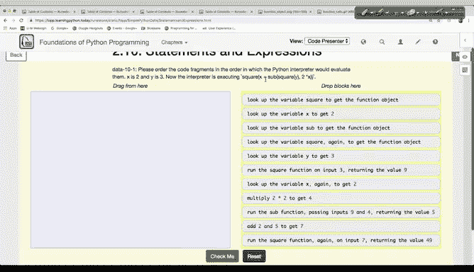

# 13：深入理解语句与表达式 🧠


在本节课中，我们将要学习 Python 如何精确地计算表达式，特别是函数调用时各个部分的执行顺序。理解这个顺序对于编写和调试代码至关重要。

---

## 函数调用的执行顺序

上一节我们介绍了表达式的基本概念，本节中我们来看看 Python 在遇到一个函数调用时，具体会如何一步步执行。

Python 计算函数调用表达式遵循一个固定的顺序：

1.  **计算函数本身**：Python 首先会计算函数名（或任何代表函数的表达式），以确定要调用的是哪个函数。
2.  **从左到右计算参数**：然后，Python 会按从左到右的顺序，计算函数调用中每个参数的值。
3.  **执行函数调用**：最后，当函数对象和所有参数值都准备就绪后，Python 才会真正调用该函数。函数返回的值就是整个表达式的值。

让我们通过一个例子来具体说明这个过程。

---

## 示例分析

假设我们定义了以下函数和变量：
```python
def add(a, b):
    return a + b

def square(x):
    return x * x

def sub(a, b):
    return a - b

x = 5
y = 7
```
现在，我们分析表达式 `add(square(y), square(x))` 的计算过程。

以下是 Python 执行此表达式的详细步骤：

1.  **计算函数 `add`**：Python 查找变量 `add`，发现它是一个函数对象。
2.  **计算第一个参数 `square(y)`**：
    *   计算函数 `square`：查找变量 `square`，发现它是一个函数。
    *   计算参数 `y`：查找变量 `y`，得到值 `7`。
    *   调用函数：执行 `square(7)`，得到结果 `49`。
3.  **计算第二个参数 `square(x)`**：
    *   计算函数 `square`：再次查找变量 `square`，得到函数对象。
    *   计算参数 `x`：查找变量 `x`，得到值 `5`。
    *   调用函数：执行 `square(5)`，得到结果 `25`。
4.  **执行最终函数调用**：现在，Python 拥有了函数 `add` 和两个参数值 `49` 和 `25`。它执行 `add(49, 25)`，得到最终结果 `74`。

因此，整个表达式的值是 **74**。

---

## 复杂表达式计算顺序挑战

现在，让我们分析一个更复杂的表达式，以巩固理解。假设变量初始值为 `x = 2`, `y = 3`，并已有 `square` 和 `sub` 函数定义。

表达式为：`square(x + sub(square(y), 2 * x))`

我们需要推断 Python 计算这个表达式的具体步骤顺序。以下是计算过程中的关键动作列表：

*   查找变量 `square` 以获取函数对象。
*   计算参数 `x + sub(...)` 的值：
    *   查找变量 `x` 得到值 `2`。
    *   计算 `sub(...)` 的值：
        *   查找变量 `sub` 以获取函数对象。
        *   计算第一个参数 `square(y)`：
            *   查找变量 `square` 以获取函数对象。
            *   查找变量 `y` 得到值 `3`。
            *   **执行 `square` 函数**：调用 `square(3)` 得到 `9`。
        *   计算第二个参数 `2 * x`：
            *   查找变量 `x` 得到值 `2`。
            *   计算 `2 * 2` 得到 `4`。
        *   **执行 `sub` 函数**：调用 `sub(9, 4)` 得到 `5`。
    *   计算 `x + 5` 得到 `7`。
*   **执行外层的 `square` 函数**：调用 `square(7)` 得到最终结果 **49**。

通过这个逐步拆解，我们可以看到 Python 如何深入每个子表达式，严格按照“先计算函数对象，再从左到右计算参数，最后调用函数”的规则来工作。

---

## 总结

本节课中我们一起学习了 Python 解释器计算表达式的核心机制。关键在于记住函数调用的三步顺序：**先确定函数，再算参数，最后执行调用**。对于嵌套的复杂表达式，这个规则会递归应用。掌握这个执行顺序能帮助你更好地预测代码行为，并有效地进行调试。



下次课再见！