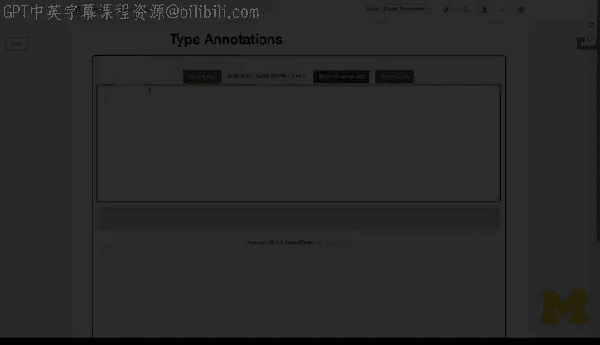
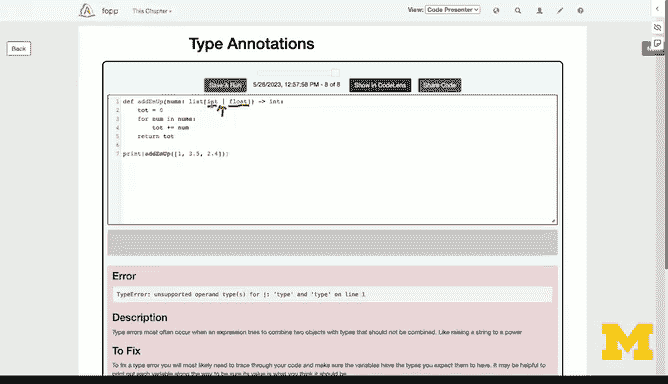

# Python 3 编程（课程1、2）｜第130讲：类型提示技术 🧩




## 概述

在本节课中，我们将要学习 Python 3.5 版本引入的一个重要特性：**类型提示**。我们将了解动态类型与静态类型的区别，学习如何为函数参数和返回值添加类型注解，并探讨这一技术如何帮助我们编写更清晰、更易维护的代码。

---

## 动态类型与静态类型

Python 是一门以**动态类型**著称的语言。这意味着一个变量可以在程序运行过程中被赋予不同类型的值。

例如，你可以先让变量 `x` 指向一个整数，之后再让它指向一个字符串或列表。

```python
x = 3
x = "hello"
print(x)  # 输出：hello
```

这在 Python 中是完全可以的，`x` 的值会更新为最新的赋值 `"hello"`。

然而，在其他一些语言（如 C++ 和 Java）中，使用的是**静态类型**。在静态类型语言中，变量在声明时必须指定其类型（例如整数或字符串），并且这个类型在后续使用中不能改变。

动态类型为编写小型程序提供了灵活性，但也使得理解和推理大型程序变得更加困难。当你定义一个函数时，你可能希望每次调用它时都传入一个字符串，但它也可能被传入其他类型的对象，这可能导致运行时错误，或者更糟的是，产生难以调试的语义错误。

此外，当你查看一个函数定义时，如果没有参数的类型声明，就很难理解这个函数期望接收什么类型的输入。如果有类型声明，将极大地帮助理解函数的功能。

---

## 什么是类型提示？

从 Python 3.5 开始，引入了一个名为**类型注解**或**类型提示**的新特性。它并不能实现静态类型语言的所有功能，但确实提供了一些帮助。

你可以把它看作是一种结构化的、机器可读的注释，用于说明期望的数据类型。它对于函数的形参和返回值特别有用。

上一节我们介绍了动态类型的挑战，本节中我们来看看类型提示如何帮助我们解决这些问题。

---

## 基本语法

以下是一个使用类型提示的函数示例：

```python
def duplicate(message: str) -> str:
    """Return a string that is a duplicate of the input message."""
    return message + message
```

在这个例子中：
*   `message: str` 表示参数 `message` 期望是一个字符串。
*   `-> str` 表示该函数期望返回一个字符串。

需要注意的是，这里的“期望”并非“强制”。Python 解释器在运行时**并不会**检查传入函数的值是否确实是字符串。类型提示主要是为了帮助开发者和工具理解代码。

类型提示可以被阅读代码的人理解，也可以被一些静态分析工具（如 Linter）读取，这些工具可以检查代码并提示潜在的类型不匹配问题。

---

## 更多类型提示示例

以下是几个不同类型提示的例子：

```python
def add(x: int, y: int) -> int:
    return x + y

def get_number(msg: str) -> float:
    return float(input(msg))

def display_message(msg: str) -> None:
    print(msg)
```

*   `add` 函数接收两个整数，返回一个整数。
*   `get_number` 函数接收一个字符串，返回一个浮点数。
*   `display_message` 函数接收一个字符串，没有返回值。我们可以用 `-> None` 来明确表示这一点。在类型提示的上下文中，`None` 本身被当作一种类型。

---

## 复杂类型的提示

对于更复杂的数据结构，如字典和列表，我们也可以提供更详细的类型提示。

以下是一个统计单词次数的函数：

```python
def count_words(text: str) -> dict[str, int]:
    words = text.split()
    counts = {}
    for w in words:
        counts[w] = counts.get(w, 0) + 1
    return counts

print(count_words("hello world hello"))  # 输出：{'hello': 2, 'world': 1}
```

这里的 `-> dict[str, int]` 表示函数返回一个字典，其键是字符串，值是整数。

对于列表，我们可以指定列表元素的类型：

```python
def add_up(nums: list[int]) -> int:
    total = 0
    for n in nums:
        total += n
    return total

print(add_up([1, 3, 5]))  # 输出：9
```

`nums: list[int]` 表示参数 `nums` 是一个列表，且列表中的每个元素都应该是整数。

---

## 联合类型

有时，一个参数可以接受多种类型。例如，一个列表可能包含整数或浮点数。我们可以使用**联合类型**来表示这种情况。

在较新版本的 Python（如 3.10+）中，可以使用 `|` 操作符：

```python
def add_up(nums: list[int | float]) -> float:
    total = 0.0
    for n in nums:
        total += n
    return total

print(add_up([1, 3.5, 2.4]))  # 输出：6.9
```

`list[int | float]` 表示列表中的元素可以是整数或浮点数。`|` 符号在许多编程语言中表示“或”的关系。

---

## 总结

本节课中我们一起学习了 Python 的**类型提示**技术。

我们了解到：
1.  类型提示是一种为函数参数和返回值添加类型注解的语法。
2.  它不会在运行时强制进行类型检查，主要目的是提高代码的可读性和可维护性。
3.  类型提示可以帮助开发者理解代码，也能被各种静态分析工具利用，提前发现潜在问题。
4.  我们可以为基本类型（如 `int`, `str`）、复杂类型（如 `list[int]`, `dict[str, int]`）甚至联合类型（如 `int | float`）添加提示。



虽然在本课程后续的许多示例中可能不会总是使用类型提示（因为教材编写时间较早），但这是一个非常好的编程实践。我鼓励大家，尤其是在编写复杂代码时，尽可能地使用类型提示。在最终的课程项目中，你们也会看到我们使用了类型提示的代码。