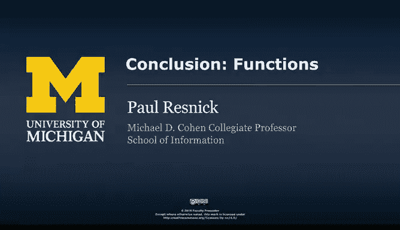

# 131：函数章节总结 📚

在本节课中，我们将对函数这一核心概念进行总结。我们将回顾如何定义和使用函数，理解参数与返回值，并最终掌握编写可重用代码的能力。


---



上一节我们介绍了函数的实际应用，本节中我们来看看本章节的核心要点总结。

## 掌握编写可重用函数的能力 🛠️

你现在已经掌握了编写可重用函数的工具，而不仅仅是编写一次性的代码片段。

## 定义函数与参数命名 📝

你现在应该能够为形式参数定义具有恰当名称的函数。

以下是定义函数的基本结构：
```python
def function_name(parameter1, parameter2):
    # 函数体
    return result
```

## 识别参数与预测返回值 🔍

你应当能够在代码示例中识别形式参数和参数值，并能够根据给定的示例参数值预测函数的返回值。

例如，给定以下函数：
```python
def add(a, b):
    return a + b
```
当参数值为 `add(3, 5)` 时，返回值是 **8**。

---

我假设你已经完成了本课程提供的所有练习。

因此，凭借密歇根大学和Coursera赋予我的权力，我正式授予你“程序员”的称号，并赋予其包含的所有特权与责任。

---

## 关于函数的一个笑话 😄

为什么函数之间不再互相调用了？

因为它们有太多参数（争论）了。

---

本节课中我们一起学习了函数的定义、参数传递、返回值预测以及编写可重用代码的重要性。我们完成了函数章节的核心内容总结，为后续学习奠定了坚实基础。下次再见！