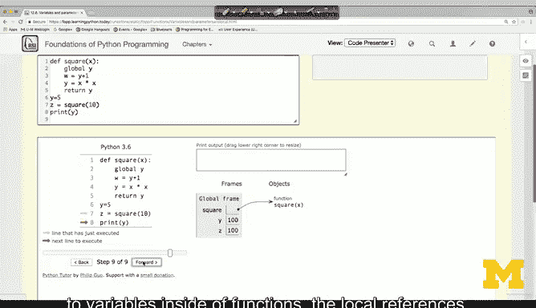

# 133：局部变量与全局变量详解 🧠

在本节课中，我们将要学习Python中一个核心概念：变量的作用域。具体来说，我们将探讨什么是局部变量和全局变量，理解它们在不同命名空间中的行为，并掌握在函数内部正确使用变量的规则。

## 变量作用域概述

变量的作用域是指变量名可以被访问的语句集合。

在函数 `square` 中，我们进行赋值操作。由于该赋值位于函数定义内部，其作用域仅限于该函数定义的其余部分。例如，在函数外部，我们无法引用在函数内部定义的变量。

## 命名空间的概念

为了更清晰地理解，我们需要引入“命名空间”这个概念。命名空间是一个所有名称都唯一的环境。例如，在密歇根州安娜堡市，只能有一条“主街”。但在其他城市，也可以有名为“主街”的道路，它们互不干扰。

在Python中，存在一个全局（或顶级）命名空间。每次调用函数时，都会创建一个新的局部命名空间。在代码可视化工具中，这些命名空间通常被显示为“栈帧”。

## 变量查找与赋值规则

以下是变量在函数内部查找和赋值时，与命名空间交互的具体规则：

### 变量查找规则

1.  **规则一：优先查找局部变量**
    如果在函数内部的代码中引用一个变量，并且该变量名在函数定义内的任何位置被赋值过（即使是在引用之后），那么Python会将该引用视为局部变量。它会在局部栈帧中查找该变量的值。如果找到，就使用该值；否则，会引发错误。

2.  **规则二：查找全局变量**
    如果变量名在函数定义内部从未被赋值，那么Python会去全局栈帧中查找它。

### 变量赋值规则

赋值操作总是在函数的局部命名空间（即该函数调用的栈帧）中进行。即使全局命名空间中存在同名的变量，函数内的赋值语句也会在局部创建一个新的变量。

## 实践与示例

为了更好地理解，让我们通过一些例子来观察这些规则的实际应用。

以下是几个关键示例，展示了不同情况下变量的行为：

*   **示例1：局部变量作用域受限**
    在函数 `square` 内部定义的变量 `y` 是局部变量。在函数外部（例如第6行）尝试引用它会导致 `NameError`，因为该变量在其作用域之外不可见。

*   **示例2：同名变量的区分**
    如果在全局定义了 `y = 5`，在函数 `square` 内部又定义了 `y = 100`，那么这两个 `y` 分别属于全局和局部命名空间，互不影响。函数内部的引用指向局部变量，函数外部的引用指向全局变量。

*   **示例3：引用未在内部赋值的全局变量**
    如果函数内部引用了一个变量（例如 `q`），但该变量在函数内部从未被赋值，Python会去全局命名空间查找它。例如，`w = q + 1` 会使用全局变量 `q` 的值进行计算。

*   **示例4：`global` 关键字（不推荐使用）**
    可以使用 `global` 关键字在函数内部声明一个变量引用的是全局变量。这允许在函数内部读取并修改全局变量的值。**但强烈不推荐这样做**，因为它会导致代码难以理解和调试。

## 核心建议与最佳实践

为了避免混淆，使程序更易于理解，请遵循以下最佳实践：

*   **避免在函数内部引用全局变量**。虽然这在语法上是合法的，但不是好主意。
*   **将所有需要的数据通过参数传递给函数**。如果需要使用外部值，将其作为函数的形参传入。
*   **确保函数内部的变量引用都是局部的**。这样，函数的行为就完全由其输入参数决定，更加清晰和独立。

## 总结

本节课中，我们一起学习了Python中局部变量和全局变量的核心机制：

1.  在函数定义内部，变量赋值会创建局部变量，这些变量不能在函数外部的代码中被引用（包括函数的形参，它们也是局部变量）。
2.  变量引用优先使用局部版本。
3.  虽然可以通过显式声明 `global` 或引用一个在函数内部从未被赋值的变量名来在函数内部访问全局变量，但为了代码的清晰和可维护性，最佳做法是避免这样做，让函数内部的所有变量引用都是局部的。

理解并遵循这些规则，将帮助你编写出更健壮、更易读的Python代码。我们下次再见！