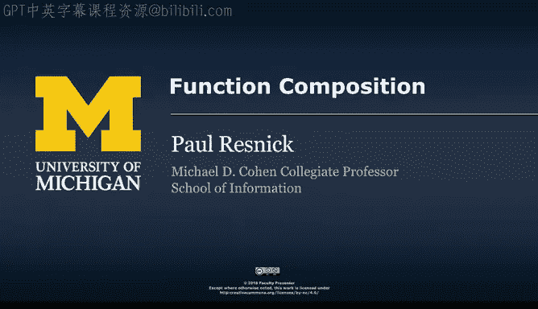
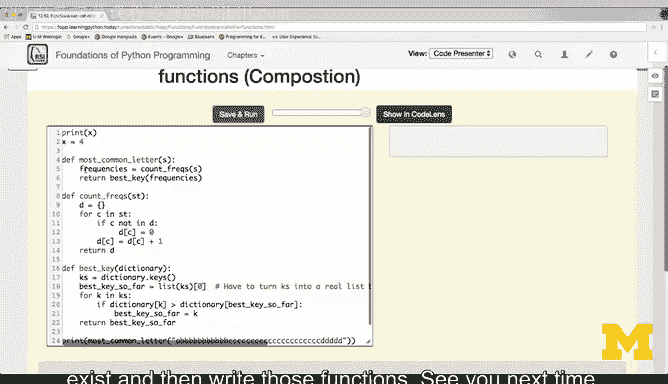

# 134：46_03_03_函数组合技术 🧩




## 概述

在本节课中，我们将要学习函数组合技术。你已经了解到，函数是一种将代码片段抽象为具有名称和参数的有用方式。本节中，我们将把抽象过程再推进一步，学习如何将一个函数的功能分解为一系列动作，其中一些动作可以由其他函数实现，我们只需调用这些已命名的函数。

## 函数组合的基本概念

上一节我们介绍了函数作为代码抽象的基本单元。本节中我们来看看如何在一个函数内部调用另一个函数，这被称为函数组合。

以下是一个简单的例子，函数 `sum_of_squares` 调用了另一个函数 `square`：

```python
def square(x):
    return x * x

def sum_of_squares(x, y, z):
    return square(x) + square(y) + square(z)

a = -5
b = 2
c = 10
result = sum_of_squares(a, b, c)
```

当 `sum_of_squares` 执行时，它会为每个参数调用 `square` 函数。每次调用都会创建一个新的栈帧，拥有独立的局部变量空间。例如，`sum_of_squares` 中的变量 `x` 和 `square` 函数中的参数 `x` 是两个完全不同的变量，互不影响。

## 通过分解解决问题

通常，我们通过分解来解决问题。例如，要找出字符串中出现频率最高的字母，我们可以将这个复杂问题分解为两个更简单的子问题。

以下是解决问题的两个步骤：

1.  统计字符串中每个字母的频率。
2.  从频率字典中找出值最大的键。

### 步骤一：统计频率

首先，我们定义一个函数来统计字符频率。以下是 `count_freqs` 函数的实现：

```python
def count_freqs(st):
    d = {}
    for c in st:
        if c not in d:
            d[c] = 0
        d[c] = d[c] + 1
    return d
```

这个函数遍历输入字符串，使用字典记录每个字符出现的次数。

### 步骤二：找出最佳键

接着，我们定义一个函数，从字典中找出值最大的键。以下是 `best_key` 函数的实现：

```python
def best_key(d):
    best_key_so_far = None
    best_value_so_far = -1
    for k in d:
        if d[k] > best_value_so_far:
            best_key_so_far = k
            best_value_so_far = d[k]
    return best_key_so_far
```

这个函数遍历字典的所有键，跟踪并返回具有最大值的键。

## 组合函数

现在，我们可以组合上面两个函数来解决最初的问题。以下是 `most_common_letter` 函数的实现：

```python
def most_common_letter(s):
    frequencies = count_freqs(s)
    return best_key(frequencies)
```

这个函数清晰地展示了组合的过程：先调用 `count_freqs` 获取频率字典，然后将结果传递给 `best_key` 函数得到最常见的字母。

让我们测试一下：

```python
print(most_common_letter(“aaabbbccc”)) # 输出：b
print(most_common_letter(“aaacccbbb”)) # 输出：c
```

## 关于函数定义的顺序

你可能会注意到，在 `most_common_letter` 函数中，我们引用了后面才定义的 `count_freqs` 和 `best_key` 函数。这在Python中是允许的，因为函数体内部的代码只有在函数被调用时才会执行。到执行时刻，所有需要的函数都已经被定义了。

但是，在全局作用域中，代码必须按顺序定义。例如，`print(x)` 放在 `x=4` 之前会导致错误。

## 总结

本节课中我们一起学习了函数组合技术。我们了解到：
*   函数可以调用其他函数，这被称为组合。
*   组合执行时会创建多个栈帧，每个都有独立的命名空间和局部变量。
*   作为一种问题解决策略，分解非常有用：可以先定义一个函数，引用尚不存在的其他函数，然后再去实现它们。



掌握函数组合与分解，能帮助你写出更模块化、更清晰、更易维护的代码。我们下次再见。