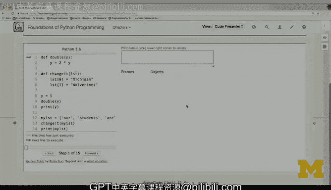
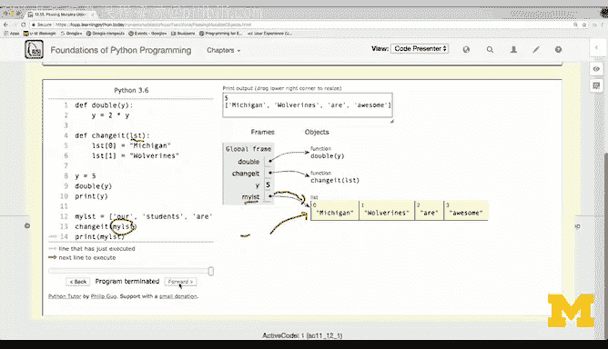

# 课程1：Python 3 编程 | P135：可变对象与副作用 🧠




在本节课中，我们将要学习函数中一个需要仔细理解的概念：**副作用**。我们将探讨当函数修改可变对象（如列表或字典）时会发生什么，以及如何理解变量作用域与对象共享之间的区别。

---

## 可变对象与副作用

上一节我们介绍了函数的基本概念和变量作用域。本节中我们来看看当函数操作可变对象时可能产生的**副作用**。

函数的主要作用是返回一个值，这被称为**主效应**。任何函数产生的其他持久性影响，则被称为**副作用**。这通常包括：
*   修改一个可变对象（如列表、字典）的内容。
*   在输出窗口中打印信息。

### 变量是局部的，对象是共享的

首先，我们通过一个例子回顾变量作用域的局部性。

```python
def double(y):
    y = 10

y = 5
double(y)
print(y)  # 输出：5
```

在这个例子中：
1.  全局变量 `y` 被赋值为 `5`。
2.  调用 `double(y)` 时，创建了一个新的栈帧，其形参 `y` 被赋值为传入的 `5`。
3.  在 `double` 函数内部，局部变量 `y` 被重新赋值为 `10`。**这个操作只影响函数栈帧内的局部变量 `y`**。
4.  函数返回后，打印全局变量 `y`，其值仍然是 `5`。

这印证了：**变量是局部的**。修改函数内的局部变量不会影响全局变量。

然而，关键在于：**变量是局部的，但对象不是**。如果局部变量和全局变量指向（引用）的是**同一个可变对象**，那么在函数内修改这个对象，其变化将在函数外持续存在。

让我们看一个修改列表的例子：

```python
def change_it(lst):
    lst[0] = "Michigan"
    lst[1] = "Wolverines"

my_list = ["Our", "students", "are", "awesome."]
change_it(my_list)
print(my_list)  # 输出：['Michigan', 'Wolverines', 'are', 'awesome.']
```

以下是执行过程的解析：
1.  在全局作用域，变量 `my_list` 指向一个列表对象 `["Our", "students", "are", "awesome."]`。
2.  调用 `change_it(my_list)` 时，形参 `lst` 被赋值为 `my_list` 的值，即**指向同一个列表对象**。此时，`my_list` 和 `lst` 是两个不同的变量，但它们是**同一个列表对象的别名**。
3.  在函数内部，通过 `lst[0]` 和 `lst[1]` 修改了该列表对象前两个元素的值。
4.  函数执行完毕后，虽然局部变量 `lst` 已不存在，但列表对象本身已被修改。全局变量 `my_list` 仍然指向这个已被修改的对象。

因此，`change_it` 函数产生了**副作用**：它修改了传入的列表对象。

### 如何对待副作用

以下是关于副作用的一些重要注意事项：

*   **可能造成混淆**：当多个变量引用同一对象时，在某一处修改对象可能会在意料之外的地方引发问题，增加调试难度。
*   **最佳实践**：在编写函数时，应尽可能避免产生副作用。这种完全避免副作用的编程风格称为**函数式编程**。
*   **灵活运用**：Python 语言本身支持副作用。有时为了便捷，我们会有意识地、谨慎地使用副作用，但必须清楚其影响。

---



本节课中我们一起学习了函数**副作用**的概念。我们明确了修改局部变量与修改共享对象之间的关键区别：修改局部变量不影响外部，但通过别名修改共享的可变对象会产生持久影响。理解这一点对于编写可预测、易调试的代码至关重要。在后续编程中，请有意识地管理你的函数对数据产生的影响。