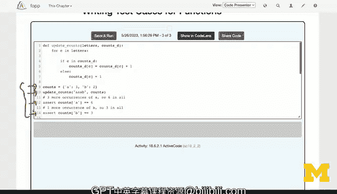

# 136：函数测试用例设计 🧪


在本节课中，我们将学习如何为编写的函数设计测试用例。通过编写测试，我们可以验证函数是否被正确实现，确保其按预期工作。

## 概述

编写函数时，为其编写测试用例以确保实现正确是一个好习惯。我们可以使用断言语句来实现这一点。本节将介绍如何设计两种主要的测试：返回值测试和副作用测试。

## 函数的行为类型

在思考如何测试函数之前，我们需要了解函数运行时可能产生的三种行为。

首先，函数可以返回一个值。对于这类函数，我们将编写**返回值测试**。

其次，函数可以修改某些可变对象（如列表或字典）的内容。对于这类函数，我们将编写**副作用测试**。

第三，函数可以打印输出或将内容写入文件。测试这类行为的正确性超出了我们当前介绍的测试框架范围，因此本节课不涉及此类测试。

## 返回值测试

为了检查函数是否计算出正确的输出，我们将编写所谓的**返回值测试**。其基本思想是，断言函数在给定特定输入时，会产生我们期望的输出。

例如，我们可以断言 `square(3)` 应该等于 `9`。

```python
assert square(3) == 9
```

在Python中，`assert` 语句并非使某事成真，而是检查其是否为真。如果为真，则无事发生；如果为假，则会引发运行时错误。

假设我在实现中犯了错误，让函数返回 `x` 而不是 `x * x`。那么运行此代码时，我会得到一个断言错误，因为 `square(3)` 将返回 `3`，而不是 `9`。

### 如何选择测试输入

选择哪些输入进行返回值测试是一门艺术，而非精确的科学。我们无法测试函数对所有可能输入是否都产生正确输出，因此必须选择一些有代表性的输入。我们希望如果函数对这些代表性输入能正确处理，那么它对其余输入也能正确处理。

我建议首先从一个简单的输入开始。对于 `square` 函数，可以是 `2` 或 `3`。

```python
assert square(2) == 4
```

但仅凭一个简单输入可能无法发现所有错误。例如，如果我错误地将函数实现为返回 `x + x`，那么 `square(2)` 的测试仍会通过，因为 `2 + 2 = 4`。

因此，在测试了基本输入（如 `2`）之后，接下来应该尝试一些**边界情况**的输入。

例如，尝试 `0`。`0` 的平方应该是 `0`。

```python
assert square(0) == 0
```

再尝试 `1`。`1` 的平方应该是 `1`。

```python
assert square(1) == 1
```

如果我的错误实现是 `x + x`，那么 `square(1)` 的断言将会失败，因为我期望得到 `1`，但实际得到 `2`。

选择测试用例的另一个方法是思考哪些地方**可能出错**。例如，两个负数相乘得到正数这个概念有时会让人困惑。虽然不担心Python解释器会搞错，但为了保险起见，可以测试负数的平方。

```python
assert square(-2) == 4
assert square(-3) == 9
```

通过运行所有这些测试用例，如果它们全部通过，我们就有足够的信心认为 `square` 函数已被正确实现。

## 副作用测试

如果函数具有副作用，我们的测试就需要不止一行代码。我们需要设置一个指向某个可变对象的变量，然后调用函数，最后编写断言语句来检查该变量的值是否被正确修改。

例如，我们之前见过一个函数，它接收一个字符串并生成一个字典，其中字母作为键，频率计数作为值。这里有一个该函数的版本，我们需要为其编写测试。

以下是编写副作用测试的步骤：

1.  设置一个变量，指向一个可变对象（如字典）。
2.  调用函数，并传入该变量（即该可变对象）。
3.  编写一个或多个断言语句，检查该变量的值是否被正确更改。

```python
# 设置初始字典
counts = {‘a‘: 3, ‘b‘: 2}
# 调用函数
update_counts(counts, “aaab“)
# 断言检查结果
assert counts[‘a‘] == 6  # 初始3个a + 新出现的3个a
assert counts[‘b‘] == 3  # 初始2个b + 新出现的1个b
```

第8行到第13行共同构成了一个副作用测试。第8行设置变量，第9行调用 `update_counts` 函数，其余行则断言函数执行后 `counts` 的状态。

运行此测试时，如果 `update_counts` 函数没有按预期工作，我们会在断言行收到错误，从而知道函数实现有问题。

### 如何设计副作用测试用例

与返回值测试类似，设计副作用测试用例也有几种思路。

第一种思路是考虑**边界情况**。

*   **边界情况一**：初始计数字典为空。
    ```python
    counts = {}
    update_counts(counts, “aaab“)
    assert counts[‘a‘] == 3
    assert counts[‘b‘] == 1
    ```
*   **边界情况二**：传入的字符串为空。
    ```python
    counts = {‘a‘: 3, ‘b‘: 2}
    update_counts(counts, ““)
    assert counts[‘a‘] == 3  # 没有新的a出现
    assert counts[‘b‘] == 2  # 没有新的b出现
    ```

第二种思路是想象**可能出错的地方**。例如，如果我们担心函数内部和外部使用了相同的变量名会导致问题（虽然在Python中通常不会），可以专门为此设计一个测试用例。

```python
# 使用与函数内部形参相同的变量名
counts_d = {‘a‘: 3, ‘b‘: 2}
update_counts(counts_d, “aaab“)
assert counts_d[‘a‘] == 6
assert counts_d[‘b‘] == 3
```

通过编写多个测试用例（一个典型输入用例，多个边界情况用例，以及多个针对想象中可能出错场景的用例），我们可以更全面地验证函数。

## 调试与修正

当我们运行测试并发现错误时（例如之前的 `update_counts` 函数在某个断言失败），就需要调试代码。

分析原 `update_counts` 函数的逻辑：它遍历字符串中的每个字母 `c`，并执行 `counts_d[c] = 1`，然后检查 `c` 是否在字典中并递增。问题在于，即使字母已存在，它也会先被重置为 `1`，这导致了错误。

修正方法是将设置初始值 `1` 的代码移到 `else` 子句中，即仅当字母不在字典中时才将其值设为 `1`。修正后，重新运行所有测试，如果不再出现错误，则说明修正成功，并且我们对函数的正确性有了更高的信心，因为我们针对多种情况进行了验证。

## 总结

本节课我们一起学习了如何为函数设计测试用例。

*   **返回值测试**可以在一行内完成，使用 `assert` 语句断言函数在特定输入下的输出是否符合预期。
*   **副作用测试**则需要多行代码：一行用于将可变对象赋值给变量，一行用于调用函数并传入该变量，然后是一行或多行断言语句来检查该对象的状态变化。

我们探讨了如何选择测试输入，包括典型输入、边界情况输入以及可能揭示错误的特殊输入。虽然为小段代码编写测试可能看起来有些繁琐，但当程序变得复杂时，拥有这些自动化测试将非常有帮助，它能确保你在修改代码时不会意外破坏其他功能。



通过系统地编写和运行测试，我们可以更自信地确保代码质量。