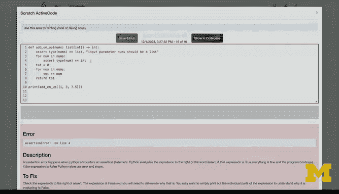

# 课程1：Python 3编程 | P137：程序员之道：使用断言强制函数参数类型 🔧


## 概述

在本节课中，我们将学习如何使用Python的`assert`语句来强制函数参数的类型。Python虽然提供了类型注解功能，但它本身并不强制执行这些类型。通过使用`assert`语句，程序员可以主动检查参数类型，从而在程序执行早期发现潜在错误，使调试过程更加清晰和高效。

---

## 类型注解与强制执行

上一节我们介绍了Python的类型注解功能。本节中我们来看看如何主动强制执行这些类型约定。

Python允许为变量和函数参数添加类型注解，例如指明某个参数应为列表。然而，这些注解仅是提示，解释器在运行时并不会检查类型是否匹配。

```python
def add_them_up(nums: list[int]) -> int:
    total = 0
    for num in nums:
        total = total + num
    return total
```

以上函数`add_them_up`的注解表明，参数`nums`应是一个整数列表，函数返回一个整数。在正常情况下，传递正确的参数可以顺利运行。

```python
print(add_them_up([1, 3, 5]))  # 输出：9
```

但是，如果传递了错误类型的参数，例如一个字符串，程序会在执行到加法操作时抛出错误。

```python
print(add_them_up("hello"))  # 这将导致 TypeError
```

此时产生的错误信息指向内部的加法逻辑，而非清晰地指出根本问题是参数类型错误。

---

## 使用断言进行类型强制

为了使错误更早、更清晰地暴露出来，我们可以在函数开始处使用`assert`语句来检查参数类型。

以下是使用断言检查参数是否为列表的方法：

```python
def add_them_up(nums: list[int]) -> int:
    assert isinstance(nums, list), "输入参数 nums 应该是一个列表。"
    total = 0
    for num in nums:
        total = total + num
    return total
```

现在，如果传递一个字符串作为参数，程序会立即在断言处失败，并显示我们自定义的清晰错误信息，明确指出“输入参数 nums 应该是一个列表”。

---

## 增强断言检查

为了确保代码更加健壮，我们还可以进一步检查列表内的每个元素是否都是整数。

以下是检查列表中每个元素类型的断言示例：

```python
def add_them_up(nums: list[int]) -> int:
    assert isinstance(nums, list), "输入参数 nums 应该是一个列表。"
    for num in nums:
        assert isinstance(num, int), "列表中的所有元素都应该是整数。"
    total = 0
    for num in nums:
        total = total + num
    return total
```

通过这个增强的检查，即使传递的列表包含一个浮点数（如`[1, 2, 3.5]`），程序也会在断言处立即失败，提示“列表中的所有元素都应该是整数”，从而避免了后续可能出现的隐蔽计算错误。

---

## 断言的作用与局限性

需要明确的是，`assert`语句本身并不解决程序中的逻辑问题。它的作用是将那些难以发现和诊断的潜在问题，转化为更及时、更易于理解的错误提示。

断言是一种给程序员使用的调试和开发辅助工具。它强制程序在执行偏离预期时立即发出警报。最终，解决问题仍然需要程序员确保调用函数时传递了正确类型的参数。

---

## 总结



本节课中我们一起学习了如何使用`assert`语句来强制函数参数的类型。我们了解到，虽然Python的类型注解不具强制性，但通过主动添加断言检查，我们可以在错误发生时获得更清晰、更即时的反馈，从而提升代码的可靠性和可维护性。记住，断言是辅助我们发现问题的工具，确保数据正确性的责任最终在于程序员自身。