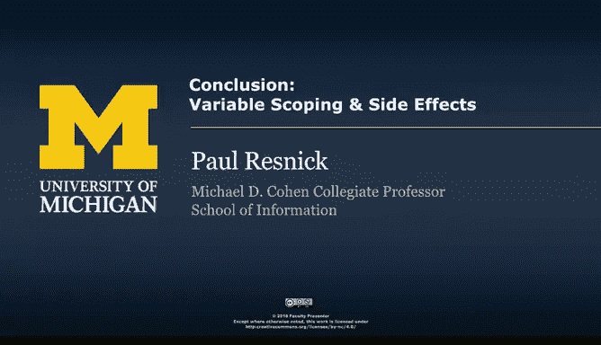

# 课程1、2：Python 3编程 - P138：变量作用域与副作用总结 🧠

在本节课中，我们将总结关于函数参数传递、变量作用域以及函数副作用的核心概念。你将学习如何避免使用全局变量，如何设计更安全、更清晰的函数，并理解函数式编程的一些基本思想。

---


## 概述

你已经了解了传递参数的一些微妙之处、访问全局变量的风险、函数间的相互调用，以及函数可能产生的副作用。本节课程将对这些知识点进行总结，并提供最佳实践指导。



---

## 避免使用全局变量

上一节我们介绍了参数传递的机制，本节中我们来看看如何避免使用全局变量。全局变量会使代码难以理解和调试，因为它们可以在程序的任何地方被修改。

最佳实践是：**为函数所需的所有值创建形式参数**。这意味着函数应该通过参数明确地接收其运行所需的所有数据，而不是从外部作用域隐式地获取。

**代码示例：避免全局变量**
```python
# 不推荐：使用全局变量
global_counter = 0

def increment_bad():
    global global_counter
    global_counter += 1

# 推荐：通过参数传递值
def increment_good(counter):
    return counter + 1

my_counter = 0
my_counter = increment_good(my_counter)
```

通过参数传递数据，可以使函数的依赖关系更清晰，也更容易进行单元测试。

---

## 识别与管理函数副作用

函数除了返回值，还可能对外部环境产生影响，这就是“副作用”。常见的副作用包括修改传入的列表或字典、打印信息、读写文件等。

以下是识别函数副作用的关键点：
*   **修改可变对象**：如果函数修改了传入的列表（`list`）或字典（`dict`）的内容，这就是一个副作用。
*   **改变全局状态**：修改函数作用域之外的变量。
*   **执行I/O操作**：如打印到屏幕、读写文件或数据库。

虽然某些副作用是必要的（如保存数据），但应尽可能将其最小化。理想情况下，函数应该像一个数学函数：**给定相同的输入，总是产生相同的输出，并且不改变外部世界**。这被称为“纯函数”。

**代码示例：有副作用的函数与纯函数**
```python
# 有副作用：原地修改了传入的列表
def add_item_side_effect(shopping_list, item):
    shopping_list.append(item) # 副作用：修改了外部列表

my_list = ['apple', 'banana']
add_item_side_effect(my_list, 'orange')
print(my_list) # 输出：['apple', 'banana', 'orange']

# 纯函数：返回一个新列表，不修改原列表
def add_item_pure(shopping_list, item):
    new_list = shopping_list.copy() # 创建副本
    new_list.append(item)
    return new_list # 返回新列表，原列表不变

my_list = ['apple', 'banana']
new_list = add_item_pure(my_list, 'orange')
print(my_list) # 输出：['apple', 'banana'] (未改变)
print(new_list) # 输出：['apple', 'banana', 'orange']
```

我鼓励你尽可能避免副作用，让你的代码尽可能接近严格的函数式编程风格。这能提高代码的可预测性和可维护性。

---

## 总结

本节课中我们一起学习了函数设计的两个重要原则。

首先，我们强调了避免使用全局变量的重要性，应通过参数向函数传递所有必要的数据。

其次，我们深入探讨了函数副作用。你现在应该能够识别一个函数是否具有副作用，特别是那些对列表和字典的修改操作。尽可能编写没有副作用的纯函数，是写出健壮、可靠代码的关键。


（关于函数式编程，为什么那个函数式程序员退掉了她的电视？因为她总是无意中按下静音键[`mute`]，她退掉电视，想要一台不可变[`immutable`]的。好吧，这个笑话有点牵强。）

我们下次再见。