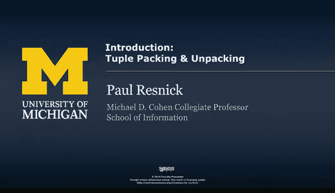

# 课程51：元组打包与解包导论 🧩

在本节课中，我们将学习Python中一个非常实用的特性：元组的打包与解包。这个特性本身不会让你实现新的功能，但它能让你的代码变得更加简洁和易读。

## 概述

上一节我们探讨了元组的基本概念。本节中，我们来看看如何利用Python的语法特性，优雅地处理多个值的打包与解包。


## 什么是打包与解包？

在Python中，**打包**指的是将多个值组合成一个元组。**解包**则是将一个元组（或其他可迭代对象）中的值分别赋给多个变量。



### 元组打包

当你用逗号分隔多个值时，Python会自动将它们打包成一个元组。这个过程通常是隐式发生的。

以下是打包的一个简单示例：
```python
# 隐式打包：三个值被打包成一个元组
my_tuple = 1, 2, 3
print(my_tuple)  # 输出：(1, 2, 3)
print(type(my_tuple))  # 输出：<class 'tuple'>
```

### 元组解包

解包允许你将一个元组中的元素分别赋值给多个变量。

以下是解包的一个简单示例：
```python
# 定义一个元组
coordinates = (10, 20)
# 解包元组，将值分别赋给两个变量
x, y = coordinates
print(f"x: {x}, y: {y}")  # 输出：x: 10, y: 20
```

## 打包与解包的应用场景

### 1. 从函数返回多个值

这是打包与解包最常用的场景之一。函数可以返回一个被打包的元组，调用者可以轻松地解包这些值。

以下是一个应用示例：
```python
def get_min_max(numbers):
    """返回列表中的最小值和最大值。"""
    return min(numbers), max(numbers)  # 隐式打包成元组

# 调用函数并解包返回值
data = [4, 2, 9, 7]
lowest, highest = get_min_max(data)  # 解包
print(f"最小值：{lowest}, 最大值：{highest}")
```

### 2. 交换两个变量的值

无需使用临时变量，利用解包可以一行代码交换两个变量的值。

以下是一个应用示例：
```python
a = 5
b = 10
print(f"交换前：a={a}, b={b}")

# 利用元组打包与解包交换值
a, b = b, a  # 右侧(b, a)打包成元组，然后解包赋值给左侧
print(f"交换后：a={a}, b={b}")
```

## 注意事项

在使用解包时，左侧变量的数量必须与右侧可迭代对象中元素的数量严格一致，否则会引发 `ValueError`。

以下是一个错误示例：
```python
# 这会导致 ValueError: too many values to unpack
x, y = (1, 2, 3)
# 这会导致 ValueError: not enough values to unpack
x, y, z = (1, 2)
```

## 总结


本节课我们一起学习了Python中元组的打包与解包功能。
*   **打包**：将多个值隐式组合成元组，常用于函数返回多个值。
*   **解包**：将元组中的元素分别赋值给多个变量，使代码更简洁，例如交换变量值。

掌握这个特性能让你的代码更加Pythonic（符合Python风格），更易于阅读和维护。