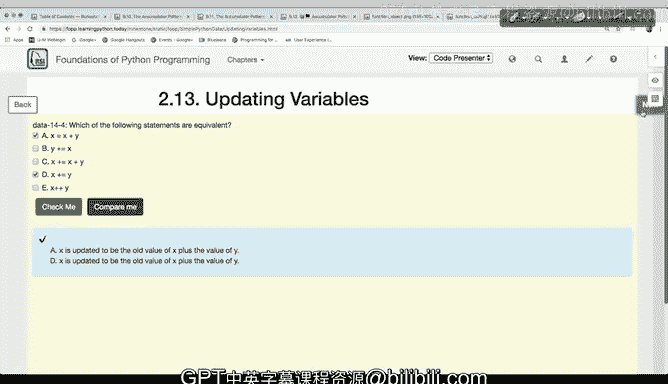

# 课程1：Python 3编程 - P14：变量更新 🔄


在本节课中，我们将要学习Python中一个非常核心的概念：**变量更新**。我们将了解如何改变一个变量所存储的值，并学习一些简化这一操作的快捷语法。

---

## 变量赋值回顾

上一节我们介绍了如何为变量赋值。例如，以下代码将变量 `x` 赋值为 `6`：

```python
x = 6
```

你可以想象存在一个“变量-值”对应表。执行上述赋值后，这个表会记录：`x` 指向 `6`。因此，如果我们打印 `x` 的值，将会得到 `6`。

---

## 变量的更新操作

本节中我们来看看如何更新一个变量的值。请看以下代码：

```python
x = 6
print(x) # 输出 6
x = x + 1
print(x) # 输出 7
```

第三行代码 `x = x + 1` 初看可能像是一个矛盾。但Python是这样执行的：
1.  首先，计算表达式 `x + 1` 的值。此时 `x` 是 `6`，所以表达式结果为 `7`。
2.  然后，将这个结果（`7`）作为新的值，重新赋值给变量 `x`。

因此，`x` 的值从 `6` 更新为了 `7`。第四行打印时，自然输出 `7`。

---

## 增量赋值快捷语法

像 `x = x + 1` 这样，在变量原值基础上进行运算并重新赋值的操作非常常见。为此，Python提供了一种更简洁的快捷语法。

以下是使用快捷语法的示例：

```python
x = 6
print(x) # 输出 6
x += 3   # 等同于 x = x + 3
print(x) # 输出 9
x -= 1   # 等同于 x = x - 1
print(x) # 输出 8
```

`x += 3` 是 `x = x + 3` 的快捷写法。它让我们只需写一次变量名，代码更简短，尤其在变量名很长时非常有用。

我们可以对变量进行任意次数的更新：

```python
s = 1
s += 2  # s 变为 3
s += 3  # s 变为 6
s += 4  # s 变为 10
print(s) # 输出 10
```

在本课程后续内容中，你还会学到更简洁的方法来完成类似操作。

---

## 练习题解析

以下是几个练习题，帮助我们巩固理解。

**问题1：以下代码输出什么？**
```python
x = 12
x = x - 1
print(x)
```
**解析**：`x` 初始为 `12`。`x = x - 1` 计算 `12 - 1` 得到 `11`，并将 `11` 赋给 `x`。因此输出 **11**。

**问题2：以下代码输出什么？**
```python
x = 12
x = x - 3
x = x + 5
x = x + 1
print(x)
```
**解析**：
1.  `x = 12 - 3` → `x` 变为 `9`
2.  `x = 9 + 5` → `x` 变为 `14`
3.  `x = 14 + 1` → `x` 变为 `15`
因此输出 **15**。

**问题3：如何构造代码，使最终打印出 `134`？**
```python
my_bank_balance = 100
my_bank_balance += 34
print(my_bank_balance)
```
**解析**：必须首先创建变量并赋初值（如 `100`），然后才能使用 `+=` 进行更新。最终 `my_bank_balance` 的值为 `134`。

**问题4：以下哪些语句与 `x = x + y` 等价？**
A. `x = x + y`
B. `y = x + y`
C. `x += x + y`
D. `x += y`
E. `x =+ y`

**解析**：
- A 是原句。
- B 更新的是 `y`，不等价。
- C 相当于 `x = x + (x + y)`，不等价。
- D (`x += y`) 是 `x = x + y` 的快捷写法，**等价**。
- E 语法无效。
因此，**A 和 D 是等价的**。

---

## 总结



本节课中我们一起学习了Python中**变量更新**的核心操作。我们明白了 `x = x + 1` 这样的语句是如何工作的，并掌握了 `+=` 和 `-=` 这类**增量赋值运算符**，它们能让代码更加简洁。记住，更新变量前，必须确保该变量已经被初始化（即已被赋值）。