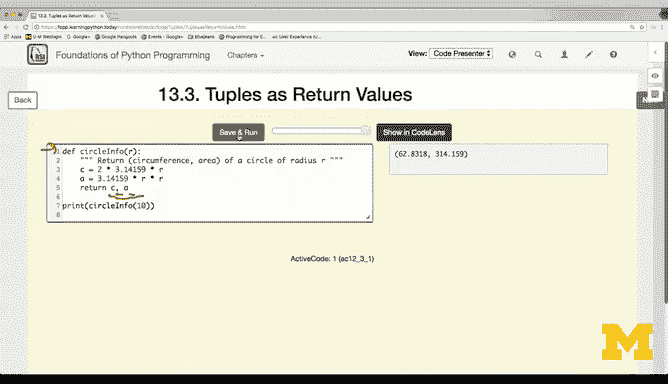

# 141：元组打包操作 📦


在本节课中，我们将要学习Python中的一个便捷特性——元组打包操作。这个特性允许我们在某些情况下省略显式的括号，让代码看起来更简洁。

## 概述

在许多Python解释器期望接收单个值的场景中，如果代码提供了多个由逗号分隔的表达式，解释器会自动将这些值打包成一个元组。这是一种语法上的便利，它让代码看起来像是在处理多个值，而实际上只是将它们组合成了一个元组。

## 元组打包的语法

上一节我们介绍了元组的基本概念，本节中我们来看看打包操作的具体语法。

通常，我们使用括号来创建一个元组，例如：

```python
# 显式使用括号创建元组
actor_info = ("Julia Roberts", 1967, "Duplicity", 2009, 80.5)
```

然而，Python允许我们省略括号，直接通过逗号分隔值来创建元组：

```python
# 省略括号，通过逗号分隔值来创建元组（打包操作）
actor_info = "Julia Roberts", 1967, "Duplicity", 2009, 80.5
```

以上两行代码的功能完全相同。第二行代码虽然没有括号，但Python解释器会自动将这一系列值“打包”成一个元组。

## 访问打包后的元组

创建元组后，我们可以像访问任何元组一样访问其元素。以下是访问元组元素的示例：

```python
# 创建元组（使用打包操作）
julia = "Julia Roberts", 1967, "Duplicity", 2009, 80.5

# 访问元组中的第五个元素（索引为4）
print(julia[4])  # 输出: 2009
```

## 在函数返回中的应用

元组打包操作在函数需要返回多个值时尤其有用。因为Python函数只能返回一个值，但我们可以通过返回一个元组来“打包”多个值。

以下是使用元组打包返回多个值的函数示例：

```python
import math

def circle_info(radius):
    """计算圆的周长和面积"""
    circumference = 2 * math.pi * radius
    area = math.pi * radius * radius
    # 使用打包操作返回一个包含两个值的元组
    return circumference, area

# 调用函数
result = circle_info(10)
print(result)  # 输出: (62.83185307179586, 314.1592653589793)
```

我们也可以选择显式地使用括号，效果是一样的：

```python
def circle_info_explicit(radius):
    circumference = 2 * math.pi * radius
    area = math.pi * radius * radius
    # 显式使用括号返回元组
    return (circumference, area)

# 输出结果相同
print(circle_info_explicit(10))
```

## 总结



本节课中我们一起学习了Python的元组打包操作。我们了解到，在提供多个由逗号分隔的值时，Python会自动将它们打包成一个元组，即使我们省略了括号。这个特性让代码更简洁，特别是在函数需要返回多个值时非常有用。下一节课，我们将学习与打包操作相对应的“解包”操作。