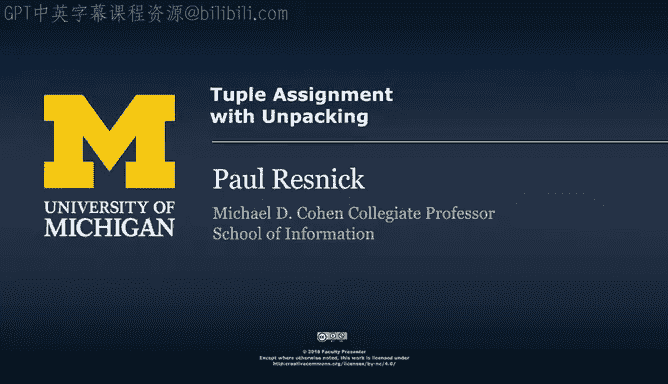
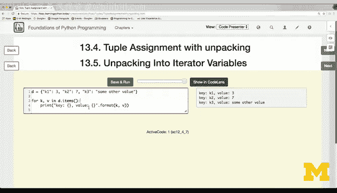

# 密歇根大学《Python3编程》课程1、2｜P141：元组解包赋值 📦➡️👤




## 概述

在本节课中，我们将要学习Python中一个非常实用的特性：**元组解包赋值**。我们将了解如何将元组中的多个值一次性分配给多个变量，以及这个技巧如何让我们的代码变得更简洁、更易读。

---

## 元组解包的基本概念

上一节我们介绍了元组的打包，本节中我们来看看它的逆操作——解包。

在赋值语句的右侧，用逗号分隔的多个表达式会自动打包成一个元组。例如：
```python
Julia = ("Julia", "Roberts", 1967, "Duplicity", 2009, "Actress")
```
变量 `Julia` 被绑定到了一个元组。我们可以用 `Julia[0]` 访问第一个元素，`Julia[1]` 访问第二个元素，依此类推。

但是，与其使用方括号索引来引用元组的元素，我们可以一次性将它们解包到一系列不同的变量名中。

以下是元组解包的基本语法：
```python
name, surname, birth_year, movie, movie_year, profession = Julia
```
这行代码的效果等同于：
```python
name = Julia[0]
surname = Julia[1]
# ... 以此类推
```
它会取出元组 `Julia` 中的所有值，并按照位置顺序，将第一个值赋给第一个变量名，第二个值赋给第二个变量名，就像我们调用函数时传递参数一样。

**核心规则**：赋值语句左侧的变量名数量必须等于右侧值的数量。

例如，以下代码会引发错误：
```python
a, b, c, d = 1, 2, 3  # 错误：需要解包的值不足（有4个变量，但只有3个值）
a, b = 1, 2, 3        # 错误：需要解包的值过多（有2个变量，但有3个值）
```

---

## 在函数调用中使用解包

元组解包在函数调用中尤其有用。我们可以将一个元组传递给函数，并让它自动解包到函数的参数中。

假设我们定义了一个简单的加法函数：
```python
def add(x, y):
    return x + y
```
我们可以这样调用它：
```python
result = add(3, 4)  # result 为 7
```
现在，如果我们有一个元组 `z = (5, 4)`，我们可以使用星号 `*` 来告诉Python解释器，我们希望将元组 `z` 解包，并将其分量分配给两个参数 `x` 和 `y`：
```python
z = (5, 4)
result = add(*z)    # result 为 9
```
这里的 `*z` 表示：“即使 `z` 是一个单一的值（元组），你也应该解包它，将5赋给第一个参数，4赋给第二个参数。”

如果不使用星号，直接调用 `add(z)`，则会出错：
```python
add(z)  # 错误：add() 需要2个参数，但只给出了1个
```
因为解释器会尝试将整个元组 `(5, 4)` 作为一个值赋给第一个参数 `x`，然后发现没有值可以赋给第二个参数 `y`。

---

## 在循环迭代中应用解包

解包特性特别适用于让迭代代码更具可读性。例如，当遍历一个元组列表或字典的键值对时。

假设我们有一个字典：
```python
d = {'k1': 3, 'k2': 7, 'k3': 14}
```
我们可以使用 `d.items()` 来获取一个包含所有 `(键, 值)` 元组的序列。在循环中，每次迭代的 `p` 变量会绑定到其中一个元组。

以下是**不使用解包**的遍历方式：
```python
for p in d.items():
    print(f"key: {p[0]} value: {p[1]}")
```
这段代码可以运行，但阅读起来有点困难。你必须记住 `p[0]` 是键，`p[1]` 是值。

我们可以通过使用有意义的变量名来让代码更清晰。以下是分两步改进的方法：
```python
for p in d.items():
    k = p[0]  # 键
    v = p[1]  # 值
    print(f"key: {k} value: {v}")
```
使用 `k` 和 `v` 这样的变量名，能让我们立刻明白打印的是键和值。

有了这个思路，我们可以更进一步，让Python在循环中直接为我们解包：

以下是使用**元组解包**的简洁写法：
```python
for k, v in d.items():
    print(f"key: {k} value: {v}")
```
这行代码 `for k, v in d.items():` 会自动将每个 `(键, 值)` 元组解包到两个变量 `k` 和 `v` 中。它的结果与上面的代码完全相同，但更加简洁和优雅。

---

## 总结

本节课中我们一起学习了Python的**元组解包赋值**。

我们了解到：
1.  解包允许我们将一个元组中的多个值一次性分配给多个变量。
2.  解包时，左右两侧的元素数量必须严格相等。
3.  在函数调用中，可以使用星号 `*` 将元组解包为多个参数。
4.  在 `for` 循环中，对可迭代对象（如 `dict.items()` 的结果）使用解包，可以极大地提高代码的可读性和简洁性。




解包是一个强大的工具，它通过“幕后赋值”简化了代码，无论是显式的赋值语句、循环中的迭代变量，还是函数调用时的参数传递，都能让我们的Python编程体验更加流畅。