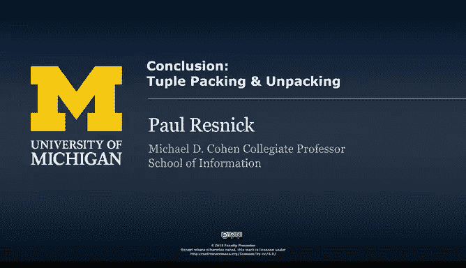

# 课程54：元组打包与解包总结 🧳

在本节课中，我们将要学习Python中元组的两个核心操作：**打包**与**解包**。我们将了解如何识别隐式元组打包，如何利用它从函数返回多个值，以及如何将元组解包到多个变量中。

---

## 识别隐式元组打包


上一节我们介绍了元组的基本概念，本节中我们来看看什么是隐式元组打包。



当Python代码在返回多个值时，实际上是将这些值自动组合成一个元组，这个过程称为**隐式元组打包**。你无需显式地使用圆括号 `()` 来创建元组。

**核心概念**：
```python
# 函数返回多个值时，Python会自动将其打包成一个元组
def get_coordinates():
    x = 10
    y = 20
    return x, y  # 隐式打包为 (10, 20)

result = get_coordinates()
print(result)  # 输出: (10, 20)
print(type(result))  # 输出: <class 'tuple'>
```

---

## 使用打包从函数返回多个值

理解了隐式打包的原理后，我们可以主动利用这一特性。

以下是使用隐式元组打包从函数返回多个值的步骤：
1.  在 `return` 语句中，用逗号分隔要返回的值。
2.  调用函数时，返回值会自动作为一个元组被接收。
3.  你可以直接使用这个元组，或将其解包到变量中。

**核心概念**：
```python
def calculate_statistics(numbers):
    total = sum(numbers)
    count = len(numbers)
    average = total / count
    return total, count, average  # 隐式打包

stats = calculate_statistics([1, 2, 3, 4, 5])
print(f"总和: {stats[0]}, 数量: {stats[1]}, 平均值: {stats[2]}")
```

---

## 将元组解包到多个变量

当我们获得一个打包好的元组后，通常希望将其中的值分配给独立的变量，这个过程就是**元组解包**。

以下是元组解包的方法：
1.  在赋值运算符左侧，列出与元组元素数量相等的变量名。
2.  变量之间用逗号分隔。
3.  Python会自动将元组中的每个值按顺序赋值给对应的变量。

**核心概念**：
```python
# 解包上面函数返回的元组
total_sum, num_count, avg_value = calculate_statistics([1, 2, 3, 4, 5])
print(f"总和: {total_sum}")  # 输出: 总和: 15
print(f"数量: {num_count}")  # 输出: 数量: 5
print(f"平均值: {avg_value}") # 输出: 平均值: 3.0
```

---

本节课中我们一起学习了Python元组的打包与解包。你学会了如何识别代码中的隐式元组打包，如何利用它从函数返回多个值，以及如何通过解包将元组元素优雅地分配给多个变量。这些技巧能让你的代码更加简洁和高效。