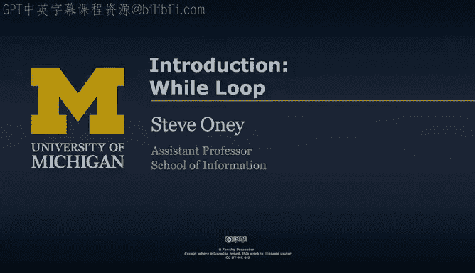

# 143：while循环导论 🔄

在本节课中，我们将要学习**不定次迭代**和 **`while` 循环**。你已经学习了 `for` 循环，它可以遍历序列中的每一个元素，并对每个元素执行一段代码。但是，我们可能还需要进行其他类型的迭代。


上一节我们介绍了 `for` 循环，本节中我们来看看 `while` 循环。



例如，假设你想编写一个程序，询问用户是否想继续，并要求他们输入“是”或“否”。我们知道如何执行一次这样的操作，但假设我们希望当用户输入其他内容时，能持续不断地询问他们，直到他们输入“是”或“否”为止。

我们无法预知需要询问用户多少次，因为这完全取决于用户的响应。因此，在这种情况下，`for` 循环就不适用了。

在本节课结束时，你将学会如何使用**不定次迭代**来解决这类以及更多其他类型的问题。我们将通过 **`while` 语句**来学习它。`while` 循环比 `for` 循环稍微复杂一些，但表达能力也更强。

我们还将扩展对 `for` 循环的认识，学习特殊的 **`break`** 和 **`continue`** 语句。这些语句既可用于 `for` 循环，也可用于我们即将学习的 `while` 循环，从而让我们能更精确地控制代码的执行时机。

那么，让我们开始吧。

---

## `while` 循环的基本结构

`while` 循环的核心思想是：**只要某个条件为真，就重复执行一段代码块**。其基本语法结构如下：

```python
while 条件:
    # 要重复执行的代码块
```

以下是 `while` 循环的工作流程：
1.  首先，检查 `条件` 是否为真。
2.  如果条件为真，则执行循环体内的代码。
3.  执行完循环体后，再次回到第一步，重新检查条件。
4.  如果条件变为假，则跳过循环体，继续执行循环之后的代码。

## `break` 与 `continue` 语句

为了更灵活地控制循环，Python 提供了两个关键语句：`break` 和 `continue`。

*   **`break` 语句**：用于**立即终止**当前所在的整个循环，并跳出循环体，继续执行循环之后的代码。
*   **`continue` 语句**：用于**跳过**当前循环迭代中剩余的代码，**直接进入下一次循环**的条件判断。

这两个语句在 `for` 循环和 `while` 循环中均可使用。

---

## 实践示例：用户输入验证

让我们回到开头的例子，用 `while` 循环来实现它。目标是持续询问用户，直到获得有效的“是”或“否”回答。

```python
while True:  # 创建一个“无限循环”
    response = input("你想继续吗？(输入 yes 或 no): ")
    if response == "yes":
        print("你选择了继续。")
        break  # 获得有效输入，跳出循环
    elif response == "no":
        print("你选择了停止。")
        break  # 获得有效输入，跳出循环
    else:
        print("无效输入，请重新输入。")
        # continue 语句在这里是隐式的，因为循环会自动回到开头
```

在这个例子中：
*   我们使用 `while True:` 创建了一个条件永远为真的循环（即“无限循环”）。
*   在循环体内，我们获取用户输入。
*   如果输入是 `"yes"` 或 `"no"`，我们执行相应操作，并使用 `break` 语句**跳出循环**。
*   如果输入是其他内容，我们提示用户重新输入，然后循环会自动回到开始，再次询问。

---

## 总结

本节课中我们一起学习了：
1.  **`while` 循环**：用于在条件为真时重复执行代码块，适用于迭代次数不确定的场景。
2.  **`break` 语句**：用于立即终止并跳出当前循环。
3.  **`continue` 语句**：用于跳过当前迭代的剩余代码，直接开始下一次循环。

通过结合 `while` 循环与 `break` 语句，我们可以有效地处理像用户输入验证这类需要反复尝试直到满足条件的问题。`while` 循环极大地扩展了我们在 Python 中处理迭代任务的能力。