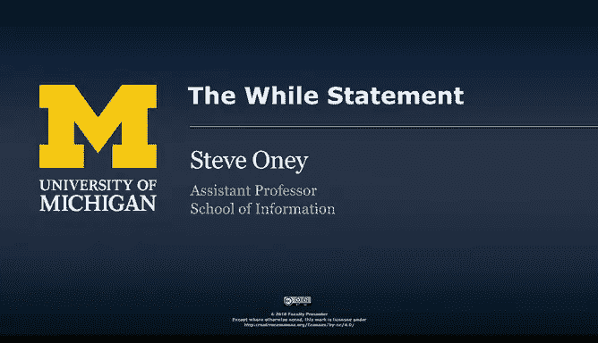
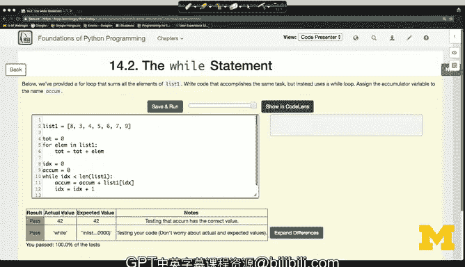

# 144：深入理解 `while` 循环 🔄




在本节课中，我们将要学习 `while` 循环。这是一种比 `for` 循环更通用的迭代方式，它结合了 `if` 语句的条件判断和 `for` 语句的循环特性。

## 概述 📋

你已经见过 `for` 循环，它可以遍历序列中的每一个元素。`while` 循环则是一种更通用的迭代方法。它有点像 `for` 语句和 `if` 语句的混合体。

## `while` 循环的基本结构 ⚙️

一个 `while` 循环的写法如下：首先写 `while`，然后像 `if` 语句一样，在后面跟一个条件表达式。接着是一段代码块，如果条件为真，这段代码就会执行。

但与 `if` 语句不同的是，在 `while` 循环中，当代码块执行完毕后，程序会回到顶部再次检查条件是否仍然为真。这种“回到顶部”的特性使它类似于 `for` 循环。

简单来说，流程是这样的：
1.  遇到 `while` 语句时，检查条件。
2.  如果条件为真，执行代码块。
3.  执行完毕后，回到顶部再次检查条件。
4.  如果条件不为真，则像 `if` 语句一样，跳过这个代码块，执行后面的代码。

## 代码示例：累加求和 🧮

让我们通过一个具体的例子来理解。下面的代码使用 `while` 循环来计算从 1 加到某个边界值（`bound`）的总和。

```python
def sum2(bound):
    sum = 0
    number = 1
    while number <= bound:
        sum = sum + number
        number = number + 1
    return sum

print(sum2(4))   # 输出：10 (1+2+3+4)
print(sum2(1000)) # 输出：一个很大的数
```

运行这段代码，`sum2(4)` 会正确输出 10。

## 代码执行过程详解 🔍

上一节我们看到了 `while` 循环的代码，本节我们来详细看看它的执行过程。我们将使用 `sum2(4)` 作为例子，逐步分析。

1.  **初始化**：函数调用时，`bound` 被赋值为 4。变量 `sum` 初始化为 0，用于记录当前总和。变量 `number` 初始化为 1，用于记录当前累加到哪个数字。
2.  **第一次循环**：
    *   检查条件：`number` (1) <= `bound` (4) 为真。
    *   执行代码块：`sum = 0 + 1`，`sum` 变为 1。`number = 1 + 1`，`number` 变为 2。
3.  **第二次循环**：
    *   检查条件：`number` (2) <= 4 为真。
    *   执行代码块：`sum = 1 + 2`，`sum` 变为 3。`number = 2 + 1`，`number` 变为 3。
4.  **第三次循环**：
    *   检查条件：`number` (3) <= 4 为真。
    *   执行代码块：`sum = 3 + 3`，`sum` 变为 6。`number = 3 + 1`，`number` 变为 4。
5.  **第四次循环**：
    *   检查条件：`number` (4) <= 4 为真。
    *   执行代码块：`sum = 6 + 4`，`sum` 变为 10。`number = 4 + 1`，`number` 变为 5。
6.  **循环结束**：
    *   再次检查条件：`number` (5) <= 4 为假。
    *   因此，跳过 `while` 循环的代码块，执行 `return sum`，返回结果 10。

通过这个过程，我们可以看到 `while` 循环如何通过条件控制和变量更新，一步步完成计算任务。

## 知识问答与练习 💡

理解了基本概念后，我们通过几个问题来巩固所学。

**问题 1：判断对错。任何 `for` 循环都可以用 `while` 循环重写。**

*   **答案：正确。** `while` 循环是一种更通用的迭代形式，能够表达 `for` 循环所能表达的一切，甚至更多。

**问题 2：编写一个 `while` 循环。**

要求：循环从 0 开始，到 15 结束。如果计数器是偶数，则将其追加到名为 `even_nums` 的列表中。

以下是实现代码：

```python
count = 0
even_nums = []
while count <= 15:
    if count % 2 == 0:  # 检查是否为偶数
        even_nums.append(count)
    count = count + 1
# 运行后，even_nums 为 [0, 2, 4, 6, 8, 10, 12, 14]
```

**问题 3：将 `for` 循环转换为 `while` 循环。**

下面是一个使用 `for` 循环对 `list1` 求和的代码：

```python
list1 = [8, 3, 4, 5, 6, 7, 9]
total = 0
for elem in list1:
    total = total + elem
```

请用 `while` 循环完成相同的任务，并将求和结果赋值给变量 `a_sum`。

转换策略是使用一个变量（如 `idx`）来跟踪当前元素的索引。

```python
list1 = [8, 3, 4, 5, 6, 7, 9]
a_sum = 0
idx = 0
while idx < len(list1):  # 当索引小于列表长度时循环
    a_sum = a_sum + list1[idx]  # 累加当前索引对应的元素
    idx = idx + 1  # 索引加1，指向下一个元素
# 循环结束后，a_sum 的值与 total 相同
```

**关键点解释**：
*   `idx` 初始化为 0，因为列表索引从 0 开始。
*   条件是 `idx < len(list1)` 而不是 `<=`，因为当 `idx` 等于列表长度时，已经超出了最后一个元素的索引（最后一个元素索引是 `len(list1)-1`）。

## 总结 🎯

本节课我们一起学习了 `while` 循环。
*   我们了解了 `while` 循环是结合了条件判断和循环迭代的通用结构。
*   我们通过一个累加求和的例子，详细剖析了 `while` 循环的执行流程。
*   我们通过问答和练习，掌握了 `while` 循环与 `for` 循环的关系，并实践了如何用 `while` 循环实现列表遍历和条件筛选。



`while` 循环为你提供了更灵活的流程控制能力，是编程中的重要工具。