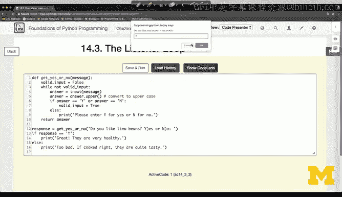

# 145：监听循环模式 🔄


在本节课中，我们将要学习一种在编程中非常常见的模式——监听循环。这种模式的核心思想是，程序会持续运行，直到接收到某个特定的输入或满足某个条件为止。它特别适用于那些我们无法预先知道循环需要执行多少次的情况。

## 什么是监听循环？ 🤔

监听循环是一种编程模式，它本质上会等待某些输入或某个特定值，然后才决定终止循环。

你只能在`while`循环中使用监听循环模式。因为根据定义，监听循环并不一定知道它需要运行多少次。即使在程序启动后，你也不知道`while`循环中的代码实际上需要执行多少次。

## 一个简单的例子：数字求和 ➕

以下是监听循环模式的一个典型应用：持续请求用户输入数字进行求和，直到用户输入0为止。

在运行这个程序之前，我们无法知道用户会输入多少个数字。因此，我们不能使用`for`循环，而必须使用`while`循环。我们需要设定条件：当用户输入的数字不等于0时，循环继续。

让我们来看一下这段代码：

```python
sum = 0
x = -1  # 初始化为-1，以确保能进入while循环

while x != 0:
    x = int(input("请输入下一个要相加的数字（输入0结束）："))
    sum = sum + x

print("所有数字的总和是：", sum)
```

在这段代码中：
1.  变量`sum`初始化为0，用于存储总和。
2.  变量`x`被初始化为-1。这样做的原因是，我们的`while`循环条件是`x != 0`。如果一开始就把`x`设为0，循环就会直接跳过。
3.  在`while`循环内部，我们将用户输入的值转换为整数并赋值给`x`。
4.  然后将`x`的值加到`sum`上。
5.  当用户输入0时，条件`x != 0`变为`False`，循环终止，程序打印出总和。

运行示例：
*   输入：10, 20, 0 → 输出：总和是 30。
*   输入：5, 4, 3, 2, 1, 0 → 输出：总和是 15。

Python 无法预知我们在输入0之前会输入多少个数字，这正是我们需要使用`while`循环的原因。这种模式被称为监听循环模式，我们在这里“监听”的特定输入是`x == 0`。

## 一个更复杂的例子：验证用户输入 ✅

上一节我们介绍了基本的求和监听循环。本节中我们来看看一个需要验证用户输入的场景。



在这段代码中，我们将询问用户是否喜欢利马豆，并要求他们输入`Y`（是）或`N`（否）。但问题是，用户可能会输入任何内容（数字、其他字母等）。我们真正需要的是确保他们只输入`Y`或`N`。

因此，我们要做的是：持续请求用户输入，直到他们输入一个有效的`Y`或`N`为止。当他们给出有效输入后，如果是`Y`，则打印“太好了，它们很健康”；如果是`N`，则打印“太可惜了”。

以下是实现此功能的核心函数`get_yes_or_no`：

```python
def get_yes_or_no():
    valid_input = False  # 初始化输入有效性为False

    while not valid_input:
        answer = input("你喜欢利马豆吗？(Y/N): ").upper()  # 将输入转换为大写

        if answer == 'Y' or answer == 'N':
            valid_input = True  # 输入有效，准备退出循环
        else:
            print("请输入 Y (是) 或 N (否)。")

    return answer  # 返回有效的输入

# 使用函数
user_answer = get_yes_or_no()
if user_answer == 'Y':
    print("太好了，它们很健康！")
else:
    print("太可惜了。")
```

这段代码的工作原理如下：
1.  我们创建一个变量`valid_input`来跟踪输入是否有效，并初始化为`False`。
2.  `while not valid_input:` 意味着只要输入无效，循环就继续。
3.  在循环内，请求用户输入并将其转换为大写（这样`y`和`n`也会被接受）。
4.  检查输入是否是有效的`Y`或`N`。
    *   如果是，将`valid_input`设为`True`。下次循环检查条件时，`not True`为`False`，循环终止，并返回用户的答案。
    *   如果不是，打印提示信息，然后循环回到顶部再次询问。此时`valid_input`仍为`False`，因此`not valid_input`为`True`，循环继续。

只要用户输入的不是`Y`或`N`，这个`while`循环就会一直要求他们重新输入。直到输入有效，函数才会返回。

## 总结 📝

本节课中我们一起学习了监听循环模式。
*   **监听循环**是一种使用`while`循环等待特定条件（通常是用户输入）来终止的编程模式。
*   它适用于**无法预知循环次数**的场景。
*   我们通过两个例子掌握了其应用：
    1.  **数字求和**：循环直到用户输入0。
    2.  **输入验证**：循环直到用户提供符合要求的有效输入（如`Y`或`N`）。


掌握这种模式对于编写交互式、健壮的程序至关重要。