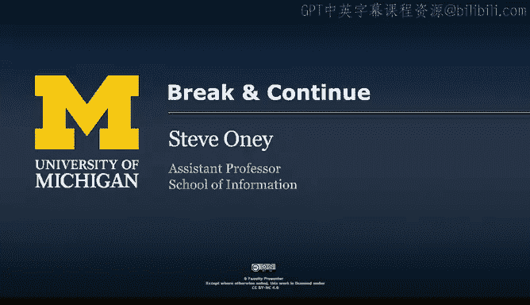
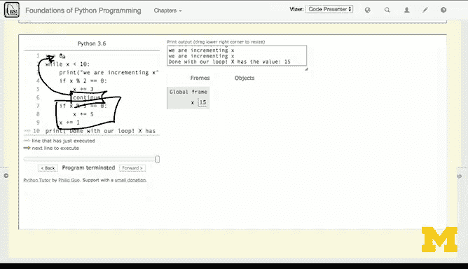
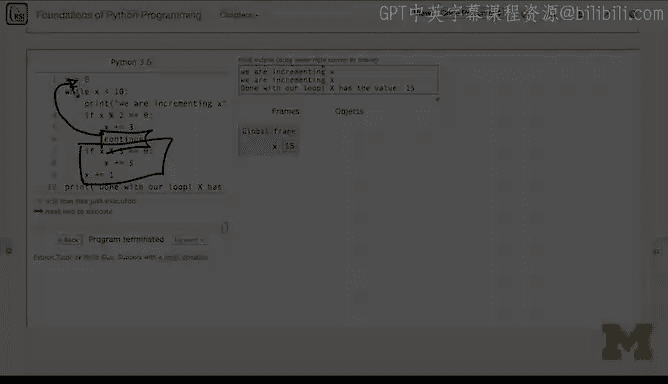

# 146：04_04 `break` 与 `continue` 控制 🔄




在本节课中，我们将要学习 `break` 和 `continue` 这两个特殊的语句。它们可以在 `while` 或 `for` 循环内部使用，用于改变循环的正常执行流程。

## 概述 📋

`break` 和 `continue` 是控制循环流程的关键字。理解它们的行为对于编写高效、无错误的循环代码至关重要。

## `break` 语句 🛑

`break` 语句会立即终止包含它的最内层循环。

当程序在循环内部遇到 `break` 语句时，Python 会立即跳出该循环。程序会从 `break` 语句所在的位置跳转到循环体之后的代码，并跳过循环体中剩余的所有语句，且不再检查循环条件。

**代码示例：**
```python
while True:
    print("这个短语总会打印")
    break
    print("这个短语会打印吗？")
print("while 循环结束")
```

在上面的例子中，尽管 `while` 的条件是 `True`，但 `break` 语句使得循环只执行一次就退出了。

## `continue` 语句 ⏭️

`continue` 语句会跳过当前循环迭代中剩余的语句，并立即开始下一次迭代。

与 `break` 不同，`continue` 不会终止整个循环，而是返回到循环的顶部，重新检查循环条件。如果条件为真，则继续执行下一次循环。

**代码示例：**
```python
while True:
    print("这个短语总会打印")
    continue
    print("这个短语会打印吗？")
print("while 循环结束")
```

在这个例子中，`continue` 语句导致程序陷入无限循环，因为每次执行到 `continue` 时，都会跳回循环开头，而条件 `True` 永远为真。

## 综合示例 🔄

上一节我们介绍了 `break` 和 `continue` 的基本概念，本节中我们来看一个更复杂的例子，以理解 `continue` 在实际循环中的工作方式。

以下是使用 `continue` 控制循环流程的示例代码：

```python
x = 0
while x < 10:
    print(f"正在递增 x: {x}")
    if x % 2 == 0:
        x = x + 3
        continue
    if x % 3 == 0:
        x = x + 5
    x = x + 1
print("循环结束")
print(f"x 的最终值是: {x}")
```

让我们逐步分析这段代码：
1.  `x` 初始值为 0。
2.  进入 `while` 循环，条件是 `x < 10`。
3.  打印当前 `x` 值。
4.  如果 `x` 是偶数（`x % 2 == 0`），则 `x` 加 3，并执行 `continue`。
5.  `continue` 语句使程序跳回循环顶部，跳过本次迭代中剩余的代码（即下面的 `if` 语句和 `x = x + 1`）。
6.  如果 `x` 不是偶数，则检查 `x` 是否能被 3 整除（`x % 3 == 0`）。如果是，则 `x` 加 5。
7.  最后，`x` 自增 1。
8.  循环继续，直到 `x` 不再小于 10。

运行此代码，`x` 的最终值会是 15。`continue` 语句确保了在特定条件下（`x` 为偶数时），循环体后半部分的逻辑不会被执行。

## 总结 🎯

本节课中我们一起学习了 `break` 和 `continue` 语句。

*   **`break`**：用于立即**终止**当前循环，跳出循环体。
*   **`continue`**：用于**跳过**当前循环迭代的剩余部分，立即开始**下一次**迭代。





合理使用这两个语句可以帮助你更精确地控制循环的逻辑，避免无限循环，并编写出更简洁、高效的代码。记住，`break` 是“打断并离开”，而 `continue` 是“跳过这次，继续下次”。