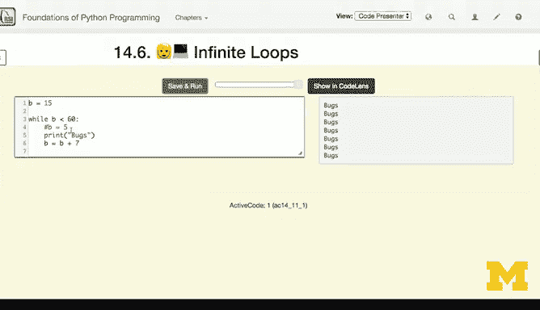

# 课程1：Python 3编程 | 第59讲：程序员之道 - 无限循环处理 🔄


在本节课中，我们将要学习`while`循环的一个重要概念：**无限循环**。我们将探讨无限循环是如何产生的，为什么它们会导致程序问题，以及如何识别和避免它们。

---

## 什么是无限循环？

上一节我们介绍了`while`循环比`for`循环更灵活，但同时也存在一些缺点。本节中我们来看看其中一个主要缺点：**无限循环**。

无限循环是指永远不会终止的循环。换句话说，如果条件允许，程序将永远运行下去。

每个`while`循环都有一个条件。当执行到循环体末尾时，程序会回到顶部检查该条件是否仍为真。这意味着，循环体内的代码必须有机会将条件从**真**变为**假**。如果条件始终为真，并且我们总是能执行完循环体，那么程序就会陷入无限循环。

在现实中，大多数解释器（包括本课程使用的环境）都有机制来防止代码运行过长时间，并能够中断无限循环。尽管如此，无限循环仍然令人困扰，因此学会识别它们非常重要。

---

## 一个无限循环的示例

以下是导致无限循环的代码示例：

```python
b = 15
while b < 60:
    b = 5
    print("bugs")
    b = b + 7
```

让我们分析一下这段代码为何会陷入无限循环。

首先，变量`b`被初始化为`15`。`while`循环的条件是`b < 60`，初始时条件为真，因此进入循环。

在循环内部，我们立即将`b`重新赋值为`5`。然后打印“bugs”，接着执行`b = b + 7`，将`b`的值增加到`12`。

问题在于，**每次循环迭代开始时，`b`的值都被重置为`5`**。因此，无论之后如何增加，`b`的值（`12`）始终小于`60`。这导致条件`b < 60`永远为真，循环永不停止。

---

## 如何识别和修复无限循环

以下是识别无限循环的几个关键点：

1.  **检查循环条件**：确保循环条件最终有机会变为假。
2.  **跟踪变量变化**：注意循环体内是否意外重置了用于控制循环的变量。
3.  **观察程序行为**：如果程序似乎“卡住”或无响应，可能陷入了无限循环。

要修复上面的示例，我们需要移除或修改导致变量被意外重置的代码行。例如，注释掉`b = 5`这一行：

```python
b = 15
while b < 60:
    # b = 5  # 这行代码导致b被重置，引发了无限循环
    print("bugs")
    b = b + 7
```

修改后，变量`b`将从`15`开始正常递增，直到不小于`60`，循环便会正常终止。

---

## 总结

本节课中我们一起学习了**无限循环**的概念。我们了解到，当`while`循环的条件永远无法变为假时，就会发生无限循环，这可能导致程序无响应或意外终止。

通过分析一个具体的代码示例，我们看到了因在循环内意外重置变量而导致的无限循环，并学习了如何通过仔细检查循环条件和变量变化来识别和修复此类问题。

随着编写`while`循环的经验增加，你将能更熟练地识别和避免无限循环。

---




本节内容到此结束，我们下次再见。