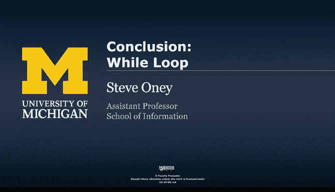
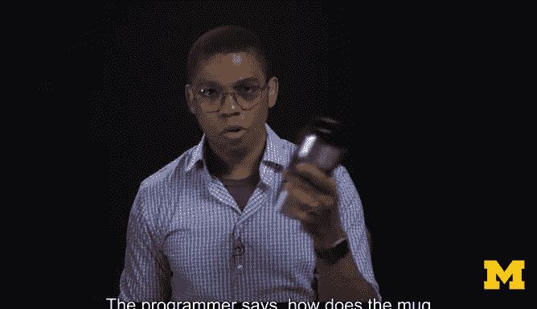

# 密歇根大学《Python3编程》课程1、2｜P148：60_04_06_while循环总结 🎬





## 概述

在本节课中，我们将要学习**不定次迭代**和 **`while`循环**。我们将探讨`while`循环的用途、优缺点，并通过一个有趣的例子来加深理解。

## 学习内容

本节课我们学习了不定次迭代和`while`循环。

## `while`循环的优缺点

虽然`while`循环存在一些缺点，例如比`for`循环更复杂，并且可能不小心创建出无限循环，但它允许我们表达一些用`for`循环无法实现的功能。

例如，如果我们不确定需要迭代多少次，那么我们很可能应该使用`while`循环。

以下是`while`循环的基本语法结构：

```python
while 条件:
    # 循环体代码
```

## 一个程序员的冷笑话

现在，讲一个冷笑话。一个程序员走进一家户外用品店，销售人员向他们展示了一个保温杯。

销售人员说：“这个杯子很神奇。如果你的饮料是热的，它会保持热；如果你的饮料是冷的，它会保持冷。”

然后销售人员把杯子递给程序员。程序员看着杯子，非常仔细地检查，审视了好几分钟，看起来非常、非常怀疑。

最后，程序员问道：“那么，它是怎么做到的？”

销售人员回答：“什么怎么做到的？”

程序员说：“这个杯子怎么知道是要保持饮料热还是冷？”



## 总结


本节课中我们一起学习了`while`循环的核心概念。我们了解到，`while`循环是实现不定次迭代的强大工具，适用于那些在编写代码时无法预知确切循环次数的场景。尽管使用它需要更谨慎以避免无限循环，但它极大地扩展了程序处理问题的能力。


本次内容到此结束。下次见。