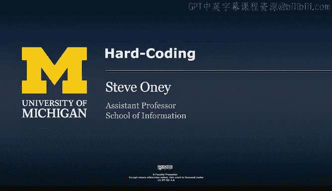
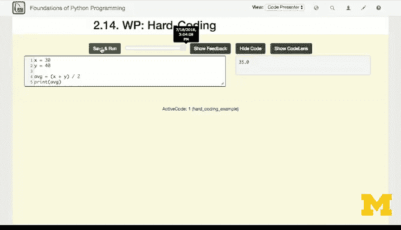

# 密歇根大学《Python3编程》课程1-2：第15课 - 避免硬编码 🚫




在本节课中，我们将要学习编程中的一个重要概念——“硬编码”。我们将通过一个生动的故事来理解它的含义，并通过具体的Python代码示例，学习如何避免在程序中硬编码答案，从而编写出更灵活、更通用的代码。

---

## 从童年故事说起

在深入讲解“硬编码”之前，我想先分享一个我童年时的故事。我有三个哥哥姐姐，当他们学习代数时，经常会遇到“求解X”、“求解Y”这类问题。

有一天，我无意中听到姐姐在电话里和朋友讨论一道数学题，他们正在尝试求解X的值。我听到姐姐说：“X的值是3。”

当时我听到这句话，以为自己发现了代数的秘密：X永远等于3。我以为从此以后，所有涉及X的问题，我都可以直接把3代进去。我觉得自己破解了密码，甚至不用再学代数了。

当然，如果你真的学过代数，就会知道X并不总是等于3。你必须每次都重新求解X的值。

我当时的那种想法，就是一种“硬编码”的思维，即认为X在所有问题中都是3。

---

## 什么是硬编码？

上一节我们通过一个故事引出了“硬编码”的概念。本节中，我们来看看在Python编程的语境下，它具体指什么。

在编程中，**硬编码**指的是不通过计算过程，而是直接写下答案的行为。

让我们通过一个例子来理解。假设我想写一个程序，计算并打印出变量`x`和`y`的平均值。

```python
x = 10
y = 20
```

如果我采用硬编码的方式，我会直接写下答案：

```python
average = 15.0
print(average)
```

在这个特定例子中，我碰巧得到了正确答案：10和20的平均值确实是15.0。但我的答案是硬编码的，因为我直接声明平均值是15。

这意味着，如果我将`x`的值改为30，平均值应该变成25.0，但我的程序仍然会输出15，因为答案被固定写死了。

---

## 如何避免硬编码？

上一节我们看到了硬编码带来的问题。本节中，我们来看看正确的做法。

为了避免硬编码，我们需要编写能够引用变量并进行计算的表达式，而不是直接写出最终答案。

对于求平均值的问题，正确的做法是：

```python
x = 10
y = 20
average = (x + y) / 2
print(average)
```

现在，虽然我们仍然得到相同的答案15.0，但这个答案不再是硬编码的。表达式`(x + y) / 2`会动态地根据`x`和`y`的值进行计算。

以下是这种做法的优势：
*   如果我将`x`改为30，程序会自动计算出正确的平均值25.0。
*   如果我将`y`改为40，程序也会相应地计算出新的平均值。



在你的作业中，我们经常会要求“不要硬编码你的答案”。这意味你必须编写能够真正引用变量并进行计算的表达式和语句，而不是直接跳到最终答案。你的代码应该具备计算答案的能力。

---

## 课程总结

本节课中，我们一起学习了“硬编码”的概念。我们通过一个童年故事理解了它的含义，并认识到在编程中直接写下固定答案会导致程序失去灵活性和正确性。我们学习了避免硬编码的方法，即通过编写引用变量的表达式（如 **`average = (x + y) / 2`**）来动态计算结果，从而确保代码能适应不同的输入数据。

记住，优秀的代码是通用和可复用的，而避免硬编码是迈向这一步的关键。