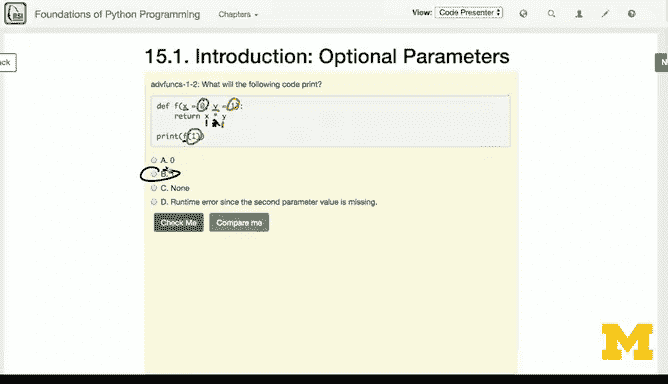
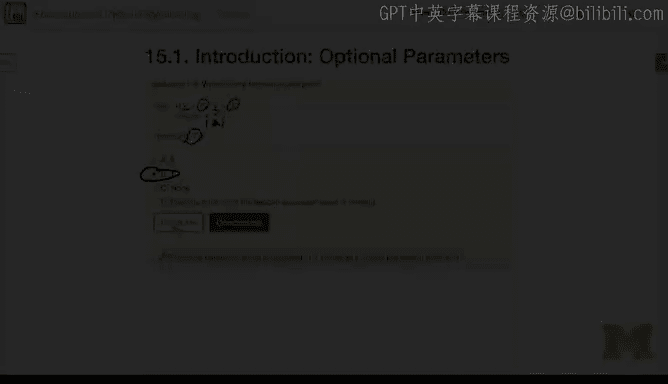

# 课程 62：Python 可选参数介绍 🎯


在本节课中，我们将要学习 Python 函数中一个非常实用的特性：可选参数。通过为函数参数设置默认值，我们可以让函数调用变得更加灵活。

## 概述

通常，当我们定义一个函数时，会指定它接受多少个参数。例如，一个函数 `f` 有三个参数 `x`、`y` 和 `z`。在调用时，通常必须为所有三个参数提供值，否则程序会报错。可选参数允许我们为参数指定默认值，这意味着在调用函数时，可以不必为这些参数提供值。

## 可选参数的基本用法

上一节我们介绍了可选参数的概念，本节中我们来看看如何定义和使用它。

我们可以通过在函数定义中为参数添加等号（`=`）和默认值来创建可选参数。

```python
def f(x, y, z=7):
    print(f"x is {x}, y is {y}, z is {z}")
```

通过指定 `z=7`，我们告诉 Python：当调用此函数时，如果没有为 `z` 提供值，就使用默认值 `7`。

现在，当我们调用这个函数时：

```python
f(2, 5)  # 输出：x is 2, y is 5, z is 7
```

即使我们没有指定 `z` 的值，它也会使用默认值 `7`。

如果我们确实为 `z` 指定了一个值，例如 `9`，那么它将覆盖默认值：

```python
f(2, 5, 9)  # 输出：x is 2, y is 5, z is 9
```

## 包含多个可选参数的例子

让我们通过一个更复杂的例子来加深理解。以下代码定义了一个函数 `f`，它有三个参数，其中 `y` 和 `z` 是可选参数。

```python
initial = 7

def f(x, y=3, z=initial):
    print(f"x is {x}, y is {y}, z is {z}")
```

以下是几种不同的调用方式及其结果：

1.  **只提供必需参数**：当我们只提供 `x` 的值时，`y` 和 `z` 将使用其默认值。
    ```python
    f(2)  # 输出：x is 2, y is 3, z is 7
    ```

2.  **覆盖部分可选参数**：我们可以为 `y` 提供一个新值，覆盖其默认值，而 `z` 仍使用默认值。
    ```python
    f(2, 5)  # 输出：x is 2, y is 5, z is 7
    ```

3.  **覆盖所有参数**：我们也可以为所有参数提供值，完全覆盖所有默认值。
    ```python
    f(2, 5, 8)  # 输出：x is 2, y is 5, z is 8
    ```

## 关于默认值计算的重要细节

一个关键点是：**可选参数的默认值是在函数定义时计算和固定的**，而不是在每次调用时重新计算。

让我们通过修改之前的代码来理解这一点：

```python
initial = 7

def f(x, y=3, z=initial):
    print(f"x is {x}, y is {y}, z is {z}")

initial = 10  # 在函数定义后修改变量 initial 的值
f(2)  # 输出：x is 2, y is 3, z is 7
```

尽管我们在第 5 行将 `initial` 的值改为了 `10`，但函数 `f` 中参数 `z` 的默认值仍然是 `7`。这是因为当 Python 解释函数定义时，它使用的是当时 `initial` 的值（即 `7`），并将其固定为 `z` 的默认值。后续对 `initial` 变量的修改不会影响这个默认值。

## 练习题解析

为了巩固所学知识，我们来看两个选择题。

**题目一：以下代码将打印什么？**

```python
def f(x=0, y=1):
    return x * y

print(f())
```

以下是选项分析：
*   `x` 使用默认值 `0`。
*   `y` 使用默认值 `1`。
*   函数返回 `0 * 1`，即 `0`。
*   因此，打印结果是 **`0`**。

**题目二：以下代码将打印什么？**

```python
def f(x=0, y=1):
    return x * y

print(f(1))
```

以下是选项分析：
*   我们为 `x` 提供了值 `1`，因此 `x` 是 `1`。
*   `y` 没有提供值，因此使用默认值 `1`。
*   函数返回 `1 * 1`，即 `1`。
*   因此，打印结果是 **`1`**。

## 总结





本节课中我们一起学习了 Python 函数的可选参数。我们了解到：
1.  可选参数通过在函数定义中使用 `参数名=默认值` 的语法来创建。
2.  调用函数时，可以为可选参数提供新值以覆盖默认值，也可以不提供而使用默认值。
3.  可选参数的默认值是在函数定义时确定的，后续对相关外部变量的修改不会影响它。
掌握可选参数能让你的函数设计更加灵活和健壮，是编写高质量 Python 代码的重要技能。