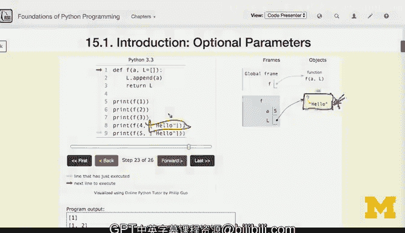

# 课程1：Python 3编程 - P151：可变性与可选参数 🧩


在本节课中，我们将要学习Python中可选参数（默认参数）的一个关键特性：**默认值只在函数定义时被计算一次**。这个特性可能导致一些非直观的结果，尤其是在处理可变对象（如列表）时。我们将通过具体的例子来理解这一行为，并学会如何正确使用可选参数。

---

## 默认值的单次计算

上一节我们介绍了函数定义的基本概念，本节中我们来看看可选参数的一个微妙之处。在Python中，函数的可选参数（即带有默认值的参数）的默认值，仅在函数被定义时计算一次，而不是在每次调用时重新计算。

这意味着，如果默认值是一个可变对象（例如一个列表），那么这个对象在内存中的位置是固定的。后续所有使用默认值的函数调用，都会操作同一个对象。

## 一个直观的例子

为了更好地理解，让我们定义一个函数 `f`，它有两个参数：`a` 和 `L`。其中 `L` 的默认值是一个空列表 `[]`。

```python
def f(a, L=[]):
    L.append(a)
    return L
```

以下是调用此函数时发生的情况：

1.  当我们第一次调用 `f(1)` 时，参数 `L` 使用了默认的空列表。函数体 `L.append(a)` 将数字 `1` 添加到了这个默认列表中。
2.  当我们第二次调用 `f(2)` 时，参数 `L` 再次使用了默认值。但请注意，这个默认值**不是一个新的空列表**，而是我们第一次调用时已经修改过的那个列表（现在包含 `[1]`）。因此，这次调用会将 `2` 添加到同一个列表中。
3.  同理，第三次调用 `f(3)` 会继续向这个列表添加 `3`。

最终，这个默认列表会随着每次调用而不断增长，而不是每次都重新开始。以下是代码演示：

```python
print(f(1))  # 输出：[1]
print(f(2))  # 输出：[1, 2]
print(f(3))  # 输出：[1, 2, 3]
```

## 可变对象与不可变对象的区别

这个现象的核心在于**可变性**。列表（`list`）是可变对象，可以被原地修改。当默认值是可变对象时，所有使用该默认值的调用都共享并可能修改这同一个对象。

相反，如果默认值是**不可变对象**（如整数、字符串、元组），则不会出现这个问题，因为不可变对象无法被修改。每次调用时，函数内部操作的都是该值的一个新副本或引用，但原始值本身不变。

## 如何避免这个问题

为了避免在函数间共享可变默认值带来的意外，一个常见的做法是使用 `None` 作为默认值，然后在函数内部创建新的可变对象。

以下是修改后的安全版本：

```python
def f_safe(a, L=None):
    if L is None:
        L = []  # 每次调用时，如果L为None，就创建一个新的空列表
    L.append(a)
    return L
```

使用这个版本，每次调用 `f_safe` 且不提供 `L` 参数时，都会创建一个全新的列表，从而保证了函数调用的独立性。

```python
print(f_safe(1))  # 输出：[1]
print(f_safe(2))  # 输出：[2]
print(f_safe(3))  # 输出：[3]
```

## 传递不同列表对象的情况

需要区分的是，当我们显式传递一个列表给参数 `L` 时，函数操作的是我们传入的那个特定对象，与默认列表无关。

例如：

```python
print(f(4, L=["hello"]))  # 输出：['hello', 4]
print(f(5, L=["hello"]))  # 输出：['hello', 5]
```

这里，两次调用分别传入了**两个不同的列表对象**（尽管它们值相同 `["hello"]`）。函数分别修改了这两个不同的列表，因此它们的结果互不影响。这与使用同一个默认列表对象的情况有本质区别。

---

## 总结

本节课中我们一起学习了Python函数可选参数的一个重要特性。我们了解到，**函数的默认参数值只在定义时计算一次**。当默认值是可变对象（如列表）时，这会导致所有使用默认值的函数调用共享并可能修改同一个对象，从而产生非预期的结果。

为了避免这个问题，我们学习了最佳实践：**使用 `None` 作为可变参数的默认值，并在函数体内进行判断和初始化**。同时，我们也明确了显式传递参数与使用默认参数时，所操作对象的区别。



理解可变性与默认参数的关系，对于编写正确、可预测的Python代码至关重要。