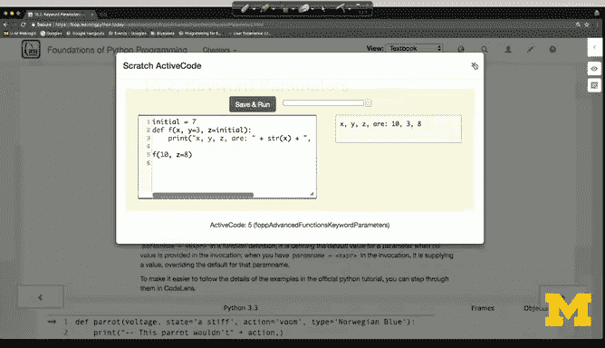
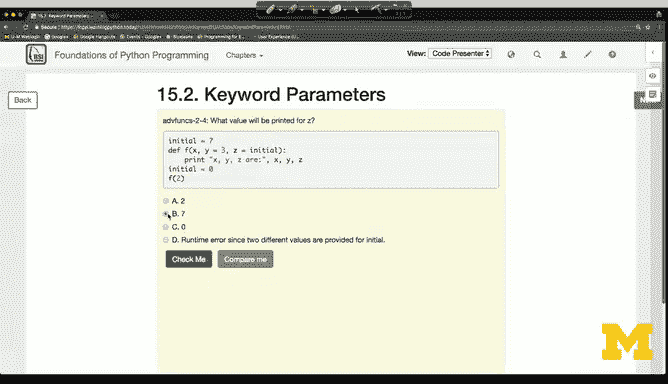
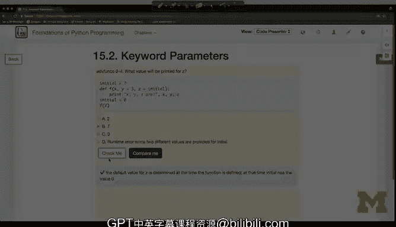

# Python 3 编程课程 1、2｜第 64 课：关键字参数详解 🔑


在本节课中，我们将要学习 Python 中一个非常实用的功能——关键字参数。我们将了解它们如何与可选参数结合使用，以及使用时的规则和注意事项。


## 概述

关键字参数允许我们在调用函数时，通过参数名来指定值，而不是仅仅依赖参数的位置。这提供了更大的灵活性，特别是在处理具有多个默认参数的函数时。

上一节我们介绍了可选参数的基本概念，本节中我们来看看如何更灵活地使用它们。

## 关键字参数与可选参数

关键字参数与可选参数紧密相关。

这里我们有一个函数 `f`，它接收三个参数：`x`、`y` 和 `z`。其中 `y` 和 `z` 有默认值。

```python
def f(x, y=3, z=7):
    print(f"x={x}, y={y}, z={z}")
```

在第五行，我们可以看到只提供 `x` 的值来调用函数。此时 `y` 和 `z` 会使用它们的默认值。

```python
f(1)  # 输出：x=1, y=3, z=7
```

在第六行，我们调用函数时指定了 `x=2` 和 `y=5`，`z` 则使用其默认值。

```python
f(2, 5)  # 输出：x=2, y=5, z=7
```

但是，假设我们想调用函数并为 `x` 和 `z` 提供值，而不为 `y` 传递值。换句话说，我们希望 `y` 使用其默认值。

如果我们尝试通过类似 `f(2, , 8)` 的格式跳过 `y`，将会得到一个语法错误，因为 Python 不理解这种格式。

## 使用关键字参数

我们可以使用关键字参数来解决这个问题。不是跳过参数，而是明确指出 `8` 是给 `z` 的值。我们在调用函数时通过 `z=8` 来实现。

```python
f(2, z=8)  # 输出：x=2, y=3, z=8
```

现在，`x` 得到值 `2`，`z` 得到值 `8`。我们没有为 `y` 指定值，所以 `y` 使用其默认值 `3`。运行代码后，我们可以看到第二次调用确实如此。

我们也可以对 `x` 使用关键字参数。

```python
f(x=2, z=8)  # 输出：x=2, y=3, z=8
```

这会产生相同的结果。

关键字参数的一个优点是允许我们以任意顺序放置参数。

```python
f(z=8, x=20)  # 输出：x=20, y=3, z=8
```

这里我先指定了 `z=8`，然后才指定 `x=20`。

## 关键字参数的限制

需要注意的是，关键字参数不会给没有默认值的参数赋予默认值。

例如，如果我们尝试只调用函数 `f` 并指定 `z=8`，那么我们没有为 `x` 传递任何值，就会得到一个错误，因为我们没有实际指定 `x` 是什么。

```python
# f(z=8)  # 这会引发错误：缺少1个必需的位置参数：'x'
```

如果我们想这样做，就必须在某个地方为 `x` 指定一个值，或者需要在函数定义中给 `x` 一个默认值。

## 避免重复赋值

也有可能意外地为同一个参数指定多个值。

一个明显的例子是同时指定 `z=8` 和 `z=4`。如果这样做，我们会看到第 5 行有一个重复的关键字参数错误。

```python
# f(10, z=8, z=4)  # 语法错误：关键字参数重复
```

另一种不太明显的情况是，先通过第一个位置参数为 `x` 传入值 `10`，然后又通过关键字参数指定 `x=8`。我们同样会得到错误，因为参数 `x` 有多个值。

```python
# f(10, x=8)  # 错误：为参数'x'提供了多个值
```

这里，根据我们作为第一个参数传入 `10` 的事实，`x` 看起来应该是 `10`；而根据我们指定 `x=8` 的事实，`x` 看起来又应该是 `8`。

## 参数顺序规则

关于关键字参数的另一个注意事项是，关键字参数必须放在所有位置参数之后。

以下代码可以正常工作：

```python
f(10, z=8)  # 输出：x=10, y=3, z=8
```

但如果我改变这个顺序，先写关键字参数，再写位置参数，就会得到一个语法错误。

```python
# f(z=8, 10)  # 语法错误：位置参数跟在关键字参数之后
```

这是因为，关键字参数必须放在任何未指定关键字的位置参数之后。换句话说，我们必须把 `z=8` 放在指定 `x` 是 `10` 之后。

所以，如果我再次改变这里的顺序，代码就会修复。



## 练习题解析

现在，让我们看一些涉及关键字参数的问题。

**问题 1：`z` 将打印什么值？**

```python
initial = 7
def f(x, y=3, z=initial):
    print(z)

f(2, 5)
```

调用函数 `f` 时，我们指定 `x=2`，`y=5`。`z` 的值将是 `initial` 在函数声明时的值。我们可以看到 `initial` 在这里被设置为 `7`。因此，`z` 的值将是 `7`。

**答案：`7`**

**问题 2：`y` 将打印什么值？**

```python
initial = 7
def f(x, y=3, z=initial):
    print(y)

f(2, z=10)
```

我们有相同的函数定义。调用函数 `f` 时，我们为 `x` 传入值 `2`，为 `z` 传入值 `10`。这意味着 `y` 将获得其默认值 `3`。

**答案：`3`**

**问题 3：`x` 将打印什么值？**

```python
initial = 7
def f(x, y=3, z=initial):
    print(x)

f(2, x=5)
```

调用函数 `f` 时，我们先指定 `x` 是 `2`，然后又指定 `x` 是 `5`。这是不允许的，Python 会给出一个运行时错误，因为我们试图为 `x` 指定两个不同的值 `2` 和 `5`。

**答案：`E` (错误)**

**问题 4：`z` 将打印什么值？**

```python
initial = 7
def f(x, y=3, z=initial):
    print(z)

initial = 0
f(2)
```

函数 `f` 的定义中，`z` 的默认值是 `initial`。当我们定义函数时，`initial` 的值是 `7`。虽然之后我们覆盖了 `initial` 的值，使其变为 `0`，但默认值只在声明函数时被求值。在声明这个函数 `f` 时，`initial` 的值是 `7`。因此，`z` 的默认值将是 `7`。

**答案：`B` (7)**

## 总结



本节课中我们一起学习了 Python 的关键字参数。我们了解到关键字参数通过参数名指定值，提供了调用函数的灵活性，允许我们跳过有默认值的参数，并以任意顺序传递参数。同时，我们也学习了关键字参数必须位于所有位置参数之后，并且不能为同一个参数多次赋值。掌握这些规则将帮助你更清晰、更灵活地编写和调用函数。



本节内容到此结束，下次再见。