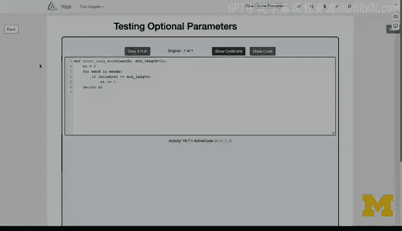
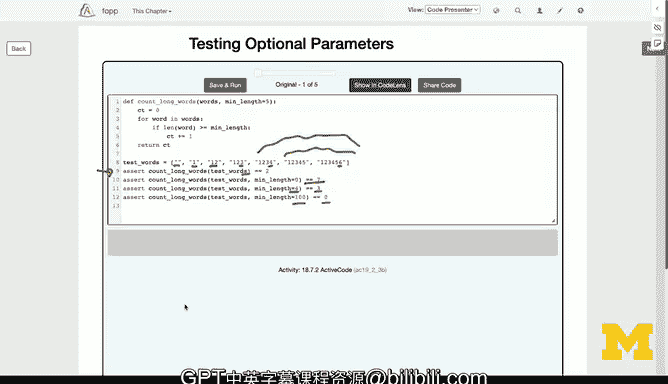

# 课程1：Python 3编程 | 第65课：可选参数测试方法 🧪


在本节课中，我们将学习如何为带有可选参数的函数编写自动化测试。我们将通过一个具体的例子，了解如何设计测试用例来验证函数在不同参数输入下的行为是否正确。

---



## 概述

编写带有可选参数的函数时，为其编写自动化测试是一个好习惯。这些测试应涵盖指定和未指定可选参数的情况。本节课我们将通过一个统计列表中长单词数量的函数，来演示如何设计并执行这些测试。

## 函数介绍

我们来看这个函数，它的功能是统计列表中“长单词”的数量。参数 `min_length` 决定了一个单词需要多长才能被计入。默认情况下，只有长度大于等于5个字符的字符串才会被计数，因此默认参数值是5。

这个函数通过返回值完成工作，没有任何副作用，因此我们需要进行返回值测试。

## 设计测试用例

那么，我们应该测试哪些输入呢？以下是一些我认为有用的测试。在所有测试中，我将使用同一个测试单词列表。

以下是测试列表：
*   `''`：这是一个空字符串，长度为0。
*   `'a6'`：这个字符串有6个字符。
*   `'b4'`：这个字符串有4个字符。
*   `'c5'`：这个字符串有5个字符。
*   `'d8'`：这个字符串有8个字符。
*   `'e1'`：这个字符串有1个字符。
*   `'f9'`：这个字符串有9个字符。

这个列表总共包含7个字符串。我特意包含了不同长度的字符串，并且让字符串本身能提醒我它的长度（例如，最后一个字符表示字符串的字符数）。

## 执行测试

接下来，我们逐一运行设计好的测试用例。

首先，测试当省略可选参数（即使用默认值 `min_length=5`）时的情况。根据列表，应该有两个字符串的长度至少为5个字符。

```python
assert count_long_words(test_words) == 2
```

其次，我想尝试一些边界情况。其中一个边界是设置 `min_length=0`。此时，列表中所有7个字符串的长度都大于等于0，所以结果应该是7。

```python
assert count_long_words(test_words, 0) == 7
```

接着，测试一个既非常规值也非默认值的参数，例如 `min_length=4`。列表中至少有4个字符的字符串有3个。

```python
assert count_long_words(test_words, 4) == 3
```

然后，测试另一个边界情况：设置一个非常大的 `min_length=100`。列表中没有字符串有这么长，所以结果应该是0。

```python
assert count_long_words(test_words, 100) == 0
```

## 测试总结

我设计了两类测试：一类是边界情况（`min_length` 为0和100），另一类是中间值情况（省略参数和使用非默认值4）。如果函数能通过所有这些测试，我将对它在其他字符串列表和其他 `min_length` 值下的正确性有足够的信心。

运行这些测试后，所有断言都通过了，没有产生任何错误。这使我认为这个函数的实现很可能是正确的。

---

## 总结



本节课我们一起学习了如何为带有可选参数的函数设计全面的自动化测试。我们通过一个实例，练习了如何测试默认参数、边界值以及常规的非默认参数，以确保函数在各种输入下都能按预期工作。掌握这些测试方法，将有助于你编写出更健壮、可靠的代码。