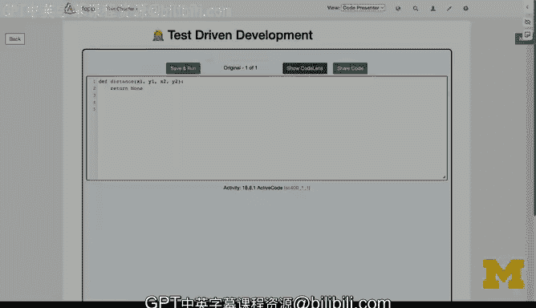
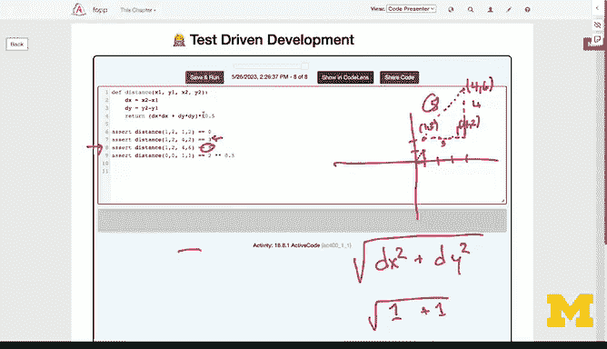

# 课程1：Python 3编程 | 第66讲：测试驱动开发实践 🧪




在本节课中，我们将学习一种名为“测试驱动开发”的编程方法。我们将通过一个具体的例子——编写一个计算两点间距离的函数——来理解如何先编写测试用例，再实现功能代码。这种方法能帮助你更清晰地定义函数目标，并确保代码的正确性。

---

## 概述

测试驱动开发是一种软件开发流程，它强调在编写实际功能代码之前，先编写测试用例。这种方法与我们一直鼓励的“逐步增量开发”过程相辅相成。通过先定义好测试，我们可以更明确函数应该做什么，并在后续编码中不断验证其正确性。

## 从定义函数开始

我们尝试定义一个名为 `distance` 的函数。它的框架如下，接受两个点的坐标作为输入：

```python
def distance(x1, y1, x2, y2):
    return None
```

参数 `x1` 和 `y1` 代表第一个点的坐标，`x2` 和 `y2` 代表第二个点的坐标。例如，调用 `distance(1, 2, 4, 2)` 就是计算点 (1, 2) 和点 (4, 2) 之间的距离。

在坐标系中，点 (1, 2) 表示 x 坐标为 1，y 坐标为 2。

## 编写测试用例

我们不急于编写函数的具体实现，而是先采用测试驱动开发的方法：先编写测试用例，后编写代码。

以下是几个我们计划用于测试的例子：

**第一个测试用例：水平移动**
计算点 (1, 2) 到点 (4, 2) 的距离。由于只在 x 轴上移动了 3 个单位，y 轴未变，因此距离应为 3。

**第二个测试用例：斜向移动**
计算点 (1, 2) 到点 (4, 6) 的距离。这相当于一个直角三角形的斜边，直角边长度分别为 3 和 4。根据勾股定理，斜边长度应为 5。

**第三个测试用例：非整数结果**
计算点 (0, 0) 到点 (1, 1) 的距离。根据勾股定理，距离应为 √2。在 Python 中，我们可以用 `2 ** 0.5` 来计算平方根，无需导入 `math` 模块。

**第四个测试用例：退化情况**
计算点 (1, 2) 到其自身的距离。直观上，这个距离应为 0。

现在，让我们将这些测试用例用代码表达出来：

```python
# 测试点 (1,2) 到 (4,2) 的距离，应为 3
assert distance(1, 2, 4, 2) == 3

# 测试点 (1,2) 到 (4,6) 的距离，应为 5
assert distance(1, 2, 4, 6) == 5

# 测试点 (0,0) 到 (1,1) 的距离，应为 √2
assert distance(0, 0, 1, 1) == 2 ** 0.5

# 测试点 (1,2) 到自身的距离，应为 0
assert distance(1, 2, 1, 2) == 0
```

## 逐步实现功能

编写完测试后，我们就可以开始实现 `distance` 函数了。最初，函数只返回 `None`，运行测试自然会失败。

**第一次尝试：返回固定值**
我们可以先尝试让函数总是返回 0。这样，第四个测试（点到自身的距离）会通过，但其他测试会失败。

**第二次尝试：计算 x 轴距离**
我们改进代码，计算并返回 x 轴方向的距离差 `dx = x2 - x1`。这样，第一个测试（纯水平移动）就能通过了。

**第三次尝试：应用勾股定理**
为了通过所有测试，我们需要完整应用勾股定理来计算两点间的直线距离。

公式如下：
**距离 = √[(x2 - x1)² + (y2 - y1)²]**

对应的 Python 代码实现为：

```python
def distance(x1, y1, x2, y2):
    dx = x2 - x1
    dy = y2 - y1
    return (dx * dx + dy * dy) ** 0.5
```

运行所有测试，现在它们应该全部通过了。

## 总结

本节课我们一起学习了测试驱动开发的实践。我们通过定义一个计算距离的函数，体验了先编写测试用例、再逐步实现功能的完整流程。这种方法能帮助你明确目标，并在开发过程中持续验证代码的正确性。记住，编写测试不仅是为了检查错误，更是为了理清思路，设计出更健壮的程序。



我们下次再见。