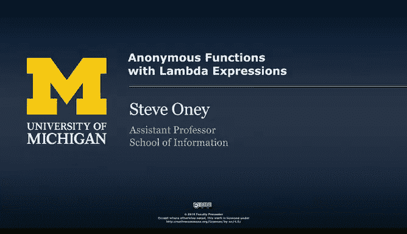
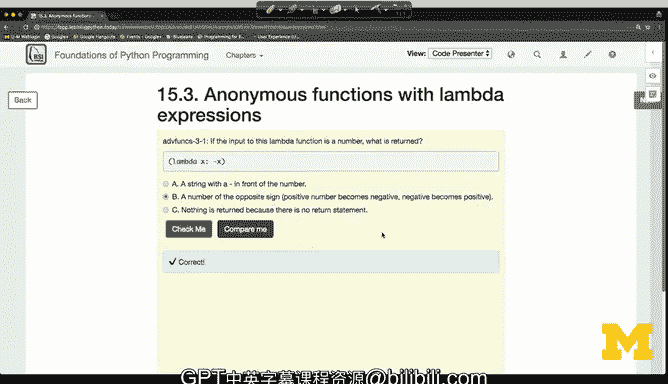

# Python 3 编程课程 1、2｜第 67 课：Lambda 表达式与匿名函数 🧮


在本节课中，我们将要学习 Python 中的 **Lambda 表达式**，这是一种定义函数的替代方式。我们将了解它的语法、用途，并通过代码示例来理解它与传统函数定义的区别。



---

## 概述 📋

Lambda 表达式提供了一种简洁的方式来创建小型、匿名的函数对象。它通常用于需要一个简单函数作为参数的地方，例如在 `map()`、`filter()` 或 `sorted()` 等函数中。本节我们将深入探讨其语法和实际应用。

---

## Lambda 表达式的基本概念

Lambda 表达式是定义函数的一种替代方法。

假设我们有一个传统的函数定义，这里用 `As` 代表参数列表。参数可能是 `x, y, z`，它们甚至可以有默认值，例如 `x=1`。函数体包含一个返回值的表达式，例如 `return x + 5`，或者任何我们想要返回的表达式。

如果我们有这种函数，我们可以使用 Lambda 表达式来表达它。这就是一个 Lambda 表达式。

我们为参数列表写的内容，可以移植到 Lambda 表达式中并在这里重用。我们可以写成 `lambda`，然后是我们的参数，例如 `x, y`，然后写一个冒号 `:`，接着指定我们想要返回的值。例如，我们可以写 `x + y`。

这个表达式的值是一个函数类型的值。当我们使用 `def` 定义函数时，我们通常会给函数一个名字。但使用 Lambda 时，我们甚至不需要给这个函数命名。如果我们想给它一个名字，我们可以说 `func =` 然后提供我们的 Lambda 函数。但我们也可以让它成为一个匿名函数，换句话说，一个没有名字的函数。

---

## 代码示例分析

上一节我们介绍了 Lambda 表达式的基本概念，本节中我们来看看具体的代码示例。

以下是第一个示例：

```python
def f(x):
    return x - 1
```

在第 1 行，我们定义了一个函数 `f`。它接受一个参数 `x`，并返回 `x - 1`。这是定义函数的传统方式。

如果我们调用这个函数，执行 `print(f(3))`，那么我们应该得到值 `2`。

如果我们打印函数对象本身，执行 `print(f)`，那么我们应该看到这是一个名为 `f` 的函数。

如果我们打印 `f` 的类型，执行 `print(type(f))`，那么我们应该得到 `f` 是一个函数。

现在，如果我们想用一个等价的 Lambda 表达式来编写这个函数，我们会这样写：

```python
lambda x: x - 1
```

`x` 是我们的参数。然后我们想返回 `x - 1`，所以我们直接写 `x - 1`。同样，在 Lambda 表达式中不需要添加 `return` 语句，返回是隐式的。

如果我们打印这个表达式的值，那么我们应该看到它是一个函数。在这个例子中，它具体是一个 lambda 函数。

如果我写成：
```python
lf = lambda x: x - 1
```
然后我打印 `lf(3)`，那么我们应该得到 `2`。如果我打印这个 lambda 函数的类型，那么我们应该看到，就像 `f` 一样，我们的 lambda 函数 `lf` 也是一个函数。

---

## 将传统函数转换为 Lambda 函数

假设我们想将这个传统的函数定义 `last_char` 转换为一个 lambda 函数。

传统函数定义如下：
```python
def last_char(s):
    return s[-1]
```

我们可以这样做：
```python
last_char = lambda s: s[-1]
```

它接受一个参数 `s`，所以是 `lambda s:`。然后，再次记住，在 Lambda 中返回是隐式的，所以我们可以直接写 `s[-1]`。

现在这个表达式的值就是一个函数，它等价于上面的传统函数。我们不一定需要实际给它一个名字，但这里我们选择给它命名为 `last_char`。

---

## 关于 Lambda 函数的选择题

让我们回答一些关于 Lambda 函数的多项选择题。

这个问题问：如果输入到这个 lambda 函数的是一个数字，那么返回什么？

我们有一个 Lambda 表达式：
```python
lambda x: -x
```
它接受一个参数 `x`，并返回 `-x`。

这告诉我，如果我们传入 `1`，我们应该得到 `-1`；如果我们传入 `-10`，我们应该得到 `10`，等等。所以，对我来说，答案是 **B**：一个符号相反的数字。正数变成负数，负数变成正数。所以我选择 B。

---

## 总结 🎯



本节课中我们一起学习了 Python 的 **Lambda 表达式**。我们了解到 Lambda 是一种创建匿名函数的简洁方式，其语法为 `lambda 参数: 表达式`。它隐式返回表达式的结果，常用于需要简单函数对象的场景。通过与传统 `def` 定义函数的对比和代码示例，我们掌握了 Lambda 的基本用法和转换方法。