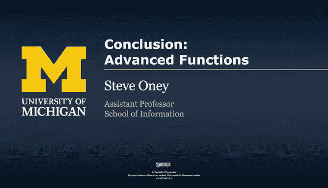

# Python 3 编程（课程1、2）｜第68讲：高级函数总结 🧩

在本节课中，我们将要学习 Python 中三种高级函数特性：可选参数、关键字参数和 Lambda 函数。这些特性能让你的代码更灵活、更简洁。


---



## 可选参数 📝

上一节我们介绍了函数的基本定义和调用，本节中我们来看看如何让函数参数变得“可选”。

可选参数允许我们为函数参数定义默认值。当我们调用函数时，如果未提供该参数的值，函数将使用其默认值。这在某个参数通常有一个标准值时尤其有用。

以下是定义可选参数的语法：

```python
def function_name(parameter=default_value):
    # 函数体
```

例如，我们定义一个问候函数，其中 `greeting` 参数默认为 “Hello”：

```python
def greet(name, greeting="Hello"):
    print(f"{greeting}, {name}!")

greet("Alice")           # 输出: Hello, Alice!
greet("Bob", "Hi")       # 输出: Hi, Bob!
```

---

## 关键字参数 🔑

接下来，我们学习如何通过参数名而非位置来传递值，这就是关键字参数。

关键字参数允许我们在调用函数时，明确指定哪个值对应哪个参数。这对于一个拥有大量可能参数的函数，而我们只想传入其中一部分时特别有帮助。

以下是使用关键字参数的语法：

```python
function_name(parameter_name=value)
```

例如，我们有一个描述人物的函数：

```python
def describe_person(name, age, city):
    print(f"{name} is {age} years old and lives in {city}.")

# 使用关键字参数，顺序可以打乱
describe_person(age=30, city="New York", name="Charlie")
```

---

## Lambda 函数 λ

最后，我们探讨一种定义函数的简洁方式——Lambda 函数。

Lambda 函数是一种用于定义简单函数的简短语法，它没有标准的 `def` 语句和函数名。这在后续学习排序等操作时会经常用到。

以下是定义 Lambda 函数的语法：

```python
lambda arguments: expression
```

例如，我们创建一个计算平方的 Lambda 函数：

```python
square = lambda x: x ** 2
print(square(5))  # 输出: 25
```

Lambda 函数通常与 `map()`、`filter()`、`sorted()` 等内置函数结合使用，实现简洁的操作。

---

## 总结 📚

本节课中我们一起学习了 Python 的三个高级函数特性。

我们首先学习了**可选参数**，它通过为参数设置默认值来增加函数的灵活性。接着，我们探讨了**关键字参数**，它允许我们通过参数名来传递值，使函数调用更清晰，尤其是在参数众多时。最后，我们介绍了**Lambda 函数**，这是一种定义简单匿名函数的快捷方式，能让代码更加简洁。

掌握这些概念将帮助你编写出更强大、更易读的 Python 代码。

---


> 程序员笑话：有一天，程序员和他的孩子争论，因为孩子想去户外打棒球，但程序员不想去。孩子说：“你从来不喜欢户外活动。有时候我觉得，如果你能写一个名为‘打棒球’的函数，而不是真的去打棒球，你一定会那么做。”程序员回答：“不，这完全不公平。我永远不会定义一个‘打棒球’函数。我会定义一个‘扔’函数，而‘棒球’将是它的一个参数。”

本节课到此结束，下次见。