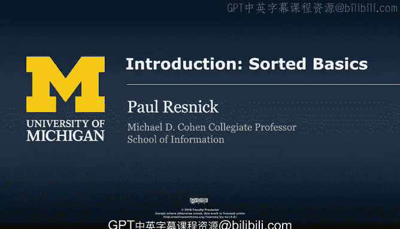

# 课程1：Python 3编程 | 第69讲：排序基础导论 🎬

在本节课中，我们将要学习Python中一个强大的新命令：排序。排序是计算机科学课程中的一个重要主题。我们将了解排序的基本概念，并学习如何使用Python内置的`sorted`函数来对数据进行排序。

---

## 排序的重要性

在典型的计算机科学课程中，你会学习几种不同的排序算法，并分析这些算法的特性。在我本科的第一门编程课上，我必须实现一种叫做“归并排序”的算法。这种算法的原理是：将项目不断对半分割，直到得到非常小的、已经排好序的列表。事实证明，将两个已经排好序的列表合并成一个更大的有序列表，是一件相对容易且快速的事情。因此，我们从这些小列表开始构建，直到整个列表排序完成。

当时我花了数天时间在计算机实验室里（那是在个人电脑普及之前），每次运行程序，都必须等待主机运行并打印出一叠报告程序运行结果的纸张。经过几天的努力，我非常自豪地把结果带回家，向我的室友们展示。

不过，对你来说不会那么困难。我们不会深入探讨排序算法的细节，我们只是要使用一个Python内置的函数。

---

## 排序算法的基本模型

尽管如此，我们希望你能够对排序算法内部发生的事情有一个基本的概念模型，因为这有助于你更好地调用它。我们为你准备了来自Sientti University的精彩视频，这些视频使用匈牙利民间舞蹈来演示排序算法。

你会看到几个不同的匈牙利舞蹈，展示了不同的排序算法。不必担心算法的细节，但请注意它们的一个共同点：它们总是涉及一系列成对的比较，即两位舞者之间的互动。两位舞者会互相查看对方身上佩戴的数字，然后进行舞蹈。在每次互动结束时，数字较大的舞者总是会移动到右侧。经过一系列这样的成对比较后，舞者们就会按照他们的数字顺序排列好。

再次强调，具体的排序算法不是我们这里的重点。我们只是要调用一个为我们执行排序的函数，无论我们给它什么序列，它都会按照我们想要的顺序返回排序后的结果。

---

## 本节课的学习目标

在本节课结束时，你将能够：

*   调用`sorted`函数来排序任何序列。
*   使用`reverse`参数指定升序（从低到高）或降序（从高到低）排序。
*   使用`key`函数指定按某个属性进行排序。

在后续课程中，你还会学习一些更高级的排序技巧，我们将在最后看到。

---

## 总结

本节课中，我们一起学习了排序在计算机科学中的重要性，并建立了对排序算法基本过程的理解。我们了解到，排序的核心在于一系列成对的比较。最重要的是，我们明确了本节课的目标：掌握使用Python内置的`sorted`函数及其关键参数（`reverse`和`key`）来对数据进行排序。这为我们处理有序数据打下了坚实的基础。