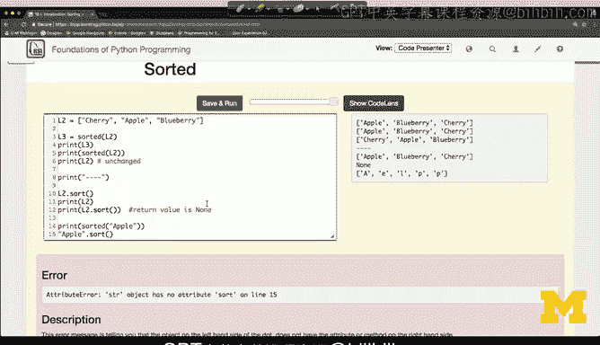

# Python 3 编程（课程1、2）｜第70课：`sort`与`sorted`方法调用 📊


在本节课中，我们将要学习Python中用于排序序列的两种主要方法：列表的`.sort()`方法和内置的`sorted()`函数。我们将详细探讨它们的工作原理、语法差异以及各自的适用场景。

---

## 概述

Python提供了两种对序列进行排序的方式。一种是列表对象的`.sort()`方法，另一种是内置的`sorted()`函数。理解它们之间的区别对于编写清晰、高效的代码至关重要。

---

## `.sort()` 方法

`.sort()`方法是列表对象的一个方法。它直接修改原始列表，将其元素按从低到高的顺序重新排列，并且不返回任何值（或者说返回`None`）。

以下是`.sort()`方法的基本用法示例：

```python
L1 = [3, 1, 4, 1, 5, 9, -2]
L1.sort()
print(L1)  # 输出：[-2, 1, 1, 3, 4, 5, 9]
```

在上面的代码中，`L1.sort()`直接改变了列表`L1`的顺序。

`.sort()`方法同样适用于字符串列表，排序规则是字典序（即字母顺序）：

```python
L2 = ['cherry', 'apple', 'blueberry']
L2.sort()
print(L2)  # 输出：['apple', 'blueberry', 'cherry']
```

---

## `sorted()` 函数

`sorted()`是一个内置函数，它与`.sort()`方法有几点关键区别。首先，它使用函数调用语法，并将要排序的序列作为参数传入。其次，它会返回一个新的已排序列表，而不会修改原始序列。

以下是`sorted()`函数的基本用法：

```python
L2 = ['cherry', 'apple', 'blueberry']
sorted_list = sorted(L2)  # 将排序结果赋值给新变量
print(sorted_list)        # 输出：['apple', 'blueberry', 'cherry']
print(L2)                 # 输出：['cherry', 'apple', 'blueberry']，原列表未改变
```

`sorted()`函数的返回值可以直接使用，例如传递给`print()`函数：

```python
print(sorted(L2))  # 输出：['apple', 'blueberry', 'cherry']
```

---

## 两种方式的对比

上一节我们介绍了两种排序方式的基本用法，本节中我们来详细对比它们的关键差异。

以下是`.sort()`方法与`sorted()`函数的主要区别：

1.  **语法与调用方式**：
    *   `.sort()`是列表的方法，使用点号调用：`list.sort()`。
    *   `sorted()`是内置函数，将序列作为参数：`sorted(sequence)`。

2.  **返回值**：
    *   `.sort()`方法不返回有用的值，它返回`None`。排序操作是其产生的“副作用”。
    *   `sorted()`函数返回一个新的已排序列表。

3.  **对原数据的影响**：
    *   `.sort()`方法会**原地修改**原始列表。
    *   `sorted()`函数**不会改变**原始序列，而是生成一个新列表。

4.  **适用对象**：
    *   `.sort()`方法**仅适用于列表**。
    *   `sorted()`函数可以应用于**任何可迭代序列**，包括字符串、元组等。

---

## 为什么更推荐使用 `sorted()` 函数？

在大多数情况下，我们更推荐使用`sorted()`函数，原因如下：

*   **安全性**：它避免了直接修改原始数据可能带来的意外和混淆。我们之前强调过，使用可变操作（mutation）容易导致代码难以理解。
*   **通用性**：它可以应用于更多类型的序列。

例如，你可以对字符串使用`sorted()`函数：

```python
result = sorted('apple')
print(result)  # 输出：['a', 'e', 'l', 'p', 'p']
```

`sorted('apple')`将字符串视为字符序列，并返回一个按字母顺序排列的字符列表。

而尝试对字符串使用`.sort()`方法则会失败，因为字符串是不可变的（immutable），无法被原地修改：

```python
# 这行代码会引发 AttributeError 错误
'apple'.sort()
```

---

## 总结

本节课中我们一起学习了Python中排序的两种方式：`.sort()`方法和`sorted()`函数。

*   **`.sort()`** 是列表的方法，原地排序，不返回新列表。
*   **`sorted()`** 是内置函数，接受任何可迭代对象，返回新的排序列表，不修改原数据。



出于代码清晰和安全性的考虑，在后续课程中我们将主要使用`sorted()`函数。下次课程，我们将学习如何按从高到低的顺序进行排序。