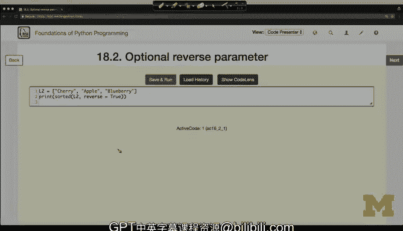
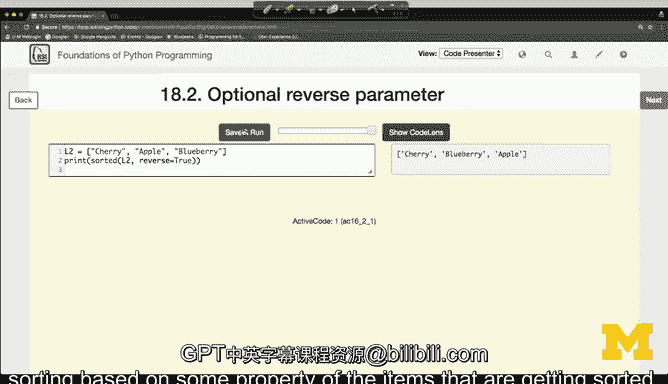

# Python 3 编程（课程1、2）｜第71讲：05_03 可选 reverse 参数 🔄




在本节课中，我们将要学习 Python 中 `sorted()` 函数的一个非常实用的可选参数：`reverse`。这个参数允许我们轻松地控制排序结果是升序还是降序。

---

上一节我们介绍了如何使用 `sorted()` 函数对一个序列进行默认的升序排序。本节中我们来看看，如果我们希望得到降序排列的结果，应该怎么做。

如果我们不希望数据从小到大排序，而是想要相反的顺序，这很简单。你已经见过如何反转一个列表。实际上，有一个 `reverse()` 函数，或者你也可以使用列表推导式。这意味着你可以先调用 `sorted()` 函数得到一个升序列表，然后再通过某种方式反转这个序列的顺序。

但事实上，有一个更简单的方法，因为我们可以为 `sorted()` 函数指定一个名为 `reverse` 的可选参数。这是一个可选参数，如果你不为其提供值，它的默认值是 `False`。但如果你传入值 `True`，你将得到一个相反顺序的列表。

你可以在下面的代码中看到这一点。

```python
# 示例：使用 reverse 参数进行降序排序
fruits = ['apple', 'cherry', 'blueberry']
sorted_fruits_desc = sorted(fruits, reverse=True)
print(sorted_fruits_desc)  # 输出：['cherry', 'blueberry', 'apple']
```

在代码的第二行，除了指定我们要排序的列表，我们还说明了 `reverse` 参数应该获得值 `True`。当我们这样做时，我们将得到反向排序的结果：Cherry、Blueberry、然后是 Apple。

所以，`reverse=True` 只是像我们以前为函数传递参数一样，传递了一个参数。我们在这里传递的实际值 `True` 只是一个布尔值。如果你还记得我们学习布尔值的时候，我可以改变这个值。

我可以不传递布尔值 `True`，而是传递布尔值 `False`，这将表示“不要以反向顺序返回”。这样我们就会得到 Apple、Blueberry 和 Cherry。

`False` 是 `reverse` 参数的默认值。因此，如果我完全省略它，我得到的结果与我说 `reverse=False` 时得到的结果相同。

所以，如果我不希望反转，我不必说明；如果我确实希望反转，我必须说明 `reverse=True`。然后我就能得到反向排序的结果。

这就是如何以相反或反向顺序对序列进行排序。

---



本节课中我们一起学习了 `sorted()` 函数的 `reverse` 可选参数。我们了解到，通过将 `reverse` 参数设置为 `True`，可以轻松获得降序排列的结果，而默认的 `False` 值则提供升序排列。下一节，我们将学习如何根据待排序项的某些属性来指定自定义的排序顺序。