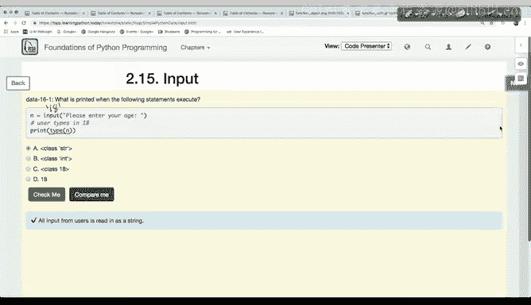

# 课程1：Python 3编程 - P16：用户输入处理 📥


在本节课中，我们将学习如何让Python程序根据用户的输入产生不同的输出，从而使代码变得更加动态和有趣。我们将重点介绍如何使用 `input` 函数获取用户输入，以及如何处理和转换这些输入数据。

---

## 从固定输出到动态交互

上一节我们介绍了编写基础Python代码的方法。本节中，我们来看看如何通过获取用户输入，让程序每次运行时都能根据输入产生不同的结果。

实现这一功能的核心是 `input` 函数。它允许程序在运行时暂停，等待用户输入信息。

### 使用 `input` 函数

`input` 函数用于请求用户输入。它可以接受一个字符串参数作为提示信息。

**代码示例：获取用户姓名**
```python
name = input("Please enter your name: ")
print("Hello", name)
```
在这段代码中：
*   `input("Please enter your name: ")` 会显示提示信息并等待用户输入。
*   无论用户输入什么内容，`input` 函数**总是返回一个字符串**。
*   这个字符串被赋值给变量 `name`，然后被打印出来。

运行这段代码时，如果你输入 “Steve”，程序会输出 “Hello Steve”；如果你输入 “Paul”，则会输出 “Hello Paul”。

---

## 处理数值输入

由于 `input` 始终返回字符串，如果我们需要进行数学计算，就必须先将字符串转换为数字。

以下是处理数值输入的步骤：

1.  使用 `input` 获取用户输入的字符串。
2.  使用 `int()` 或 `float()` 函数将字符串转换为整数或浮点数。

**代码示例：秒数转换器**
```python
# 1. 获取用户输入的字符串
str_seconds = input("Please enter the number of seconds you want to convert: ")

# 2. 将字符串转换为整数
total_seconds = int(str_seconds)

# 3. 进行计算：将总秒数转换为小时、分钟和秒
hours = total_seconds // 3600  # 整除，得到小时数
seconds_remaining = total_seconds % 3600  # 取余，得到剩余的秒数

minutes = seconds_remaining // 60  # 将剩余秒数转换为分钟
seconds = seconds_remaining % 60  # 得到最终的剩余秒数

# 4. 输出结果
print(hours, "hours,", minutes, "minutes,", seconds, "seconds")
```

**运行示例：**
*   输入 `60`，输出：`0 hours, 1 minutes, 0 seconds`
*   输入 `6000`，输出：`1 hours, 40 minutes, 0 seconds`
*   输入 `999`，输出：`0 hours, 16 minutes, 39 seconds`

---

## 需要注意的要点

在使用 `input` 和类型转换时，有以下几个关键点需要注意：

*   **输入类型固定**：`input` 函数的返回值永远是字符串类型 (`str`)。
*   **转换可能失败**：如果用户输入的不是有效的数字（例如输入了名字 “Steve”），那么 `int()` 或 `float()` 函数将无法转换，程序会抛出 `ValueError` 运行时错误。在后续课程中，我们将学习如何处理这类错误。
*   **理解代码逻辑**：在转换示例中，我们使用了整除运算符 `//` 来获取商，使用取模运算符 `%` 来获取余数，这是进行此类单位换算的常用方法。

---

## 小测验

让我们通过一个选择题来巩固理解。

**问题：** 当执行以下代码，且用户输入 `18` 时，会打印出什么？
```python
n = input("Please enter your age: ")
print(type(n))
```

**选项：**
A. `<class 'int'>`
B. `<class 'str'>`
C. `18`
D. 程序报错

**答案：** B. `<class 'str'>`

**解析：** 无论用户输入什么，`input` 函数都返回字符串。因此，即使用户输入了数字 `18`，变量 `n` 的数据类型仍然是字符串 (`str`)，`type(n)` 的结果就是 `<class 'str'>`。

---



本节课中我们一起学习了如何使用 `input` 函数与用户进行交互，让程序根据输入产生动态输出。我们掌握了获取字符串输入的方法，并重点练习了如何通过 `int()` 或 `float()` 将输入转换为数值以进行计算。记住，`input` 总是返回字符串，这是处理用户输入时需要牢记的第一原则。