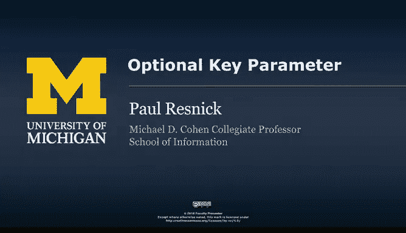
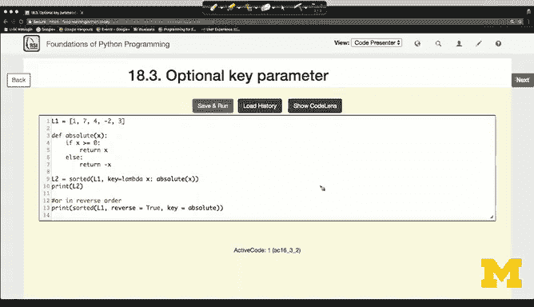

# Python 3 编程（课程1、2）｜第160讲：可选 `key` 参数解析 🔑




在本节课中，我们将要学习 `sorted` 函数中一个极其有用且强大的可选参数——`key`。这个概念初看可能有些巧妙，但一旦掌握，你将发现它能极大地扩展排序的灵活性。

## 概述：基于属性排序的需求

上一节我们介绍了 `sorted` 函数的基本用法和 `reverse` 参数。本节中我们来看看如何根据元素的某个特定属性（而非元素本身的值）进行排序。

例如，我们有一个数字列表 `L1`：
```python
L1 = [1, 7, 4, -2, 3]
```
如果我们想根据数字的**绝对值**来排序这个列表，而不是数字本身，该怎么做呢？

## `key` 参数的基本用法

`key` 是 `sorted` 函数的一个可选参数，它允许我们指定一个函数，该函数将应用于序列中的每一个元素，排序将基于该函数返回的结果进行。

以下是使用 `key` 参数根据绝对值排序的示例：
```python
# 定义一个返回绝对值的函数
def absolute(x):
    return abs(x)

L1 = [1, 7, 4, -2, 3]
# 使用 key 参数，传入函数名
L2 = sorted(L1, key=absolute)
print(L2)  # 输出: [1, -2, 3, 4, 7]
```
可以看到，`-2` 被排在了 `1` 之后，因为它的绝对值 `2` 大于 `1` 的绝对值 `1`。

我们也可以结合 `reverse` 参数进行反向排序：
```python
L3 = sorted(L1, key=absolute, reverse=True)
print(L3)  # 输出: [7, 4, 3, -2, 1]
```

## 理解 `key` 参数的工作原理

这一切看起来相当直观，直到我们深入思考其背后的机制。我们传递给 `key` 参数的值 `absolute` 实际上是一个**函数对象**。这意味着我们在将一个函数传递给另一个函数。

为了理解这个过程，我们可以建立一个心智模型。想象 `sorted` 函数在开始比较任何一对元素之前，会先调用我们提供的 `key` 函数（例如 `absolute`）。

以下是 `sorted` 函数内部可能发生的步骤：

1.  对于序列 `[1, 7, 4, -2, 3]` 中的每一个元素，`sorted` 函数调用 `absolute` 函数。
2.  它将计算出的绝对值像“便利贴”一样贴在每个元素上。
    *   `1` -> 便利贴：`1`
    *   `7` -> 便利贴：`7`
    *   `4` -> 便利贴：`4`
    *   `-2` -> 便利贴：`2`
    *   `3` -> 便利贴：`3`
3.  随后，`sorted` 函数进行所有成对比较时，**比较的是便利贴上的值**，而不是原始元素。
4.  因此，最终排序顺序基于便利贴的值：`[1, -2, 3, 4, 7]`。

我们可以通过一个简单的实验来验证 `key` 函数确实被调用了：
```python
def absolute(x):
    print(f"正在计算 {x} 的绝对值")  # 添加打印语句
    return abs(x)

L1 = [1, 7, 4, -2, 3]
print("开始排序...")
sorted_list = sorted(L1, key=absolute)
print("排序完成。")
print(sorted_list)
```
运行上述代码，你会看到 `absolute` 函数被调用了五次，正好对应列表中的五个元素。这证明了 `sorted` 函数在内部确实为每个元素调用了 `key` 函数。

## 如何提供 `key` 函数

以下是关于 `key` 参数值的核心要求：

*   **必须是一个函数**：我们常称之为“键函数”。
*   **必须接受一个输入**：这个输入将是列表中的一个元素。
*   **必须返回一个值**：这个返回值将作为该元素的“便利贴”值，用于排序比较，通常是一个数字。

提供这个函数有两种主要方式：

**1. 传递函数名**
正如之前的例子所示，直接传入一个已定义函数的名称。
```python
sorted(L1, key=absolute)
```

**2. 使用 Lambda 表达式**
Lambda 表达式可以创建匿名函数，对于简单的键函数非常方便。
```python
# 使用 lambda 表达式实现相同的绝对值排序
sorted(L1, key=lambda x: abs(x))
```
虽然在这个例子中，`lambda x: abs(x)` 和 `absolute` 函数功能完全相同，但对于初学者来说，使用 lambda 表达式有时能更清晰地提醒自己：我们正在创建一个函数对象并传递给 `key` 参数。在后续课程中，我们还会看到 lambda 表达式更复杂的应用。

## 总结

本节课中我们一起学习了 `sorted` 函数的 `key` 参数。要基于元素的某个属性对序列进行排序，可以调用 `sorted` 并为其 `key` 参数提供一个函数。这个键函数接收一个元素作为输入，并返回一个用于排序比较的值。你可以通过函数名或 lambda 表达式来提供这个函数。请多加练习，直到完全理解这个概念，之后你将能够随心所欲地对任何数据进行排序。



我们下次再见。